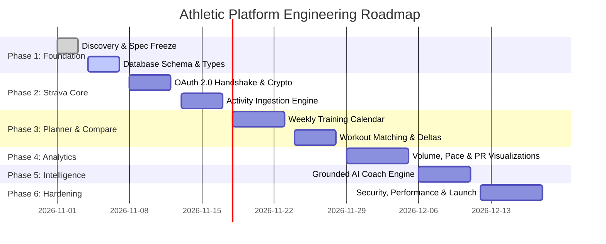

# Product & Engineering Roadmap

**Status:** CONFIRMED  
**Version:** 1.0  
**Last Updated:** 2026-11-01  
**Owner:** Principal Software Architect & Product Lead  
**Related Documents:** [PRODUCT_SCOPE.md](./PRODUCT_SCOPE.md), [IMPLEMENTATION_PLAN.md](../08-development/IMPLEMENTATION_PLAN.md)

---

## Roadmap Overview

---

## Detailed Milestone Definitions

### Phase 1: Foundation & Data Architecture
* **Objective:** Establish the TypeScript domain layer, PostgreSQL relational schema, and encryption infrastructure.
* **Deliverables:** `src/types/index.ts`, `schema.sql`, `src/lib/db.ts`, `src/lib/crypto.ts`.
* **Exit Criteria:** Database runs locally and passes unit tests with zero schema errors.

### Phase 2: Strava Integration Engine
* **Objective:** Complete server-side OAuth 2.0 authorization and activity ingestion.
* **Deliverables:** `/api/auth/strava/*`, `/api/strava/sync`, rate limit throttler.
* **Exit Criteria:** Athlete can link their Strava account and ingest activities idempotently without exposing credentials to the client.

### Phase 3: Training Planner & Workout Comparison
* **Objective:** Deliver interactive weekly calendar and planned vs actual delta matching.
* **Deliverables:** 7-day calendar UI, workout creation modal, heuristic matching service.
* **Exit Criteria:** Scheduled workouts automatically link to corresponding Strava activities with exact distance, duration, and pace variances.

### Phase 4: Analytics & Goals Suite
* **Objective:** Surface multi-sport volume progression, pace trends, and personal record recognition.
* **Deliverables:** Recharts/SVG visual charts, PR showcase, monthly/weekly goal tracker.
* **Exit Criteria:** Fast rendering (<100ms) across 7d, 30d, 90d, and 1y filters.

### Phase 5: Grounded AI Coach
* **Objective:** Provide evidence-based training insights (10% rule, ACWR, recovery suggestions).
* **Deliverables:** `lib/ai-coach.ts`, insight cards with explicit data citations.
* **Exit Criteria:** 100% compliance with zero-hallucination policy; zero fabricated metrics.

### Phase 6: Production Hardening
* **Objective:** Security audit, performance profiling, and error boundary verification.
* **Deliverables:** OWASP compliance check, full test suite, documentation audit.
* **Exit Criteria:** Zero security vulnerabilities, Lighthouse score > 90, sub-200ms API response latency.
