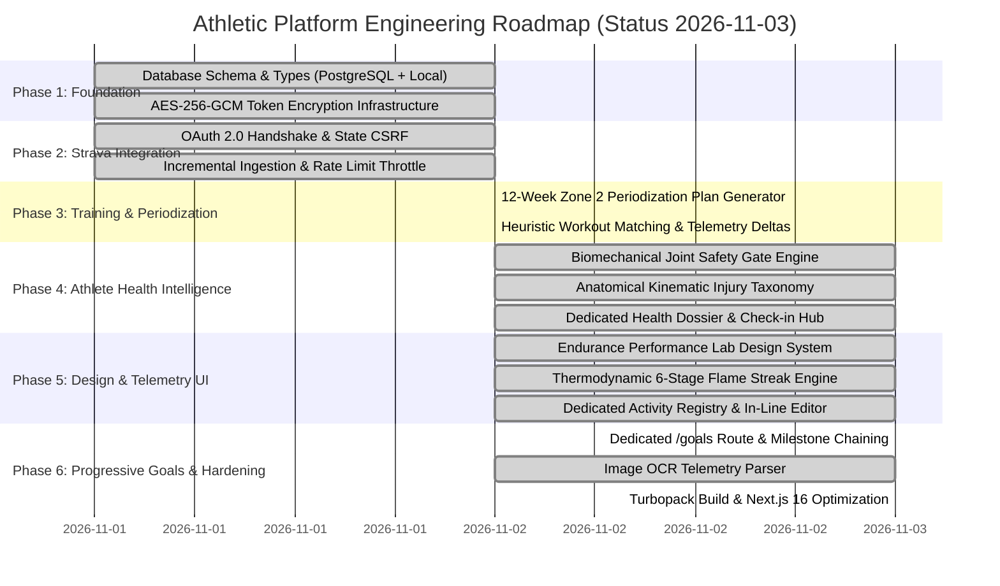

# Product & Engineering Roadmap

**Status:** CONFIRMED & SYNCHRONIZED  
**Version:** 2.0  
**Last Updated:** 2026-11-03  
**Owner:** Principal Software Architect & Product Lead  
**Related Documents:** [PRODUCT_SCOPE.md](./PRODUCT_SCOPE.md), [IMPLEMENTATION_PLAN.md](../08-development/IMPLEMENTATION_PLAN.md), [PRD.md](../01-product/PRD.md)

---

## 1. Roadmap Overview & Execution Timeline

---

## 2. Milestone Execution Status & Verification Checklist

### Phase 1: Foundation & Data Architecture
- [x] **Relational Schema (`schema.sql`)**: 16 tables covering users, Strava credentials, activities, plans, matches, goals, PRs, and clinical health logs.
- [x] **Dual Persistence Engine (`src/lib/db/`)**: Modular repositories supporting direct PostgreSQL connection pool with automated atomic local file store fallback (`.data/store.json`).
- [x] **Cryptographic Token Vault (`src/lib/crypto.ts`)**: AES-256-GCM encryption with SHA-256 key derivation.
- [x] **Domain Types (`src/types/index.ts`)**: Strict TypeScript interfaces with zero compile errors (`npx tsc --noEmit`).

### Phase 2: Strava Integration Engine
- [x] **OAuth 2.0 Handshake (`/api/auth/strava/*`)**: Server-side code exchange, HTTP-only CSRF state cookie, and deauthorization token revocation.
- [x] **Incremental Activity Ingestion (`/api/strava/sync`)**: Timestamp-filtered fetching (`after`), idempotent upsert, and rate-limit header monitoring (`X-RateLimit-*`).
- [x] **Activity Telemetry OCR Parser (`/api/activities/parse-image`)**: Multimodal telemetry extraction from Garmin/Apple/Strava screenshots.

### Phase 3: Training Periodization & Comparison
- [x] **12-Week Zone 2 Plan Generator (`coachTrainingGenerator.ts`)**: Structured aerobic volume progression with Talk Test directives.
- [x] **Interactive Calendar Hub (`/training`)**: 7-day responsive grid with session dossiers and status indicators.
- [x] **Heuristic Auto-Matching Engine (`matching.ts`)**: Computes exact variances for distance, duration, and pace between scheduled vs actual activities.

### Phase 4: Athlete Health Intelligence & Joint Safety Gate
- [x] **Biomechanical Safety Gate (`readinessEngine.ts`)**: Dynamic load constraints (Running `ON_HOLD` vs Cycling `CONDITIONAL`).
- [x] **Full-Body Kinematic Anatomy (`anatomyUtils.ts`)**: 4 anatomical zones, 16 distinct joint and ligament structures.
- [x] **Dedicated Health Dossier Route (`/health`)**: Profile biometrics, longitudinal post-activity pain check-ins, and clinical procedure tracking.

### Phase 5: Modern UI & Design System
- [x] **Endurance Performance Lab Design System (`globals.css`)**: Dual-theme support with Chalk Lab (light `#F3F4EF`) and Graphite Obsidian (dark `#111513`).
- [x] **Sticky Locked Navigation (`AppSidebar.tsx`)**: Independent internal scroll with zero body leak.
- [x] **Thermodynamic Heat Spectrum (`streakEngine.ts`)**: 6-stage physical combustion temperature visualization (Red ~800°C to Plasma Violet >2,200°C).
- [x] **Dedicated Activity Registry Route (`/activities` & `/activities/[id]`)**: Density toggles, search, filters, and in-line telemetry editing (`EditActivityModal`).

### Phase 6: Progressive Goals & Production Hardening
- [x] **Dedicated Goals Route (`/goals`)**: Full-screen progressive goal management with sport filters and custom goal creator.
- [x] **Progressive Milestone Chaining Engine**: Automatic unlocking of Tier 2 & 3 targets (+100km, 150km Gran Fondo, 1,000m D+ climbing, 200km double century) when 100km is reached.
- [x] **Interactive Simulation Tester**: Real-time simulation toggle for testing target unlocking workflows.
- [x] **Dashboard Gateway Linking**: Deep linking from `DashboardMacroGoalsCard` to `/goals` with visual milestone completion badges.
- [x] **Production Build Cleanliness**: 22 routes compiled under Next.js 16 Partial Prerendering with exit code 0.
