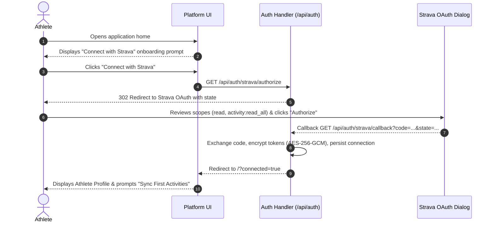
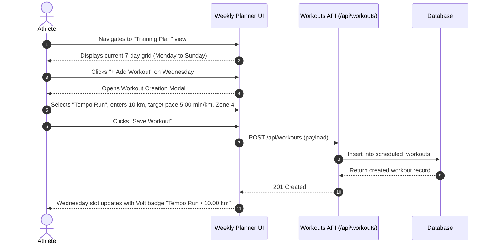
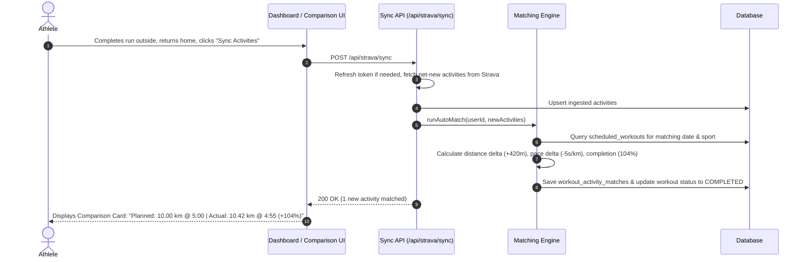

# User Journeys & Workflow Diagrams

**Status:** CONFIRMED  
**Version:** 1.0  
**Last Updated:** 2026-11-01  
**Owner:** Senior UX Researcher & Principal UI Designer  
**Related Documents:** [USER_STORIES.md](./USER_STORIES.md), [PRD.md](./PRD.md)

---

## 1. Journey 1: First-Time Onboarding & Strava Authorization

---

## 2. Journey 2: Weekly Workout Planning

---

## 3. Journey 3: Activity Synchronization & Planned vs Actual Comparison

