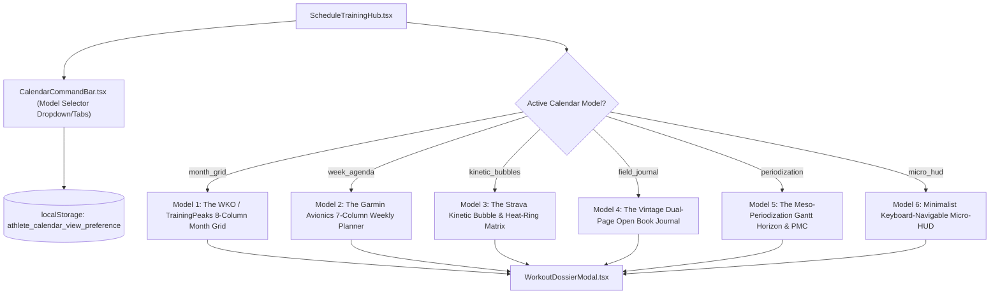

# 🗓️ Master Specification: 5+ Model UI Kalender Atletik Terpadu
## Personal Sports Training & Performance Platform • Multi-View Calendar Architecture

---

**Status:** CONFIRMED & SPECIFIED  
**Versi:** 3.0  
**Tanggal:** 2026-11-12  
**Owner:** Principal UI/UX Architect & Lead Telemetry Engineer  
**Related Documents:** [ANTI_AI_SLOP.md](./ANTI_AI_SLOP.md), [DESIGN_PHILOSOPHY.md](./DESIGN_PHILOSOPHY.md), [DESIGN_SYSTEM.md](./DESIGN_SYSTEM.md), [DATA_VISUALIZATION.md](./DATA_VISUALIZATION.md)  
**Lokasi Berkas:** `docs/02-design/CALENDAR_UI_DESIGN_VARIANTS_SPECIFICATION.md`

---

## 1. Latar Belakang & Filosofi Desain

Setiap atlet olahraga ketahanan (*endurance athlete*) memiliki kebiasaan kognitif dan kebutuhan informasi yang berbeda-beda tergantung pada momen mereka berinteraksi dengan aplikasi:
1. **Saat Merencanakan Target Bulanan:** Atlet butuh melihat gambaran besar 30 hari tanpa distraksi detail mikro.
2. **Saat Hari Pelaksanaan Latihan:** Atlet butuh melihat detail komparasi target vs realisasi secara vertikal dan mendalam.
3. **Saat Mencari Motivasi Momentum:** Atlet butuh melihat ritme konsistensi aktivitas dalam bentuk visualisasi kinetik / gelembung beban (*bubble/heatmap*).
4. **Saat Refleksi Tenang Pasca-Latihan:** Atlet menyukai intimasi buku jurnal catatan lari fisik (*tactical field journal*).
5. **Saat Menyusun Strategi Periodisasi Makro:** Atlet butuh melihat garis waktu horizontal (*Gantt timeline*) yang memperlihatkan kurva kelelahan PMC Banister di bawah blok latihan.

Oleh karena itu, sistem kalender dirancang dengan **Arsitektur Tampilan Modular Terpadu (*Interchangeable Calendar Engine*)**, di mana pengguna dapat beralih di antara **minimal 5 model UI kalender** hanya dengan 1 klik, dan pilihan preferensi mereka disimpan secara otomatis di `localStorage`.

---

## 2. Arsitektur Teknis Sistem Multi-Model



---

## 3. Rincian Spesifikasi 6 Model UI Kalender

### 🌟 Model 1: "The WKO / TrainingPeaks 8-Column Month Grid"
* **Metafor:** *The Desktop Command Station for Endurance Coaches.*
* **Karakter Visual:**
  - Kalender meja bulanan kontigu (November 2026, Desember 2026, Januari 2027) 8 kolom.
  - 7 Kolom pertama adalah Senin s/d Minggu dengan sel hari tipis borderless 1px.
  - **Kolom ke-8 adalah "Ringkasan Beban Mingguan"**: Menampilkan total jarak aktual vs target (`26.2 / 22.0 km • 119%`), estimasi TSS (`~135 TSS`), kepatuhan sesi (`3/3 Sesi`), dan status fase periodisasi (`BASE BUILD`, `DELOAD`).
* **Kelebihan:** Sangat cocok untuk mengaudit volume bulanan, mendeteksi minggu deload, dan melihat distribusi istirahat.
* **Berkas Terkait:**
  - `src/components/training/views/TrainingMonthGridView.tsx`
  - `src/components/training/monthGrid/MonthDayCell.tsx`
  - `src/components/training/monthGrid/MonthWeekSummaryColumn.tsx`
  - `src/components/training/monthGrid/monthCalendarBuilder.ts`

---

### ⚡ Model 2: "The Garmin Avionics 7-Column Weekly Planner"
* **Metafor:** *Mission-Critical Cockpit & Deep Microcycle Daily Execution.*
* **Karakter Visual:**
  - 7 Kolom vertikal tinggi ($\ge 320\text{px}$) yang memenuhi layar untuk 1 minggu terpilih.
  - Setiap kolom membagi hari menjadi 2 blok utama:
    1. **Prescribed Target Block (Atas):** Kategori olahraga, target jarak/durasi, rekomendasi cadence 85 RPM, pagu Zone 2, dan tonggak mingguan.
    2. **Executed Strava Activity Block (Bawah):** Sesi nyata dari Strava dengan moving time, detak jantung rata-rata, laju kecepatan, dan badge verifikasi hijau.
  - Variance delta indicator: Memperlihatkan selisih $+1.2\text{ km}$, $-4\text{s/km}$ pace, atau $+5\text{ bpm}$.
* **Kelebihan:** Sangat ideal saat atlet sedang bersiap-siap latihan hari ini atau baru saja selesai latihan dan ingin membandingkan kepatuhan target secara presisi.
* **Berkas Terkait:**
  - `src/components/training/views/TrainingWeekAgendaView.tsx`

---

### 🔮 Model 3: "The Strava Kinetic Bubble & Heat-Ring Matrix"
* **Metafor:** *Kinetic Energy, Momentum, and Visual Flow.*
* **Karakter Visual:**
  - Terinspirasi dari *Strava Training Log* legendaris namun diperkaya telemetri olahraga modern.
  - Setiap hari dalam rentang 12 minggu direpresentasikan sebagai **Gelembung Kinetik Lingkaran**:
    - **Diameter Lingkaran:** Berbanding lurus dengan durasi latihan (misal: 25m = lingkaran kecil 28px, 60m = lingkaran besar 56px).
    - **Warna Gelembung:** Cyan/Emerald (MTB), Terracotta/Amber (Lari), Slate (Rest/Buffer), Ungu (Puasa Sunnah).
    - **Cincin Telemetri (Heat-Ring):** Cincin luar berdenyut menandakan intensitas zona detak jantung (Zone 1-2 cincin hijau tenang, Zone 4-5 cincin oranye tebal).
  - Mengarahkan kursor (*hover*) pada gelembung akan memunculkan kartu mengambang (*Floating HUD Tooltip*) berisi telemetri lengkap.
* **Kelebihan:** Menghilangkan kebosanan teks tabel, memberikan dorongan psikologis melihat momentum latihan yang terus membesar, dan sangat menyenangkan untuk dilihat.
* **Target Berkas:**
  - `src/components/training/views/TrainingKineticBubbleView.tsx`
  - `src/components/training/kinetic/KineticDayBubble.tsx`
  - `src/components/training/kinetic/BubbleHoverHUD.tsx`

---

### 📖 Model 4: "The Vintage Dual-Page Open Book Field Journal"
* **Metafor:** *The 1970s Marathoner's Tactile Field Logbook.*
* **Karakter Visual:**
  - Menyerupai bentangan **buku catatan fisik dua halaman terbuka** (seperti modal pencatatan `AddActivityModal.tsx`):
    - **Halaman Kiri:** Senin, Selasa, Rabu, Kamis dengan tekstur kertas buku, garis-garis bergaris halus (*ruled lines*), dan catatan tepi untuk Puasa Sunnah dan pemulihan sendi.
    - **Halaman Kanan:** Jumat, Sabtu (Buffer), Minggu (Long MTB) + **"Catatan Pelatih Mingguan"** (*Coach Weekly Marginalia*) yang berisi evaluasi periodisasi dan pita pembatas buku (*ribbon bookmark*).
  - Tinta tipografi bernuansa jurnal fisik dengan angka monospace presisi.
* **Kelebihan:** Sangat emosional, memberikan nuansa ketenangan dan disiplin atlet sejati, cocok bagi atlet yang menyukai atmosfer buku catatan lari fisik klasik.
* **Target Berkas:**
  - `src/components/training/views/TrainingFieldJournalView.tsx`
  - `src/components/training/journal/JournalBookLeftPage.tsx`
  - `src/components/training/journal/JournalBookRightPage.tsx`

---

### 📊 Model 5: "The Meso-Periodization Gantt Horizon & PMC"
* **Metafor:** *Strategic Macrocycle Timeline & Bio-Energetic Fatigue Wave.*
* **Karakter Visual:**
  - Garis waktu horizontal (*Gantt-style timeline*) yang menampilkan 12 minggu secara linier dari kiri ke kanan.
  - Memiliki 3 jalur berlapis (*stacked swimlanes*):
    1. **Jalur Fase (Atas):** Blok panjang penanda Fase 1 (Base Build), Fase 2 (Volume & Deload), Fase 3 (Spesifisitas).
    2. **Jalur Blok Latihan (Tengah):** Balok horizontal harian yang panjangnya proporsional terhadap durasi (misal balok 25m, balok 30m, balok 60m). Balok hijau untuk sesi selesai, balok garis-garis untuk rencana masa depan.
    3. **Jalur Kurva Banister PMC (Bawah):** Kurva grafik mini yang memperlihatkan fluktuasi Kebugaran (*CTL*), Kelelahan (*ATL*), dan Kesiapan (*TSB*) yang mengalir tepat di bawah hari-hari latihan!
* **Kelebihan:** Sangat disukai oleh atlet yang fokus pada *tapering* menuju ajang besar (seperti 100km Century Ride) untuk memastikan puncak kebugaran tercapai tepat waktu tanpa *overtraining*.
* **Target Berkas:**
  - `src/components/training/views/TrainingPeriodizationGanttView.tsx`
  - `src/components/training/gantt/GanttSwimlaneDays.tsx`
  - `src/components/training/gantt/GanttMiniPMCSparkline.tsx`

---

### ⌨️ Model 6 (Bonus): "The Minimalist Keyboard-Navigable Micro-HUD"
* **Metafor:** *Linear / Superhuman Ultra-Fast Developer Aesthetic.*
* **Karakter Visual:**
  - Desain baris monokromatik ultra-padat dengan garis rambut 1px.
  - Navigasi penuh menggunakan keyboard:
    - `[` dan `]` : Pindah minggu
    - `J` dan `K` : Pindah hari
    - `Enter` : Buka detail dossier latihan
    - `C` : Buka pencatatan aktivitas langsung
* **Kelebihan:** Menghemat ruang layar laptop kecil, sangat cepat (*zero-lag*), dan disukai atlet yang mengutamakan kecepatan input.
* **Target Berkas:**
  - `src/components/training/views/TrainingMicroHUDView.tsx`

---

## 4. Matriks Komparasi Antar-Model

| Karakteristik | Model 1: Month Grid | Model 2: Week Agenda | Model 3: Kinetic Bubble | Model 4: Field Journal | Model 5: Gantt Horizon |
| :--- | :---: | :---: | :---: | :---: | :---: |
| **Cakupan Waktu** | 1 Bulan (4–5 Mgg) | 1 Minggu (7 Hari) | 12 Minggu Penuh | 1 Minggu (Dual-Page) | 12 Minggu Linier |
| **Kepadatan Informasi** | Tinggi (Tabular) | Sangat Tinggi (Detail) | Visual / Kinetik | Reflektif / Jurnal | Strategis Makro |
| **Integrasi Banister PMC** | Rekap TSS | Delta Jarak & HR | Heat-Ring Zona | Evaluasi Tulis | Kurva CTL/ATL/TSB |
| **Gaya Desain** | TrainingPeaks / WKO | Garmin Tacx Cockpit | Strava Kinetic Log | Physical Paper Book | Linear / Project Gantt |
| **Interaksi Cepat Tambah** | Hover Button `+` | Kolom Tombol `+` | Klik Lingkaran | Klik Garis Buku | Klik Slot Balok |
| **Responsivitas Ponsel** | Scroll horizontal | Vertikal bertumpuk | Grid gelembung rapat | Beralih 1 halaman | Mini timeline |

---

## 5. Kontrak Tipe Data TypeScript

```typescript
export type CalendarViewModel = 
  | "month_grid"       // Model 1: TrainingPeaks 8-Column Month
  | "week_agenda"      // Model 2: Garmin 7-Column Weekly Planner
  | "kinetic_bubbles"  // Model 3: Strava Kinetic Bubble Matrix
  | "field_journal"    // Model 4: Vintage Dual-Page Open Book
  | "periodization"    // Model 5: Gantt Horizon + PMC Curve
  | "micro_hud"        // Model 6: Keyboard-Navigable Micro-HUD
  | "list";            // Fallback list
```

---

## 6. Pedoman Implementasi & Batas Baris (*Clean Architecture*)

1. **Aturan 300 Baris Mutlak**: Setiap modul file komponen yang diimplementasikan untuk masing-masing model **wajib berukuran `< 300 baris`**.
2. **Persistensi State**: Pilihan model disimpan pada `localStorage.getItem('athlete_calendar_view_preference')`.
3. **Dual-Theme Compliance**: Seluruh model wajib mendukung tema gelap (*Graphite Obsidian*) dan tema terang (*Tactile Chalk Lab*) secara kontras tinggi tanpa *color clashing*.
4. **Verifikasi Mutu**: Wajib lolos `npx tsc --noEmit` (0 error), `npm run test:python` (100% pass), dan `npm run build` (34/34 routes pass).

