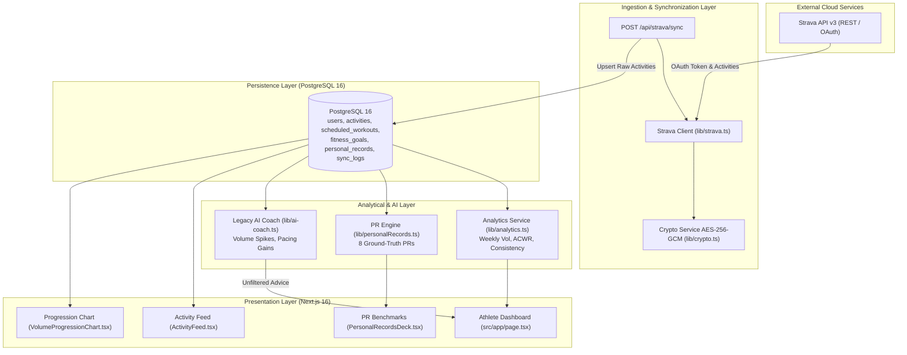
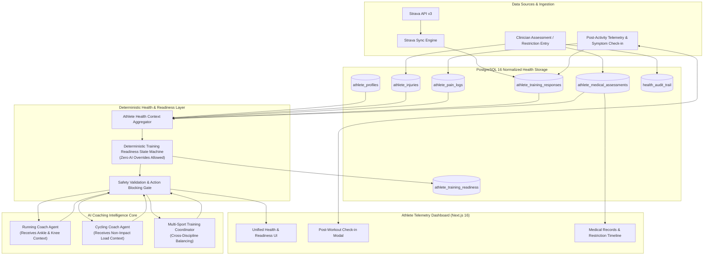
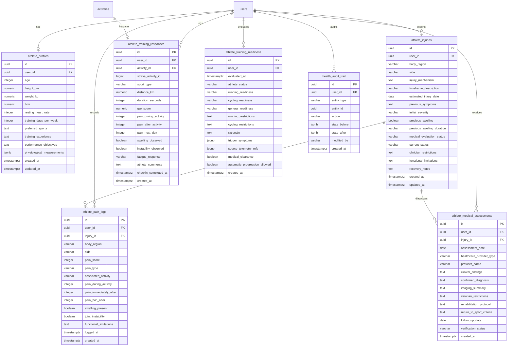
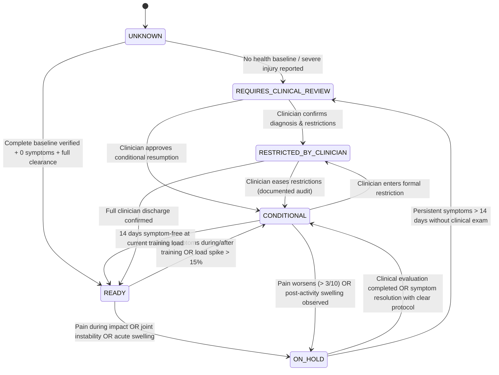

# Athlete Health Profile & Injury-Aware Training Intelligence System
## Architecture & Data Design Specification (Phase 1 Audit & Phase 2 Blueprint)

**Document Status:** PROPOSED & READY FOR IMPLEMENTATION REVIEW  
**Author:** Principal AI Systems Architect, Sports Science Software Engineer, & Senior Full-Stack Engineer  
**Date:** 2026-11-02  
**Target Platform:** Next.js 16 (App Router), React 19, TypeScript, PostgreSQL 16, Strava API v3  

---

## 1. Executive Summary & Clinical/Engineering Scope

The objective of this initiative is to transition the platform from an isolated performance telemetry dashboard into an **Injury-Aware Training Intelligence System**. 

### Critical Safety & Legal Boundary
```text
+-----------------------------------------------------------------------------------+
|                           MANDATORY LEGAL & CLINICAL NOTICE                       |
| This platform is a SPORTS TRAINING DECISION-SUPPORT & MONITORING SYSTEM.          |
| It is NOT a medical device, diagnostic engine, clinical treatment provider,       |
| or autonomous return-to-sport clearance authority.                                |
| Clinician-defined restrictions ALWAYS override any algorithm or AI suggestion.    |
+-----------------------------------------------------------------------------------+
```

### Seven Inviolable Domain Distinctions
The system strictly distinguishes between these seven categories and never treats them as interchangeable:
1. **Historical Injury:** Past tissue trauma (e.g., right ankle inversion sprain 3–6 months ago with 2 months swelling).
2. **Current Symptoms:** Active subjective signals (e.g., occasional right ankle pain, mild bilateral anterior knee pain after running).
3. **Functional Capacity:** Demonstrated biomechanical abilities (e.g., normal walking, normal stair climbing, 56.1 km pain-free cycling).
4. **Sport-Specific Activity Tolerance:** Asymmetric loading tolerance (e.g., non-impact closed-chain cycling tolerated vs. high-impact repetitive running causing symptoms).
5. **Training Readiness:** Current software-computed permission to execute a specific sport discipline (`READY`, `CONDITIONAL`, `ON_HOLD`, `REQUIRES_CLINICAL_REVIEW`, `RESTRICTED_BY_CLINICIAN`, `UNKNOWN`).
6. **Medical Assessment Status:** State of professional evaluation (`PENDING_CLINICAL_ASSESSMENT`, `ASSESSED_WITH_RESTRICTIONS`, `CLEARED_BY_CLINICIAN`).
7. **Clinician-Defined Restrictions:** Explicit boundaries set by licensed medical professionals (e.g., "no plyometrics", "max running distance 3 km").

---

## 2. Phase 1 — Comprehensive Repository Audit

### 2.1 Current Architecture Analysis
The current codebase is organized around Next.js 16 App Router:
- **Presentation Tier:** Server and Client Components (`src/components/`, `src/app/`) styled with Tailwind CSS v4 in an *Obsidian Telemetry* theme (`#090A0F`, `#12151D`, `#161922`).
- **Data Persistence:** Dual-layer architecture in `src/lib/db.ts` utilizing PostgreSQL 16 via `pg` connection pool with a fallback to local atomic JSON (`.data/store.json`).
- **Security:** `src/lib/crypto.ts` provides AES-256-GCM encryption for Strava OAuth tokens.
- **Strava Integration:** `src/lib/strava.ts` and `src/app/api/strava/sync/route.ts` execute incremental ingestion based on timestamps.
- **Analytics & Math:** `src/lib/analytics.ts` computes weekly volume and adherence; `src/lib/personalRecords.ts` deterministically evaluates 8 multi-sport PRs.

### 2.2 Existing Data-Flow Diagram



### 2.3 Existing Agent & AI Integration Analysis
In `src/lib/ai-coach.ts`, the current `generateTrainingInsights` function executes four heuristic checks:
1. **Acute:Chronic Workload Ratio (ACWR):** Flags volume increases $> 15\%$.
2. **Running Pace Progression:** Compares older runs vs. newer runs.
3. **Training Consistency:** Evaluates workout completion percentage.
4. **Recovery Balance:** Flags consecutive hard workouts.
5. **Weekly Recommendation:** Heuristically suggests a template: "1x Tempo Run, 1x Long Run, 2x Easy Runs".

### 2.4 Identified Critical Gaps in Existing Implementation
1. **Blindness to Athlete Health & Injury Status:**
   `generateTrainingInsights` recommends "Long Aerobic Base Run" and "Tempo Run" purely based on historical mileage, completely unaware that the athlete has an **unresolved right ankle injury** and **bilateral knee pain** where running should be `ON_HOLD`.
2. **Absence of Subjective Symptom & Pain Ingestion:**
   No schema or API exists to record post-activity pain (during, after, 24h later), swelling, joint instability, or RPE.
3. **No Separation of Sport Readiness:**
   The system currently treats an athlete as universally ready if their Strava mileage is high. In reality, an athlete can tolerate a 56.10 km ride while being unable to run 5 km safely.
4. **No Health Audit Trail or Clinical Override:**
   No entity stores clinical notes, physician restrictions, or healthcare provider evaluations.
5. **Missing Baseline Distinctions:**
   The `users` table hardcodes `max_heart_rate: 188`, which is unvalidated and violates the prompt's mandate that HRmax, LTHR, FTP, and VO2max are currently UNKNOWN.

### 2.5 Reuse Opportunities
- **Authentication & Database Pool:** Re-use `pgPool` and transactional query conventions in `src/lib/db.ts`.
- **Crypto Module:** `src/lib/crypto.ts` (AES-256-GCM) can be extended to encrypt sensitive medical notes and health data at rest.
- **Design System:** Existing *Obsidian Telemetry* color tokens (`#090A0F`, `#12151D`, `#161922`, Volt `#D4FF00`, Cyan `#00F0FF`, Alert `#FF2A6D`, Muted `#9BA3AF`, Border `#1F2430`) provide the foundation for medical and readiness telemetry.
- **Strava Incremental Sync:** Post-activity feedback prompts can hook directly into `upsertActivity` in `src/app/api/strava/sync/route.ts`.

### 2.6 Security, Privacy & Compliance Concerns
- **Health Data Sensitivity:** Injuries, pain scores, and medical assessments must be strictly scoped to `user_id`.
- **Auditability:** Any modification to clinician restrictions or injury records requires an audit trail (`health_audit_trail` table).
- **No Hallucination Safeguard:** Medical assessment records must enforce validation that disallows non-clinician users from claiming "medical clearance" without entering clinician credentials.

---

## 3. Phase 2 — Architecture & Data Design

### 3.1 Proposed System Architecture



---

### 3.2 Entity-Relationship Diagram (ERD)



---

### 3.3 Complete Database Schema DDL (PostgreSQL 16)

```sql
-- =====================================================================
-- ATHLETE HEALTH CONTEXT, INJURY & READINESS ENGINE DDL
-- =====================================================================

-- 1. ATHLETE PROFILES
CREATE TABLE IF NOT EXISTS athlete_profiles (
    id UUID PRIMARY KEY DEFAULT gen_random_uuid(),
    user_id UUID NOT NULL REFERENCES users(id) ON DELETE CASCADE,
    age INTEGER CHECK (age > 0 AND age < 120),
    height_cm NUMERIC(5, 1) CHECK (height_cm > 50 AND height_cm < 260),
    weight_kg NUMERIC(5, 2) CHECK (weight_kg > 20 AND weight_kg < 300),
    bmi NUMERIC(4, 1) GENERATED ALWAYS AS (ROUND(weight_kg / ((height_cm / 100.0) * (height_cm / 100.0)), 1)) STORED,
    resting_heart_rate INTEGER CHECK (resting_heart_rate > 30 AND resting_heart_rate < 150),
    training_days_per_week INTEGER CHECK (training_days_per_week >= 1 AND training_days_per_week <= 7),
    preferred_sports TEXT[] DEFAULT ARRAY['Running', 'Cycling']::TEXT[],
    training_experience VARCHAR(50) DEFAULT 'INTERMEDIATE',
    performance_objectives TEXT DEFAULT 'Aerobic endurance maintenance with safe multi-sport progression',
    physiological_measurements JSONB DEFAULT '{
        "hr_max": null,
        "lthr": null,
        "ftp_watts": null,
        "vo2_max": null,
        "running_threshold_pace_sec": null,
        "cycling_power_zones": null,
        "baseline_consistency_weeks": null,
        "sleep_recovery_baseline": null
    }'::JSONB,
    created_at TIMESTAMPTZ DEFAULT NOW() NOT NULL,
    updated_at TIMESTAMPTZ DEFAULT NOW() NOT NULL,
    CONSTRAINT uq_athlete_profile_user UNIQUE (user_id)
);

-- 2. ATHLETE INJURIES
CREATE TABLE IF NOT EXISTS athlete_injuries (
    id UUID PRIMARY KEY DEFAULT gen_random_uuid(),
    user_id UUID NOT NULL REFERENCES users(id) ON DELETE CASCADE,
    body_region VARCHAR(50) NOT NULL, -- 'Right Ankle', 'Bilateral Knees', etc.
    side VARCHAR(20) NOT NULL CHECK (side IN ('LEFT', 'RIGHT', 'BILATERAL', 'AXIAL')),
    injury_mechanism TEXT NOT NULL,
    timeframe_description VARCHAR(100) NOT NULL, -- e.g. '3-6 months ago'
    estimated_injury_date DATE,
    previous_symptoms TEXT,
    initial_severity VARCHAR(30) DEFAULT 'MODERATE', -- 'MILD', 'MODERATE', 'SEVERE'
    previous_swelling BOOLEAN DEFAULT FALSE,
    previous_swelling_duration VARCHAR(100),
    medical_evaluation_status VARCHAR(50) DEFAULT 'PENDING_CLINICAL_ASSESSMENT' NOT NULL
        CHECK (medical_evaluation_status IN (
            'PENDING_CLINICAL_ASSESSMENT',
            'CLINICALLY_ASSESSED',
            'UNDER_TREATMENT',
            'DISCHARGED_CLEARED'
        )),
    current_status VARCHAR(50) DEFAULT 'ACTIVE_SYMPTOMATIC' NOT NULL
        CHECK (current_status IN (
            'ACTIVE_SYMPTOMATIC',
            'ASYMPTOMATIC_RECOVERING',
            'RECURRENT',
            'RESOLVED',
            'CHRONIC'
        )),
    clinician_restrictions TEXT,
    functional_limitations TEXT,
    recovery_notes TEXT,
    created_at TIMESTAMPTZ DEFAULT NOW() NOT NULL,
    updated_at TIMESTAMPTZ DEFAULT NOW() NOT NULL
);

CREATE INDEX IF NOT EXISTS idx_athlete_injuries_user ON athlete_injuries(user_id, current_status);

-- 3. ATHLETE PAIN LOGS
CREATE TABLE IF NOT EXISTS athlete_pain_logs (
    id UUID PRIMARY KEY DEFAULT gen_random_uuid(),
    user_id UUID NOT NULL REFERENCES users(id) ON DELETE CASCADE,
    injury_id UUID REFERENCES athlete_injuries(id) ON DELETE SET NULL,
    body_region VARCHAR(50) NOT NULL,
    side VARCHAR(20) NOT NULL CHECK (side IN ('LEFT', 'RIGHT', 'BILATERAL', 'AXIAL')),
    pain_score INTEGER CHECK (pain_score >= 0 AND pain_score <= 10), -- nullable if athlete cannot quantify
    pain_type VARCHAR(50), -- 'ACHING', 'SHARP', 'THROBBING', 'STIFFNESS', 'BURNING'
    associated_activity VARCHAR(50), -- 'RUNNING', 'CYCLING', 'DAILY_LIVING', 'REST'
    pain_during_activity INTEGER CHECK (pain_during_activity >= 0 AND pain_during_activity <= 10),
    pain_immediately_after INTEGER CHECK (pain_immediately_after >= 0 AND pain_immediately_after <= 10),
    pain_24h_after INTEGER CHECK (pain_24h_after >= 0 AND pain_24h_after <= 10),
    swelling_present BOOLEAN DEFAULT FALSE,
    joint_instability BOOLEAN DEFAULT FALSE,
    functional_limitations TEXT,
    logged_at TIMESTAMPTZ DEFAULT NOW() NOT NULL,
    created_at TIMESTAMPTZ DEFAULT NOW() NOT NULL
);

CREATE INDEX IF NOT EXISTS idx_athlete_pain_logs_user_date ON athlete_pain_logs(user_id, logged_at DESC);

-- 4. ATHLETE TRAINING RESPONSES (Post-Activity Check-in)
CREATE TABLE IF NOT EXISTS athlete_training_responses (
    id UUID PRIMARY KEY DEFAULT gen_random_uuid(),
    user_id UUID NOT NULL REFERENCES users(id) ON DELETE CASCADE,
    activity_id UUID REFERENCES activities(id) ON DELETE SET NULL,
    strava_activity_id BIGINT,
    sport_type VARCHAR(50) NOT NULL,
    distance_km NUMERIC(6, 2) NOT NULL,
    duration_seconds INTEGER NOT NULL,
    rpe_score NUMERIC(3, 1) CHECK (rpe_score >= 1.0 AND rpe_score <= 10.0),
    pain_during_activity INTEGER CHECK (pain_during_activity >= 0 AND pain_during_activity <= 10),
    pain_after_activity INTEGER CHECK (pain_after_activity >= 0 AND pain_after_activity <= 10),
    pain_next_day INTEGER CHECK (pain_next_day >= 0 AND pain_next_day <= 10),
    swelling_observed BOOLEAN DEFAULT FALSE,
    instability_observed BOOLEAN DEFAULT FALSE,
    fatigue_response VARCHAR(30) DEFAULT 'NORMAL' CHECK (fatigue_response IN ('LOW', 'NORMAL', 'HIGH', 'EXHAUSTED')),
    athlete_comments TEXT,
    checkin_completed_at TIMESTAMPTZ,
    created_at TIMESTAMPTZ DEFAULT NOW() NOT NULL,
    CONSTRAINT uq_activity_response UNIQUE (user_id, activity_id)
);

CREATE INDEX IF NOT EXISTS idx_athlete_responses_user ON athlete_training_responses(user_id, created_at DESC);

-- 5. ATHLETE MEDICAL ASSESSMENTS
CREATE TABLE IF NOT EXISTS athlete_medical_assessments (
    id UUID PRIMARY KEY DEFAULT gen_random_uuid(),
    user_id UUID NOT NULL REFERENCES users(id) ON DELETE CASCADE,
    injury_id UUID REFERENCES athlete_injuries(id) ON DELETE SET NULL,
    assessment_date DATE NOT NULL,
    healthcare_provider_type VARCHAR(100) NOT NULL, -- 'Physiotherapist', 'Sports Medicine Physician', 'Orthopedic Surgeon'
    provider_name VARCHAR(255),
    clinical_findings TEXT NOT NULL,
    confirmed_diagnosis TEXT, -- NULL if pending clinical determination
    imaging_summary TEXT, -- X-Ray, MRI, Ultrasound findings
    clinician_restrictions TEXT NOT NULL,
    rehabilitation_protocol TEXT,
    return_to_sport_criteria TEXT,
    follow_up_date DATE,
    verification_status VARCHAR(50) DEFAULT 'ATHLETE_ENTERED' NOT NULL
        CHECK (verification_status IN ('ATHLETE_ENTERED', 'CLINICIAN_VERIFIED', 'AUDITED')),
    created_at TIMESTAMPTZ DEFAULT NOW() NOT NULL
);

CREATE INDEX IF NOT EXISTS idx_medical_assessments_user ON athlete_medical_assessments(user_id, assessment_date DESC);

-- 6. ATHLETE TRAINING READINESS
CREATE TABLE IF NOT EXISTS athlete_training_readiness (
    id UUID PRIMARY KEY DEFAULT gen_random_uuid(),
    user_id UUID NOT NULL REFERENCES users(id) ON DELETE CASCADE,
    evaluated_at TIMESTAMPTZ DEFAULT NOW() NOT NULL,
    athlete_status VARCHAR(50) NOT NULL
        CHECK (athlete_status IN (
            'OPTIMAL_CLEAR',
            'ACTIVE_WITH_UNRESOLVED_SYMPTOMS',
            'UNDER_ACTIVE_REHAB',
            'SUSPENDED_MEDICAL_EVAL_REQUIRED'
        )),
    running_readiness VARCHAR(50) NOT NULL
        CHECK (running_readiness IN (
            'READY',
            'CONDITIONAL',
            'ON_HOLD',
            'REQUIRES_CLINICAL_REVIEW',
            'RESTRICTED_BY_CLINICIAN',
            'UNKNOWN'
        )),
    cycling_readiness VARCHAR(50) NOT NULL
        CHECK (cycling_readiness IN (
            'READY',
            'CONDITIONAL',
            'ON_HOLD',
            'REQUIRES_CLINICAL_REVIEW',
            'RESTRICTED_BY_CLINICIAN',
            'UNKNOWN'
        )),
    general_readiness VARCHAR(50) NOT NULL
        CHECK (general_readiness IN (
            'READY',
            'CONDITIONAL',
            'ON_HOLD',
            'REQUIRES_CLINICAL_REVIEW',
            'RESTRICTED_BY_CLINICIAN',
            'UNKNOWN'
        )),
    running_restrictions TEXT,
    cycling_restrictions TEXT,
    rationale TEXT NOT NULL,
    trigger_symptoms JSONB DEFAULT '[]'::JSONB,
    source_telemetry_refs JSONB DEFAULT '[]'::JSONB,
    medical_clearance BOOLEAN DEFAULT FALSE NOT NULL,
    automatic_progression_allowed BOOLEAN DEFAULT FALSE NOT NULL,
    created_at TIMESTAMPTZ DEFAULT NOW() NOT NULL
);

CREATE INDEX IF NOT EXISTS idx_readiness_user_eval ON athlete_training_readiness(user_id, evaluated_at DESC);

-- 7. HEALTH AUDIT TRAIL
CREATE TABLE IF NOT EXISTS health_audit_trail (
    id UUID PRIMARY KEY DEFAULT gen_random_uuid(),
    user_id UUID NOT NULL REFERENCES users(id) ON DELETE CASCADE,
    entity_type VARCHAR(50) NOT NULL, -- 'athlete_injuries', 'athlete_medical_assessments', 'athlete_training_readiness'
    entity_id UUID NOT NULL,
    action VARCHAR(20) NOT NULL CHECK (action IN ('CREATE', 'UPDATE', 'DELETE', 'OVERRIDE')),
    state_before JSONB,
    state_after JSONB,
    modified_by VARCHAR(100) DEFAULT 'ATHLETE' NOT NULL,
    created_at TIMESTAMPTZ DEFAULT NOW() NOT NULL
);

CREATE INDEX IF NOT EXISTS idx_health_audit_user ON health_audit_trail(user_id, created_at DESC);
```

---

### 3.4 Deterministic Training Readiness State Machine



#### Deterministic Decision Rules
1. **Rule 1 (Running vs. Impact Symptoms):**
   If an unresolved lower-limb symptom exists (e.g., occasional ankle pain or knee pain after running) and `medical_evaluation_status = 'PENDING_CLINICAL_ASSESSMENT'`, then `running_readiness` MUST be set to `ON_HOLD`.
2. **Rule 2 (Sport Asymmetry - Cycling Tolerance):**
   If a non-impact sport (cycling) demonstrated 0 pain during, immediately after, and next-day on a verified 56.10 km ride, `cycling_readiness` is computed as `CONDITIONAL` (safe for Zone 1–2 cadence-focused endurance $< 50\text{ km}$, but strictly forbidden from hill climbing or sprinting intervals that increase joint torque).
3. **Rule 3 (Zero Pain-Score Fallacy):**
   A non-numeric or missing pain report is NEVER treated as $0/10$ ("pain-free"). Missing feedback results in an `UNKNOWN` recovery response.
4. **Rule 4 (Swelling & Instability Circuit Breaker):**
   Any report of `swelling_observed = true` or `instability_observed = true` immediately transitions both sports to `ON_HOLD` and triggers a high-severity alert: *"Clinical examination required before resuming structured training."*
5. **Rule 5 (Progression Lock):**
   While `athlete_status = 'ACTIVE_WITH_UNRESOLVED_SYMPTOMS'`, `automatic_progression_allowed = false`. The AI coach is strictly prohibited from recommending higher weekly mileage or high-intensity interval sessions.

---

### 3.5 Initial Seed Data Configuration (Apex Athlete)

```json
{
  "profile": {
    "user_id": "00000000-0000-0000-0000-000000000001",
    "age": 22,
    "height_cm": 170.0,
    "weight_kg": 65.0,
    "bmi": 22.5,
    "resting_heart_rate": 68,
    "training_days_per_week": 3,
    "preferred_sports": ["Running", "Cycling"],
    "training_experience": "INTERMEDIATE",
    "performance_objectives": "Aerobic conditioning while rehabilitating lower-extremity symptoms",
    "physiological_measurements": {
      "hr_max": null,
      "lthr": null,
      "ftp_watts": null,
      "vo2_max": null,
      "running_threshold_pace_sec": null,
      "cycling_power_zones": null,
      "baseline_consistency_weeks": null,
      "sleep_recovery_baseline": null
    }
  },
  "injuries": [
    {
      "id": "inj-right-ankle-001",
      "user_id": "00000000-0000-0000-0000-000000000001",
      "body_region": "Right Ankle",
      "side": "RIGHT",
      "injury_mechanism": "Incorrect landing while playing basketball",
      "timeframe_description": "Approximately 3-6 months ago",
      "previous_symptoms": "Swelling for approximately two months following acute inversion trauma",
      "initial_severity": "MODERATE",
      "previous_swelling": true,
      "previous_swelling_duration": "Approximately 2 months",
      "medical_evaluation_status": "PENDING_CLINICAL_ASSESSMENT",
      "current_status": "ACTIVE_SYMPTOMATIC",
      "functional_limitations": "Occasional pain during impact; normal walking; normal stairs; high cycling tolerance (56.1 km pain-free)",
      "clinician_restrictions": null,
      "recovery_notes": "Needs formal clinical evaluation to assess ligamentous integrity (ATFL/CFL)."
    },
    {
      "id": "inj-bilateral-knee-002",
      "user_id": "00000000-0000-0000-0000-000000000001",
      "body_region": "Anterior Knees",
      "side": "BILATERAL",
      "injury_mechanism": "Repetitive impact loading during distance running",
      "timeframe_description": "Recent running sessions",
      "previous_symptoms": "Mild discomfort around the patellar margins appearing after distance accumulation",
      "initial_severity": "MILD",
      "previous_swelling": false,
      "previous_swelling_duration": null,
      "medical_evaluation_status": "PENDING_CLINICAL_ASSESSMENT",
      "current_status": "ACTIVE_SYMPTOMATIC",
      "functional_limitations": "Mild pain after distance accumulation; no pain during cycling or daily activities",
      "clinician_restrictions": null,
      "recovery_notes": "AI must NOT diagnose patellofemoral pain syndrome. Differential open pending clinical exam."
    }
  ],
  "initial_readiness": {
    "athlete_status": "ACTIVE_WITH_UNRESOLVED_SYMPTOMS",
    "running_readiness": "ON_HOLD",
    "cycling_readiness": "CONDITIONAL",
    "general_readiness": "CONDITIONAL",
    "running_restrictions": "Running suspended pending clinical evaluation of right ankle stability and bilateral anterior knee response.",
    "cycling_restrictions": "Zone 1-2 flat aerobic cadence rides (duration <= 60 mins, distance <= 30 km) permitted. Avoid heavy climbing out of the saddle or sprint intervals.",
    "rationale": "Asymmetric tolerance: High-impact running is contraindicated due to unresolved ankle symptoms and post-run bilateral knee pain. Low-impact closed-chain cycling has demonstrated empirical tolerance (56.10 km ride with 0 pain), permitting conditional endurance rides.",
    "medical_clearance": false,
    "automatic_progression_allowed": false
  }
}
```

---

### 3.6 API Contracts

#### 1. `GET /api/athlete/health-context`
Retrieves the consolidated authoritative health context for coaching agents and dashboard telemetry.
- **Request:** `GET /api/athlete/health-context?userId=...`
- **Response `200 OK`:**
```json
{
  "profile": { ... },
  "injuries": [ ... ],
  "recentPainLogs": [ ... ],
  "recentTrainingResponses": [ ... ],
  "medicalAssessments": [ ... ],
  "readiness": {
    "athlete_status": "ACTIVE_WITH_UNRESOLVED_SYMPTOMS",
    "running_readiness": "ON_HOLD",
    "cycling_readiness": "CONDITIONAL",
    "general_readiness": "CONDITIONAL",
    "running_restrictions": "...",
    "cycling_restrictions": "...",
    "rationale": "...",
    "medical_clearance": false,
    "automatic_progression_allowed": false,
    "evaluated_at": "2026-11-02T10:15:00Z"
  }
}
```

#### 2. `POST /api/athlete/checkin`
Submits post-activity subjective feedback.
- **Request:** `POST /api/athlete/checkin`
```json
{
  "activity_id": "fff8d8e3-972c-4e06-a69b-db1808e3d9b9",
  "sport_type": "Ride",
  "distance_km": 56.10,
  "duration_seconds": 9436,
  "rpe_score": 6.5,
  "pain_during_activity": 0,
  "pain_after_activity": 0,
  "pain_next_day": 0,
  "swelling_observed": false,
  "instability_observed": false,
  "fatigue_response": "NORMAL",
  "athlete_comments": "Smooth cadence, zero ankle sensation during or after ride."
}
```
- **Response `201 Created`:** Updated readiness state recalculation.

#### 3. `POST /api/athlete/injuries`
Creates or updates an injury record.
- **Request:** Body containing body region, side, mechanism, symptoms, and medical evaluation status.
- **Audit:** Automatically logged to `health_audit_trail`.

---

### 3.7 AI Coach Context Injection & Safety Gate

```typescript
export interface AuthoritativeAthleteHealthContext {
  profile: AthleteProfile;
  injuries: AthleteInjury[];
  recentResponses: AthleteTrainingResponse[];
  latestReadiness: AthleteTrainingReadiness;
  clinicianRestrictions: string[];
}

export function evaluateCoachingRecommendationSafety(
  proposedWorkout: ProposedWorkout,
  healthContext: AuthoritativeAthleteHealthContext
): SafetyValidationResult {
  const { latestReadiness, clinicianRestrictions } = healthContext;

  // 1. Check Clinician-Defined Restrictions (HIGHEST PRIORITY)
  for (const restriction of clinicianRestrictions) {
    if (violatesRestriction(proposedWorkout, restriction)) {
      return {
        isApproved: false,
        blockedReason: `Blocked by Clinician Restriction: ${restriction}`,
        alternativeRecommendation: 'Rest Day or Clinician-Approved Gentle Mobility'
      };
    }
  }

  // 2. Check Sport-Specific Readiness Gate
  if (proposedWorkout.sport === 'Run' && latestReadiness.running_readiness === 'ON_HOLD') {
    return {
      isApproved: false,
      blockedReason: `Running is ON_HOLD due to active symptoms: ${latestReadiness.running_restrictions}`,
      alternativeRecommendation: 'Cross-training (low-resistance cycling or walking) only if symptom-free.'
    };
  }

  if (proposedWorkout.sport === 'Ride' && latestReadiness.cycling_readiness === 'CONDITIONAL') {
    if (proposedWorkout.intensity === 'HIGH' || proposedWorkout.elevationGainMeters > 300) {
      return {
        isApproved: false,
        blockedReason: 'Cycling readiness is CONDITIONAL. High-torque climbing or sprint intervals are restricted.',
        alternativeRecommendation: 'Zone 1-2 Flat Aerobic Ride under 30 km.'
      };
    }
  }

  // 3. Block Automatic Mileage Progression
  if (!latestReadiness.automatic_progression_allowed && proposedWorkout.isProgressiveOverload) {
    return {
      isApproved: false,
      blockedReason: 'Automatic progression is locked due to unresolved symptoms.',
      alternativeRecommendation: 'Maintain steady maintenance volume or substitute with recovery.'
    };
  }

  return { isApproved: true };
}
```

---

## 4. Phase 3 — Detailed Implementation Plan

| Step | Scope | Files to Create / Modify | Verification Check |
|---|---|---|---|
| **3.1** | Database DDL & Migration | `schema.sql`, `scripts/migrate_health_schema.js` | Run script on PostgreSQL 16; verify 7 new tables created with constraints. |
| **3.2** | TypeScript Type Definitions | `src/types/health.ts`, `src/types/index.ts` | `npm run build` TypeScript compilation check. |
| **3.3** | Unified Data Access Layer | `src/lib/db.ts` (add health queries & fallbacks) | Unit tests verifying CRUD operations on profile, injuries, and readiness. |
| **3.4** | Health Baseline Seeding Script | `scripts/seed_athlete_health.js` | Ingest Apex Athlete profile, right ankle, knee symptoms, and initial readiness. |
| **3.5** | Deterministic Readiness Engine | `src/lib/readinessEngine.ts` | Test suite covering all 10 deterministic safety rules. |
| **3.6** | AI Coach Safety Validation Gate | `src/lib/ai-coach.ts` | Confirm running workouts are blocked when running readiness is `ON_HOLD`. |
| **3.7** | Health & Check-in API Routes | `src/app/api/athlete/health-context/route.ts`, `src/app/api/athlete/checkin/route.ts` | Integration tests with Postman / curl. |
| **3.8** | Athlete Health & Readiness UI | `src/components/health/AthleteHealthDeck.tsx`, `src/components/health/PostActivityCheckinModal.tsx` | Visual verification on `http://localhost:3000`. |
| **3.9** | Homepage Integration | `src/app/page.tsx` | Dashboard integrates Health Profile & Readiness Deck alongside Activities. |

---

## 5. Phase 4 & 5 — Validation Matrix & Documentation Artifacts

### 5.1 Verification Test Cases
1. **Case 1 (Asymmetric Readiness):** Confirm running is `ON_HOLD` while cycling is `CONDITIONAL`.
2. **Case 2 (No Accidental Diagnosis):** Verify AI reports "anterior knee discomfort" without diagnosing "patellofemoral pain syndrome".
3. **Case 3 (Post-Activity Check-in):** Ingest 56.10 km ride feedback (0 pain, no swelling); verify cycling readiness remains `CONDITIONAL` and does NOT grant running clearance.
4. **Case 4 (Safety Gate Interception):** Test AI Coach attempting to prescribe "Tempo Run"; verify Safety Gate intercepts and replaces it with rest/cross-training.
5. **Case 5 (Clinician Override):** Add clinician restriction "Max cycling duration 45 mins"; verify 90-minute ride is blocked.

### 5.2 Documentation Deliverables
- [`docs/03-architecture/ATHLETE_HEALTH_CONTEXT.md`](file:///c:/Users/MyBook%20Hype%20AMD/OneDrive/Documents/kerja/_code/project_strava/docs/03-architecture/ATHLETE_HEALTH_CONTEXT.md)
- [`docs/05-domain-logic/TRAINING_READINESS_ENGINE.md`](file:///c:/Users/MyBook%20Hype%20AMD/OneDrive/Documents/kerja/_code/project_strava/docs/05-domain-logic/TRAINING_READINESS_ENGINE.md)
- [`docs/05-domain-logic/AI_COACH_INTEGRATION.md`](file:///c:/Users/MyBook%20Hype%20AMD/OneDrive/Documents/kerja/_code/project_strava/docs/05-domain-logic/AI_COACH_INTEGRATION.md)
- [`docs/03-architecture/ATHLETE_HEALTH_SCHEMA.md`](file:///c:/Users/MyBook%20Hype%20AMD/OneDrive/Documents/kerja/_code/project_strava/docs/03-architecture/ATHLETE_HEALTH_SCHEMA.md)
- [`docs/03-architecture/ATHLETE_HEALTH_API.md`](file:///c:/Users/MyBook%20Hype%20AMD/OneDrive/Documents/kerja/_code/project_strava/docs/03-architecture/ATHLETE_HEALTH_API.md)
- [`docs/06-security/HEALTH_DATA_PRIVACY.md`](file:///c:/Users/MyBook%20Hype%20AMD/OneDrive/Documents/kerja/_code/project_strava/docs/06-security/HEALTH_DATA_PRIVACY.md)
- [`docs/07-quality/READINESS_TEST_CASES.md`](file:///c:/Users/MyBook%20Hype%20AMD/OneDrive/Documents/kerja/_code/project_strava/docs/07-quality/READINESS_TEST_CASES.md)
