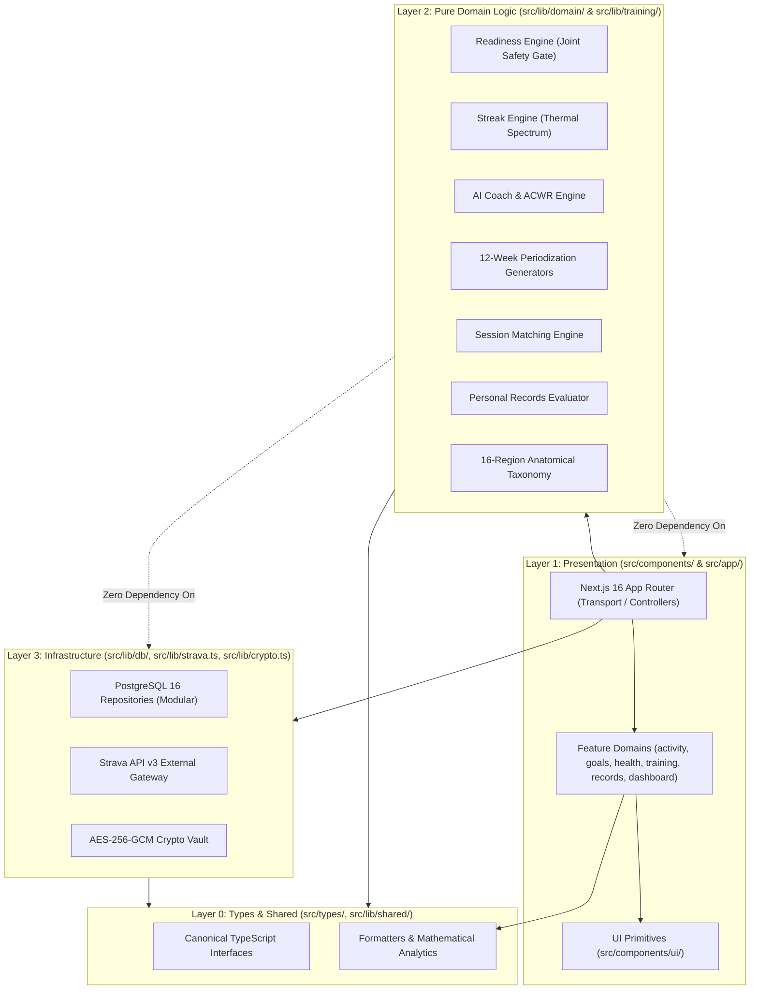

# Project Directory Organization & Clean Architecture Conventions

**Status:** AUTHORITATIVE & STRICTLY ENFORCED  
**Version:** 3.0  
**Effective Date:** 2026-11-04  
**Architecture:** Clean Architecture + Domain-Driven Design (DDD)  
**Owners:** Principal Architecture Lead & Core Engineering Team  
**Related Documents:** [SYSTEM_ARCHITECTURE.md](./SYSTEM_ARCHITECTURE.md), [TECH_STACK.md](./TECH_STACK.md), [DATA_MODEL.md](./DATA_MODEL.md)

---

## 1. Executive Architectural Vision & Paradigms

Endurance Performance Lab is engineered as a high-integrity, sports-science-driven telemetry platform. To ensure long-term maintainability, zero-regression refactoring, and deterministic testing, the entire codebase strictly complies with **Clean Architecture** and **Domain-Driven Design (DDD)** principles:



### Golden Architectural Rules
1. **Separation of Concerns (SoC):** 
   - `src/app/` contains **ONLY** routing, route handlers, and top-level page shells. No raw SQL queries, no direct cryptographic manipulations, and no monolithic UI implementations.
   - `src/components/` contains **ONLY** presentation components. Components do not execute direct database queries or heavy raw mathematical algorithms.
   - `src/lib/domain/` contains **PURE** domain business logic. Zero React hooks/JSX, zero database connection dependencies. 100% unit-testable in pure Node.js environments.
   - `src/lib/db/` contains **ONLY** persistence and query logic against PostgreSQL 16 (or local store fallback).
2. **Single Responsibility Principle (SRP) & File Size Limits:**
   - **Hard Limit:** Maximum **300 lines of code** per file. Any file approaching 300 lines must be decomposed into co-located submodules.
   - **Zero God Components:** UI hubs (such as Goals, Training, Health) must act only as slim orchestrators (< 250 lines), delegating state, views, hero cards, and modals to sub-packages.
3. **Backward Compatibility via Facade Pattern:**
   - Whenever an internal module or component is relocated to adhere to DDD folder boundaries, a lightweight re-export facade (`export * from '...'`) is preserved at the legacy location to guarantee 100% backward compatibility for existing scripts, tests, and consumers.

---

## 2. Definitive Directory Structure

```text
project_strava/
├── .data/                                  # Local fallback atomic store (store.json)
├── docs/                                   # Authoritative Engineering Documentation
│   ├── 00-foundation/                      # Mission, principles, roadmap, glossary
│   ├── 01-product/                         # PRDs, functional specs, user personas
│   ├── 02-design/                          # Anti-AI-slop policy, color tokens, typography
│   ├── 03-architecture/                    # System architecture, project structure, ADRs
│   ├── 04-integrations/                    # Strava API v3, OAuth flow, webhooks, rate limits
│   ├── 05-domain-logic/                    # Readiness, AI coach, PRs, training load specs
│   ├── 06-security/                        # AES-256-GCM, privacy, threat model, health data
│   ├── 07-quality/                         # Testing strategy, definition of done, clean code
│   ├── 08-development/                     # Git workflow, implementation plan, setup guides
│   ├── 09-audit/                           # Architectural, security, and UI audits
│   └── 10-changelog/                       # Granular versioned feature changelogs
├── public/                                 # Static assets, SVG icons, brand assets
├── scripts/                                # Maintenance, database migrations & test runners
│   ├── archive/                            # Archived one-off migration utilities
│   ├── maintenance/                        # Schema updates, PR sync, audit scripts
│   ├── seed/                               # Database seeders (training, health, activities)
│   └── tests/                              # Node.js integration and domain verification suites
├── src/                                    # Application Source Code
│   ├── app/                                # LAYER 1: TRANSPORT & APP ROUTER (Next.js 16)
│   │   ├── activities/                     # Activity Registry Route (/activities, /activities/[id])
│   │   ├── goals/                          # Goals & Milestone Hub Route (/goals)
│   │   ├── health/                         # Clinical Health & Joint Safety Route (/health)
│   │   ├── training/                       # 12-Week Periodization Calendar Route (/training)
│   │   ├── api/                            # RESTful API Route Handlers
│   │   │   ├── activities/                 # Activity CRUD & OCR Image Parser
│   │   │   ├── athlete/                    # Clinical Biometrics, Injuries, Pain Logs
│   │   │   ├── auth/strava/                # Strava OAuth Handshake & Token Encryption
│   │   │   ├── goals/                      # Fitness Goals & Primary Target Management
│   │   │   ├── strava/                     # Incremental Webhook & Manual Sync Pipeline
│   │   │   └── training/                   # 12-Week Plan Generation Pipeline
│   │   ├── globals.css                     # Tailwind v4 Theme Tokens (Chalk & Graphite)
│   │   ├── layout.tsx                      # Root Layout, Metadata & Font Definitions
│   │   └── page.tsx                        # Tactical Athletic Overview Dashboard
│   │
│   ├── components/                         # LAYER 1: PRESENTATION (Modular React 19 UI)
│   │   ├── ui/                             # Generic Design System Primitives
│   │   │   ├── MetricCard.tsx              # Standardized Telemetry Metric Card
│   │   │   └── ...                         # Badges, Modal shells, Buttons
│   │   ├── layout/                         # Core App Shell & Navigation
│   │   │   ├── AppShell.tsx                # Responsive Shell Frame
│   │   │   ├── AppHeader.tsx               # Top Sticky Brand Bar & Quick Add
│   │   │   └── AppSidebar.tsx              # Locked Tactical Navigation Rail
│   │   ├── activity/                       # Activity Domain Presentation
│   │   │   ├── ActivityFeed.tsx            # Activity Telemetry Stream
│   │   │   ├── ActivityManagementDeck.tsx  # Grouped Activity Table & Registry
│   │   │   ├── deck/                       # Activity Table Toolbars, Headers, Action Bars
│   │   │   ├── detail/                     # Activity Detail Hero, GPS Map, HR Zones, Biometrics
│   │   │   └── modal/                      # AddActivityModal, EditActivityModal, Form Fields
│   │   ├── dashboard/                      # Dashboard Domain Presentation
│   │   │   ├── DashboardTacticalDeck.tsx   # Top Macro Command Grid
│   │   │   ├── DashboardIntegrityStrip.tsx # Strava Sync Status & Integrity
│   │   │   ├── DashboardMacroGoalsCard.tsx # Macro Goals Progress Widget
│   │   │   ├── DashboardAiInsightsDeck.tsx # AI Rule-Based Coach Insights
│   │   │   ├── DashboardScheduledWorkoutsCard.tsx # Upcoming Calendar Sessions
│   │   │   └── WeeklyStreakCard.tsx        # Weekly Thermodynamic Streak Showcase
│   │   ├── goals/                          # Goals Domain Presentation (Decomposed Hub)
│   │   │   ├── GoalsManagementHub.tsx      # Slim Orchestrator (< 300 lines)
│   │   │   ├── data/                       # Progression templates & constant tiers
│   │   │   ├── hero/                       # PrimaryGoalHeroSection (Target Utama Showcase)
│   │   │   ├── modal/                      # CreateCustomGoalModal
│   │   │   ├── progression/                # GoalsProgressionDeck & ProgressionGoalCard
│   │   │   ├── registry/                   # GoalRegistryCard & GoalsFilterTabs
│   │   │   └── telemetry/                  # GoalsTelemetrySummary
│   │   ├── health/                         # Health & Biomechanical Domain Presentation
│   │   │   ├── AthleteHealthDeck.tsx       # Health Status Summary Deck
│   │   │   ├── EditAthleteProfileModal.tsx # Athlete Biometric Profile Form
│   │   │   ├── PostActivityCheckinModal.tsx# Post-Workout VAS Pain Check-In Form
│   │   │   ├── hub/                        # Dossier Tabs (Overview, Injuries, Pain, Forms)
│   │   │   ├── profile/                    # Profile Biometrics & Medical Procedures
│   │   │   └── widgets/                    # Joint Safety Indicators & Zone Visualizers
│   │   ├── records/                        # Personal Records Presentation
│   │   │   └── PersonalRecordsDeck.tsx     # Multi-sport PR Deck & Milestones
│   │   ├── strava/                         # Strava Integration Presentation
│   │   │   ├── StravaConnectCard.tsx       # OAuth Connect Status & Actions
│   │   │   ├── StravaConnectedView.tsx     # Active Connection Badge & Athletes
│   │   │   └── StravaSetupGuide.tsx        # Self-Hosted OAuth Setup Accordion
│   │   ├── training/                       # Structured Training Presentation
│   │   │   ├── ScheduleTrainingHub.tsx     # Slim Periodization Calendar Orchestrator
│   │   │   ├── CalendarDayCard.tsx         # Individual Calendar Day Cell
│   │   │   ├── WorkoutDossierModal.tsx     # Planned vs Actual Session Match Modal
│   │   │   ├── filters/                    # Training View Filter Tabs
│   │   │   └── views/                      # TrainingCalendarGridView & TrainingWorkoutListView
│   │   ├── charts/                         # Telemetry Visualizations
│   │   │   └── VolumeProgressionChart.tsx  # SVG Weekly Volume Progression Chart
│   │   └── theme/                          # Theme Context & Switchers
│   │       ├── ThemeProvider.tsx           # Context Provider
│   │       └── ThemeSwitcher.tsx           # Dark/Light Mode Selector
│   │
│   ├── lib/                                # LAYER 2 & 3: DOMAIN LOGIC & INFRASTRUCTURE
│   │   ├── domain/                         # LAYER 2: PURE DOMAIN ENGINES (Pure Sports Science)
│   │   │   ├── readiness/                  # Asymmetric Joint Safety Gate & Readiness Engine
│   │   │   │   └── readinessEngine.ts      # Biomechanical safety rules & recovery algorithms
│   │   │   ├── streak/                     # Weekly Streak & Thermodynamic Flame Engine
│   │   │   │   └── streakEngine.ts         # Calendar-week streak, flame tier spectrum
│   │   │   ├── coach/                      # Heuristic AI Coach & Training Generators
│   │   │   │   ├── aiCoachEngine.ts        # Statistical rules engine & ACWR ratio
│   │   │   │   └── coachTrainingGenerator.ts # 12-week Zone 2 program generator
│   │   │   ├── training/                   # Parametric Periodization Generators
│   │   │   │   ├── workoutTemplates.ts     # Prescription dispatcher & templates
│   │   │   │   └── generators/             # Century 100K, Climbing, Consistency, Rehab
│   │   │   ├── matching/                   # Heuristic Planned-vs-Actual Matcher
│   │   │   │   └── matchingEngine.ts       # 4-tier confidence scoring engine
│   │   │   ├── records/                    # Personal Records Evaluator
│   │   │   │   └── personalRecordsEngine.ts# Multi-sport single effort PR detector
│   │   │   ├── sports/                     # Sport Taxonomy & Kinematics
│   │   │   │   └── sportUtils.ts           # MET values, pace conversion, sport categories
│   │   │   └── anatomy/                    # 16-Structure Anatomical Taxonomy
│   │   │       ├── index.ts, resolver.ts, types.ts, zones.ts
│   │   │       └── regions/                # Ankle, Spine, Foot, Knee, Hip, Thigh, UpperLimb
│   │   │
│   │   ├── db/                             # LAYER 3: INFRASTRUCTURE (PostgreSQL 16 Repositories)
│   │   │   ├── client.ts                   # Connection pool, transaction helper, fallback
│   │   │   ├── index.ts                    # Consolidated database repository facade
│   │   │   ├── activityRepo.ts             # Activities CRUD & pagination queries
│   │   │   ├── goalRepo.ts                 # Goals & Personal Records persistence
│   │   │   ├── trainingRepo.ts             # Training plans & scheduled workouts persistence
│   │   │   ├── stravaRepo.ts               # Strava token & sync log persistence
│   │   │   ├── userRepo.ts                 # Athlete user account management
│   │   │   ├── availabilityRepo.ts         # Athlete schedule & availability constraints
│   │   │   ├── equipmentRepo.ts            # Athlete gear & bikes persistence
│   │   │   ├── wellnessRepo.ts             # Daily wellness check-in persistence
│   │   │   └── health/                     # Decomposed Clinical Health Repositories
│   │   │       ├── index.ts                # Authoritative health context builder
│   │   │       ├── athleteProfileRepo.ts   # Physical biometrics persistence
│   │   │       ├── injuryRepo.ts           # Clinical injury dossier persistence
│   │   │       ├── painLogRepo.ts          # Post-workout VAS pain logs persistence
│   │   │       ├── trainingResponseRepo.ts # RPE & session response persistence
│   │   │       ├── assessmentRepo.ts       # Physiotherapy assessments persistence
│   │   │       └── healthAuditRepo.ts      # Clinical mutation audit trail persistence
│   │   │
│   │   ├── shared/                         # LAYER 0: CROSS-CUTTING UTILITIES
│   │   │   ├── formatters.ts               # ISO durations, pace, distances, dates
│   │   │   └── analytics.ts                # Volume progression aggregations
│   │   │
│   │   ├── strava.ts                       # LAYER 3: Strava API v3 External Client
│   │   └── crypto.ts                       # LAYER 3: AES-256-GCM Cryptographic Vault
│   │
│   └── types/                              # LAYER 0: CANONICAL CONTRACTS & INTERFACES
│       ├── index.ts                        # Global entities, DTOs, API payloads
│       └── health.ts                       # Clinical anatomy, VAS pain scale, injury types
│
├── .env.example                            # Template configuration variables
├── .env.local                              # Local secrets (DATABASE_URL, tokens, ENCRYPTION_KEY)
├── package.json                            # Next.js 16, React 19, TypeScript dependencies
├── schema.sql                              # 16-table normalized PostgreSQL DDL schema
└── tsconfig.json                           # Strict TypeScript configuration
```

---

## 3. Layer Responsibility & Cross-Layer Import Boundaries

To preserve architectural purity, dependency flows **must strictly point inward**:

```text
Presentation Layer (app/, components/)
         │
         ▼
Pure Domain Layer (lib/domain/, lib/training/)
         │
         ▼
Infrastructure Layer (lib/db/, lib/strava.ts, lib/crypto.ts)
         │
         ▼
Types & Shared Layer (types/, lib/shared/)
```

### Strict Forbidden Dependencies:
1. **Domain Layer Forbidden Imports:**
   - Files in `src/lib/domain/` **MUST NEVER** import from `src/components/`, `src/app/`, or `next/*`.
   - Files in `src/lib/domain/` **MUST NEVER** import database clients (`src/lib/db/client`) or execute SQL queries. Domain logic receives pure data structures and returns pure calculation outcomes.
2. **Presentation Layer Restrictions:**
   - React components in `src/components/` **MUST NEVER** directly query PostgreSQL or call repository functions directly. Data must be passed via props (from Server Components in `src/app/`) or fetched via API routes (`/api/...`).
3. **No God Files:**
   - Any file exceeding **300 lines** is flagged as an architectural violation in code reviews and CI audits. Decompose using specialized folders (e.g., `hero/`, `registry/`, `modal/`, `views/`).

---

## 4. File Naming & Code Conventions

1. **React Components:**
   - PascalCase matching the component name: `GoalsManagementHub.tsx`, `MetricCard.tsx`, `PrimaryGoalHeroSection.tsx`.
   - File co-location: Sub-components that belong solely to a feature reside in subfolders within that feature folder (e.g. `src/components/goals/hero/PrimaryGoalHeroSection.tsx`).
2. **Domain Engines & Repositories:**
   - CamelCase with descriptive semantic suffixes: `readinessEngine.ts`, `streakEngine.ts`, `activityRepo.ts`, `injuryRepo.ts`.
3. **Types & Interfaces:**
   - Canonical domain interfaces reside in `src/types/index.ts` and `src/types/health.ts`.
   - Submodule-specific DTOs may be defined co-located in `types.ts` within their respective domain directory (e.g. `src/lib/anatomy/types.ts`).
4. **Dates and Durations:**
   - Database storage: UTC ISO-8601 strings (`TIMESTAMPTZ`).
   - Presentation display: Converted via authoritative formatters in `src/lib/shared/formatters.ts` (`formatDuration`, `formatDate`, `formatDistance`).

---

## 5. Verification & Architectural Audit Commands

To verify that the codebase strictly conforms to this architectural standard:

```bash
# 1. Type check all layers with strict TypeScript
npx tsc --noEmit

# 2. Verify all 23 Next.js App Router routes compile without error
npm run build

# 3. Run pure domain unit and integration test suites
node scripts/tests/test_goal_driven_training_engine.js
npm run test:streak
npm run test:coach
npm run test:health

# 4. Audit line counts across all files (enforce <= 300 lines limit)
node scripts/maintenance/audit_line_counts.cjs
```
