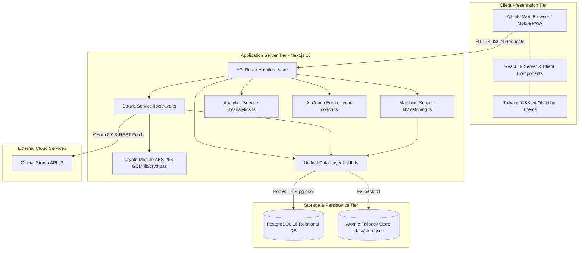

# System Architecture & Technical Specifications

**Status:** CONFIRMED  
**Version:** 1.0  
**Last Updated:** 2026-11-01  
**Owner:** Principal Software Architect  
**Related Documents:** [TECH_STACK.md](./TECH_STACK.md), [DATABASE_SCHEMA.md](./DATABASE_SCHEMA.md), [DATA_FLOW.md](./DATA_FLOW.md)

---

## 1. Architectural Overview & Style
The platform is architected as a modular, decoupled full-stack application built upon **Next.js 16 (App Router)** and **React 19**, powered by **TypeScript** and supported by **PostgreSQL 16**.

## 2. Component Responsibilities
* **Frontend Tier:** Renders dense athletic telemetry, manages local user interaction state, executes drag-and-drop calendar operations, and displays responsive SVG charts.
* **Serverless Route Handlers:** Acts as an authenticated API gateway, validating inputs, handling OAuth redirection and callbacks, enforcing token encryption, and running activity synchronization.
* **Crypto Service:** Encrypts and decrypts OAuth tokens using AES-256-GCM with unique 16-byte IVs.
* **Unified Data Layer:** Abstract repository decoupling PostgreSQL operations from local file storage fallback.
