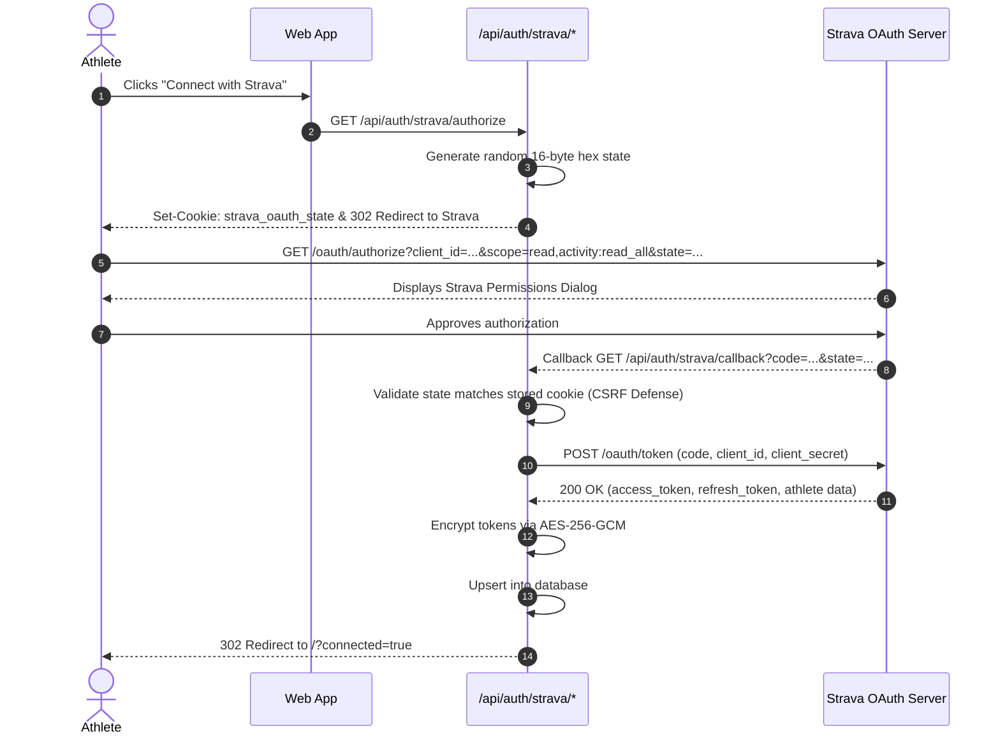

# Strava OAuth 2.0 Flow & Lifecycle Specification

**Status:** CONFIRMED  
**Version:** 1.0  
**Last Updated:** 2026-11-01  
**Owner:** API Integration Specialist & Security Engineer  
**Related Documents:** [STRAVA_SCOPES_AND_PERMISSIONS.md](./STRAVA_SCOPES_AND_PERMISSIONS.md)

---

## 1. Handshake Sequence Diagram

## 2. Revocation & Disconnect Flow
When an athlete clicks "Disconnect Strava" in Settings:
1. Server retrieves active decrypted access token.
2. Server calls `POST https://www.strava.com/oauth/deauthorize` with `Authorization: Bearer <token>`.
3. Server updates `strava_connections.is_active = false`.
