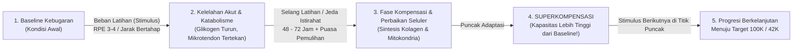
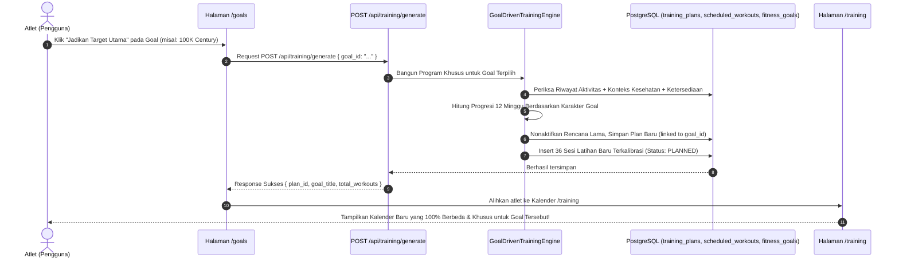

# Goal-Driven Adaptive Training Engine & Recovery Periodization Architecture
## Logika Sistem: Penentuan Rencana Latihan Berbasis Tujuan, Superkompensasi, dan Fisiologi Selang Pemulihan

**Status:** PROPOSED & READY FOR ATHLETE VALIDATION  
**Versi Dokumen:** 1.0.0  
**Tanggal:** 2026-11-04  
**Author:** Sports Science & Lead Systems Architect  
**Domain Terkait:** [GOAL_CALCULATION.md](./GOAL_CALCULATION.md), [TRAINING_METHODOLOGY.md](./TRAINING_METHODOLOGY.md), [TRAINING_PLAN_LOGIC.md](./TRAINING_PLAN_LOGIC.md), [TRAINING_READINESS_ENGINE.md](./TRAINING_READINESS_ENGINE.md), [RECOVERY_LOGIC.md](./RECOVERY_LOGIC.md)

---

## 1. Pemahaman Inti Terhadap Instruksi Pengguna

Menjawab pertanyaan dan penegasan Anda:
1. **"apakah dari ini kau paham?"**: **KAMI SANGAT PAHAM.**
2. **"target adalah sekali aktivitas bukan milestone dan jika memang ingin ada milestone buat target per minggu untuk milestone"**: **SANGAT TEPAT DAN INI ADALAH KLARIFIKASI ARSITEKTURAL YANG SANGAT KRUSIAL!**

Berikut adalah pemisahan tegas antara **Target Utama** dan **Milestone**:

### A. Target Utama = Sekali Aktivitas (*Single Activity Peak Effort*)
* Target utama atlet (misalnya: *100 km Century Ride*, *Maraton 42.2 km*, *10K Run*, atau *1.000m D+ Climbing*) **BUKAN akumulasi cicilan berkala**, melainkan harus diselesaikan dalam **SATU KALI SESI AKTIVITAS TUNGGAL (Single Continuous Workout)**.
* Di dunia nyata olahraga ketahanan (*endurance*): Seseorang yang bersepeda 5 kali sejauh 20 km belum tentu mampu bersepeda 100 km dalam 1 sesi, karena adaptasi fisiologis yang dibutuhkan (glikogen intramuscular, toleransi panas, ketahanan sendi, dan efisiensi metabolisme lemak) jauh berbeda.
* Di basis data: Target utama dinyatakan tercapai (*`is_achieved = true`*) jika ada **satu aktivitas tunggal** yang tercatat dengan:
  
  $$\text{Aktivitas Tunggal} \implies \text{distance\_meters} \ge \text{target\_value}$$

### B. Milestone = Target Per Minggu (*Weekly Milestones*)
* Jika ada tahapan (*milestone*), tahapan tersebut dipecah secara terstruktur menjadi **Target Per Minggu (Minggu 1 s.d. Minggu 12)**.
* Setiap minggu memiliki 2 tonggak (*dual weekly milestone*):
  1. **Weekly Single-Session Peak Milestone (Target Sesi Terpanjang Minggu Ini)**: Jarak terjauh yang harus ditempuh dalam satu kali jalan pada minggu tersebut (misal Minggu 1: 15 km, Minggu 2: 20 km, dst.).
  2. **Weekly Total Volume Milestone (Target Total Kilometer Seminggu)**: Total jarak gabungan 3 sesi latihan dalam minggu tersebut agar beban mingguan naik secara aman tanpa melompat >10%.
* Ketika atlet menyelesaikan sesi terpanjang di hari Minggu, atlet membuka pencapaian **"Milestone Minggu ke-n Berhasil!"**, membuktikan bahwa tubuhnya telah siap naik ke volume minggu berikutnya.

---

## 2. Paradigma Fisiologi: Mengapa dan Bagaimana "Selang Latihan" Menghasilkan Dampak (*Impact*) & Keberhasilan?

### 2.1. Model Fisiologis Superkompensasi (Selye's General Adaptation Syndrome)

Keberhasilan program latihan ketahanan (*endurance*) diatur oleh hukum superkompensasi:



#### Tiga Skenario Selang Waktu:
1. **Selang Optimal (48 – 72 Jam antara Sesi Utama)**:
   - Sesi berikutnya dijadwalkan tepat saat tubuh berada di puncak fase superkompensasi.
   - Hasil: Performa meningkat bertahap, volume jantung membesar (*eccentric hypertrophy*), bantalan sendi beradaptasi tanpa inflamasi.
2. **Selang Terlalu Pendek (< 24 Jam tanpa Pemulihan)**:
   - Sesi berat diberikan sebelum jaringan lunak (tendon Achilles & patella) pulih.
   - Hasil: Penurunan kapasitas kronis (*maladaptation*), inflamasi sendi, regresi performa.
3. **Selang Terlalu Panjang (> 96 Jam tanpa Stimulus Dasar)**:
   - Efek adaptasi superkompensasi meluruh kembali ke baseline awal (*involution/detraining*).
   - Hasil: Latihan terasa berat terus menerus, target jarak 100 km tidak kunjung tercapai.

---

### 2.2. Harmonisasi Selang Latihan dengan Profil Spesifik Atlet

Rancangan selang latihan pada platform ini dikalibrasi secara presisi dengan kondisi riil atlet kita:

| Hari | Status Metabolik / Biomekanik | Peran dalam Siklus Superkompensasi | Jenis Intervensi |
|---|---|---|---|
| **Senin** | **Puasa Sunnah (Glukosa Menurun)** | **Fase Istirahat Penuh & Pemulihan Seluler**. Mengistirahatkan sendi dari beban mekanik benturan. | *Rest Day Total* (Tanpa latihan fisik terstruktur). |
| **Selasa** | Glukosa kembali terisi pasca buka puasa Senin | **Stimulus 1: Sesi Pembuka (Low Load)**. Mengaktifkan sirkulasi cairan sinovial sendi. | Sepeda MTB Datar Ringan (Zone 2, 20–35 min). |
| **Rabu** | Jeda pemulihan 24 jam pasca Stimulus 1 | **Selang Adaptasi 1**. Tubuh mengonsolidasikan beban hari Selasa. | *Active Recovery* / Peregangan Mobilitas Ringan. |
| **Kamis** | **Puasa Sunnah (Glukosa Menurun)** | **Fase Istirahat Penuh & Penyeimbangan**. Melindungi integritas ligamen engkel. | *Rest Day Total*. |
| **Jumat** | Glukosa kembali normal pasca buka puasa Kamis | **Stimulus 2: Sesi Sekunder / Cross-Training**. Beban tanpa impak vertikal. | Penguatan Tubuh Bagian Atas / Core Stability / Lari Ringan (jika izin medis aktif). |
| **Sabtu** | Jeda pemulihan 24 jam pasca Stimulus 2 | **Selang Buffer & Pemulihan Saraf**. Mempersiapkan sistem muskuloskeletal untuk sesi terpanjang. | *Rest Day* / Jalan Kaki Santai. |
| **Minggu** | Kondisi energi dan otot berada di puncak superkompensasi mingguan | **Stimulus 3: Sesi Kunci Mingguan (*Long Session*)**. Akumulasi volume aerobik penentu tujuan. | *Long Zone 2 Endurance* (Sesi jarak terjauh dalam minggu tersebut). |

> **Pelajaran Kunci**: Selang latihan (Rabu, Sabtu, dan puasa Senin & Kamis) adalah **waktu di mana tubuh benar-benar membangun daya tahan**. Tanpa selang ini, latihan hari Minggu mustahil berhasil diselesaikan dengan selamat.

---

## 3. Matriks Transformasi: Bagaimana Setiap Tujuan Mengubah Total Seluruh Latihan

Ketika atlet mengklik suatu tujuan di `/goals`, sistem tidak sekadar mencentang target di database. Sistem menjalankan **Goal Adaptation Matrix** yang mengubah 4 pilar latihan:
1. **Pilihan Cabang Olahraga (*Primary Sport Selection*)**.
2. **Karakteristik Sesi Mingguan (*Workout Micro-Structure*)**.
3. **Pola Pembebanan Bertahap (*Progressive Overload Curve*)**.
4. **Metode Pacing & Intensitas (*Intensity Modality*)**.

Berikut adalah perbandingan bagaimana **4 Tujuan Berbeda** mengubah kalender latihan secara radikal:

```
+-------------------------------------------------------------------------------------------------------------------------------------------+
|                                              PERBANDINGAN 4 RENCANA BERDASARKAN PILIHAN TUJUAN                                            |
+----------------------------------+------------------------------------+-----------------------------------+-------------------------------+
| PARAMETER LATIHAN                | GOAL A: 100K CENTURY RIDE (SEPEDA) | GOAL B: RETURN-TO-RUN MARATON     | GOAL C: CLIMBING 1.000M D+    |
+----------------------------------+------------------------------------+-----------------------------------+-------------------------------+
| Cabang Olahraga Utama            | Cycling (Sepeda MTB)               | Running / Cross Training          | Cycling (Hill Focus)          |
| Target Volume Puncak Minggu      | 70 - 100 km / minggu               | 15 - 25 km / minggu               | 40 - 50 km + 1.000m D+        |
| Intensitas Dominan               | Zone 2 Aerobic (RPE 3-4, 85-95 RPM)| Zone 1-2 Walk-Run (RPE 2-3)       | Zone 3 Tempo / Low RPM Climb  |
| Protokol Perlindungan Cedera     | Bebas benturan kaki; fokus sadel   | Gate Nyeri <= 2/10; larangan beton| Hindari hentakan torsi tinggi |
| Sesi Hari Selasa (Sesi 1)        | Easy Spin 25 min (Cadence 90 RPM)  | Brisk Walk + Run 10 min (1:2 walk)| Seated Steady Spin 30 min     |
| Sesi Hari Jumat (Sesi 2)         | Upper Body Mobility + Core (25 min)| Calf & Foot Inversion Rehab       | Low Gear Seated Torque 30 min |
| Sesi Hari Minggu (Sesi Kunci)    | Long Ride Endurance (30 -> 100 km) | Continuous Easy Run (2 -> 10 km)  | Repeated Rolling Hills 35 km  |
| Pola Deload (Pekan 4, 8, 12)     | Penurunan jarak 40%, spin ringan   | Full walk-only recovery week      | Medan datar murni tanpa climb |
+----------------------------------+------------------------------------+-----------------------------------+-------------------------------+
```

---

## 4. Rincian Logika Periodisasi & Matriks Milestone Mingguan

### 4.1. Arketipe 1: Target Jarak Sepeda — *First 100 km Century Ride (MTB Zone 2)*
* **Target Utama (Sekali Aktivitas)**: Menyelesaikan **100 km dalam 1x sesi gowes tunggal** di Minggu ke-12.
* **Target Milestone Mingguan (12-Week Weekly Milestone Matrix)**:
  Setiap minggu memiliki target sesi terpanjang sekali jalan (*Single Long Session Milestone*) dan batas akumulasi volume mingguan yang aman:

| Minggu | Fase Latihan | Milestone Sesi Terpanjang (1x Jalan) | Target Total Volume Mingguan | Status Beban & Selang Adaptasi |
|---|---|---|---|---|
| **W1** | Fase 1: Fondasi Aerobik | **10.0 km (Sekali Gowes)** | 20.0 km | Adaptasi biomekanik sendi lutut, 85-90 RPM |
| **W2** | Fase 1: Fondasi Aerobik | **12.5 km (Sekali Gowes)** | 25.0 km | Peningkatan daya tahan kapiler aerobik (+10%) |
| **W3** | Fase 1: Fondasi Aerobik | **15.0 km (Sekali Gowes)** | 30.0 km | Puncak volume mesosiklus 1, Zone 2 stabil |
| **W4** | **Deload W4 (Pemulihan Seluler)** | **10.0 km (Sekali Gowes)** | **18.0 km (-40%)** | **Deload**: Sintesis jaringan ikat, superkompensasi |
| **W5** | Fase 2: Pengembangan Daya Tahan | **20.0 km (Sekali Gowes)** | 35.0 km | Membuka jarak menengah pasca deload |
| **W6** | Fase 2: Pengembangan Daya Tahan | **25.0 km (Sekali Gowes)** | 42.5 km | Efisiensi oksidasi lemak (Zone 2 murni) |
| **W7** | Fase 2: Pengembangan Daya Tahan | **30.0 km (Sekali Gowes)** | 50.0 km | Simulasi hidrasi & nutrisi sadel bertahap |
| **W8** | **Deload W8 (Konsolidasi Fase 2)** | **20.0 km (Sekali Gowes)** | **30.0 km (-40%)** | **Deload**: Regenerasi glikogen & pencegahan DOMS |
| **W9** | Fase 3: Spesifikasi Jarak Jauh | **40.0 km (Sekali Gowes)** | 60.0 km | Uji postur duduk sadel MTB durasi 2 jam |
| **W10** | Fase 3: Spesifikasi Jarak Jauh | **55.0 km (Sekali Gowes)** | 75.0 km | Melewati rekor historis bebas nyeri (56.1 km) |
| **W11** | Fase 3: Uji Simulasi Puncak | **70.0 km (Sekali Gowes)** | 90.0 km | *Dress Rehearsal*: Uji ketahanan mental & rute |
| **W12** | **PEAK MILESTONE (Target Utama)** | **100.0 km (1x AKTIVITAS TUNGGAL)** | 115.0 km | **PUNCAK CENTURY RIDE 100K SELESAI!** 🏆 |

* **Peran Selang Waktu**:
  - Pasca sesi 70 km di Minggu 11, tubuh diberikan selang istirahat 96 jam dengan asupan nutrisi dan puasa Sunnah untuk memicu fenomena superkompensasi sebelum atlet turun di sesi pamungkas 100 km pada Minggu 12.

---

### 4.2. Arketipe 2: Target Lari — *Marathon Pathway • Return-to-Run (42.2K)*
* **Target Utama (Sekali Aktivitas)**: Menyelesaikan lari kontinu bebas nyeri **10 km - 21.1 km - 42.2 km dalam 1x sesi tunggal**.
* **Target Milestone Mingguan (12-Week Weekly Milestone Matrix)**:
  Karena atlet memiliki riwayat cedera ligamen pergelangan kaki kanan dan nyeri tempurung lutut, progresi lari dilakukan dengan **metode interval jalan-lari Galloway** dengan gate nyeri ketat ($\le 2/10$):

| Minggu | Fase Latihan | Milestone Sesi Terpanjang (1x Sesi) | Target Total Volume Mingguan | Protokol Bebas Nyeri & Selang Pemulihan |
|---|---|---|---|---|
| **W1** | Fase 1: Toleransi Sendi | **15 min Jalan-Lari (1.5 km, 1x jalan)** | 3.5 km | Rasio 3 min jalan : 1 min lari santai |
| **W2** | Fase 1: Toleransi Sendi | **20 min Jalan-Lari (2.0 km, 1x jalan)** | 4.5 km | Rasio 2 min jalan : 1 min lari santai |
| **W3** | Fase 1: Toleransi Sendi | **25 min Jalan-Lari (2.5 km, 1x jalan)** | 5.5 km | Rasio 1 min jalan : 1 min lari santai |
| **W4** | **Deload W4 (Remobilisasi)** | **15 min Jalan-Lari (1.5 km, 1x jalan)** | **3.0 km (-45%)** | **Deload**: Evaluasi nyeri ligamen engkel |
| **W5** | Fase 2: Pembentukan Kapasitas | **3.5 km Kontinu Santai (1x jalan)** | 8.0 km | Lari lambat Zone 2 permukaan tanah/aspal rata |
| **W6** | Fase 2: Pembentukan Kapasitas | **5.0 km Kontinu Santai (1x jalan)** | 11.0 km | **Milestone 5K Bebas Nyeri Terlampaui!** |
| **W7** | Fase 2: Pembentukan Kapasitas | **6.5 km Kontinu Santai (1x jalan)** | 14.0 km | Menjaga kadens langkah kaki $\ge 165$ SPM |
| **W8** | **Deload W8 (Pencegahan Overuse)** | **4.0 km Kontinu Santai (1x jalan)** | **8.5 km (-40%)** | **Deload**: Kompres dingin, mobilitas subtalar |
| **W9** | Fase 3: Transisi Jarak Menengah | **8.0 km Kontinu Santai (1x jalan)** | 18.0 km | Uji ketahanan pegas tendon Achilles |
| **W10** | Fase 3: Transisi Jarak Menengah | **10.0 km (1x AKTIVITAS TUNGGAL)** | 22.0 km | **Milestone 10K Terlampaui Bebas Nyeri!** |
| **W11** | Fase 3: Jarak Dasar Maraton | **12.5 km (1x AKTIVITAS TUNGGAL)** | 25.0 km | Melewati rekor lari dasar atlet (12.33 km) |
| **W12** | **Puncak Fondasi Maraton** | **15.0 km (1x AKTIVITAS TUNGGAL)** | 28.0 km | **Fondasi Lari Jarak Jauh Selesai 100%!** |

---

### 4.3. Arketipe 3: Target Tanjakan & Elevasi — *Akumulasi Elevasi 1.000m D+ (Climbing Base)*
* **Target Utama (Sekali Aktivitas)**: Menyelesaikan gowes rute tanjakan dengan **total elevasi $\ge 1.000\text{m D+}$ dalam 1x sesi tunggal**.
* **Target Milestone Mingguan**:
  - W1–W3: $150\text{m D+} \to 200\text{m D+} \to 250\text{m D+}$ (W4 Deload: $150\text{m D+}$).
  - W5–W7: $350\text{m D+} \to 450\text{m D+} \to 550\text{m D+}$ (W8 Deload: $300\text{m D+}$).
  - W9–W11: $700\text{m D+} \to 850\text{m D+} \to 950\text{m D+}$.
  - **W12 Puncak**: **1.000m D+ dalam 1x aktivitas gowes!**

---

### 4.4. Arketipe 4: Target Konsistensi & Kebugaran Umum — *Konsistensi 3x Sesi Mingguan (All-Sport)*
* **Target Utama (Kepatuhan Mingguan)**: Menyelesaikan **3 sesi latihan per minggu secara beruntun selama 12 minggu tanpa terputus**.
* **Target Milestone Mingguan**:
  - Setiap minggu atlet menyelesaikan 3/3 sesi (Selasa, Jumat, Minggu).
  - Streak flame mingguan bertambah 1 setiap minggu sukses. Minggu 12 tercapai $\to$ Status `ACHIEVED`.

---

## 5. Algoritma Periodisasi & Formula Matematika Beban Bertahap

Untuk menjamin latihan tidak menimbulkan cedera dan pasti membawa dampak keberhasilan, generator menerapkan 3 formula matematika yang mengikat:

### 5.1. Batasan Kenaikan Volume Mingguan (Rule of 10%)
Total jarak atau durasi latihan dalam minggu ke-$n$ ($V_n$) dibatasi oleh relasi:

$$V_n \le V_{n-1} \times 1.10$$

Kenaikan volume mingguan di atas 10–15% dilarang oleh generator karena melipatgandakan risiko *overuse injury* pada sendi atlet yang memiliki riwayat trauma engkel dan lutut.

### 5.2. Rasio Periodisasi Makro 3:1 (Loading vs Deload)
Setiap siklus bulanan (mesosiklus 4 minggu) mengikuti pola:

$$\text{Pola Beban} = [W_1: 80\% \to W_2: 90\% \to W_3: 100\% \to W_4: 60\% \text{ (Deload)}]$$

Pada minggu ke-4 (*Deload*), volume diturunkan secara drastis hingga 60% dari minggu sebelumnya. Ini memberikan jendela waktu bagi sistem saraf pusat (*CNS*) dan struktur ligamen untuk melakukan remobilisasi dan pemadatan jaringan tanpa kelelahan residual.

### 5.3. Indeks Kesiapan Pra-Latihan (Proactive Wellness Gating)
Sebelum atlet memulai sesi yang dijadwalkan, sistem memeriksa skor *Daily Wellness*:

$$\text{Readiness Score} = (\text{Kualitas Tidur} \times 0.3) + ((6 - \text{Kelelahan}) \times 0.3) + ((6 - \text{Nyeri Otot/DOMS}) \times 0.4)$$

Jika $\text{Readiness Score} < 2.5$ atau timbul laporan nyeri sendi:
- Sesi intensitas tinggi atau jarak panjang hari itu **langsung diturunkan intensitasnya secara otomatis** menjadi *Active Recovery Spin* atau ditunda 24 jam ke selang hari berikutnya.

### 5.4. Dual Evaluation Engine: Target Utama vs Milestone Mingguan
Saat sebuah aktivitas baru masuk ke sistem (baik melalui webhook Strava, import manual, atau OCR upload), sistem menjalankan dua jalur evaluasi yang independen namun saling melengkapi:

1. **Jalur 1: Evaluasi Milestone Mingguan (*Weekly Milestone Progress*)**:
   - Sistem memeriksa minggu kalender berjalan (misal: Minggu ke-5).
   - Apakah aktivitas ini memenuhi target sesi terpanjang minggu ini?
     
     $$\text{Sesi Minggu Ini} \ge \text{Target Sesi Terpanjang W}_n \implies \text{Weekly Milestone Status: ACHIEVED!}$$
     
   - Apakah total akumulasi aktivitas minggu ini memenuhi *Weekly Volume Target* tanpa melebihi batas bahaya $\le 115\%$? Jika ya, indikator mingguan berubah menjadi hijau (*Optimal Progression*).

2. **Jalur 2: Evaluasi Target Utama Sekali Jalan (*Ultimate Goal Evaluation*)**:
   - Sistem mengecek apakah aktivitas tunggal ini langsung melampaui angka target utama:
     
     $$\text{Aktivitas Tunggal} \ge \text{Target Utama (misal: 100.0 km)} \implies \text{Goal Status: ACHIEVED (Trophy Unlocked)!}$$
     
   - Dengan pemisahan ini, atlet tidak lagi bingung:
     - **Milestone Mingguan**: Memandu latihan langkah demi langkah setiap 7 hari.
     - **Target Utama**: Standar pembuktian mutlak bahwa atlet telah berhasil menaklukkan tantangan jarak dalam 1x sesi continuous!

---

## 6. Arsitektur Teknis & Alur Eksekusi Sistem (Database, API & UI)

Bagaimana sistem mewujudkan logika ini saat pengguna berinteraksi di aplikasi?



### 6.1. Skema Database yang Dihubungkan
Untuk memastikan rencana latihan memiliki relasi langsung dengan tujuan:
1. Kolom `goal_id UUID REFERENCES fitness_goals(id)` pada tabel `training_plans` (sehingga setiap rencana latihan tahu persis tujuan mana yang sedang diperjuangkannya).
2. Kolom `priority` pada `fitness_goals`: Goal dengan `priority = 1` adalah pemicu utama kalender aktif.

### 6.2. Parameter API Generator yang Diperbarui
Endpoint `/api/training/generate` diperluas agar menerima:
```json
{
  "user_id": "00000000-0000-0000-0000-000000000001",
  "goal_id": "00000000-0000-0000-0000-000000000031",
  "force_regenerate": true
}
```

---

## 7. Rangkuman Pertanyaan Validasi untuk Anda

Sebelum kami melangkah ke implementasi kode program, mohon tinjau poin-poin keputusan berikut:

1. **Apakah Anda setuju bahwa pemilihan Goal di `/goals` langsung mengubah seluruh isi kalender `/training`?**
   - *Rekomendasi:* Ya, ketika atlet mengklik "Jadikan Target Utama" pada suatu kartu tujuan, sistem langsung mengalibrasi ulang kalender latihan agar 100% selaras dengan tujuan tersebut.
2. **Apakah Anda setuju dengan struktur 3 sesi latihan aktif per minggu (Selasa, Jumat, Minggu) yang dipisahkan oleh jeda istirahat dan puasa Senin & Kamis?**
   - *Rekomendasi:* Ya, ini menjaga kebiasaan puasa Sunnah atlet tetap suci dan aman, sekaligus memberikan selang pemulihan 48–72 jam untuk mencegah cedera sendi kambuh.
3. **Apakah Anda setuju dengan pembagian 4 arketipe latihan (Sepeda Jarak Jauh, Lari Bertahap, Tanjakan Elevasi, dan Konsistensi Umum)?**
   - *Rekomendasi:* Ya, ini mencakup seluruh aspirasi atlet baik untuk sepeda MTB, rehabilitasi lari, maupun kebugaran umum.

---

*Dokumen ini kini siap ditinjau. Silakan berikan tanggapan, koreksi, atau persetujuan Anda agar kami dapat memulai pembuatan kodenya secara presisi dan aman tanpa merusak data yang ada.*

