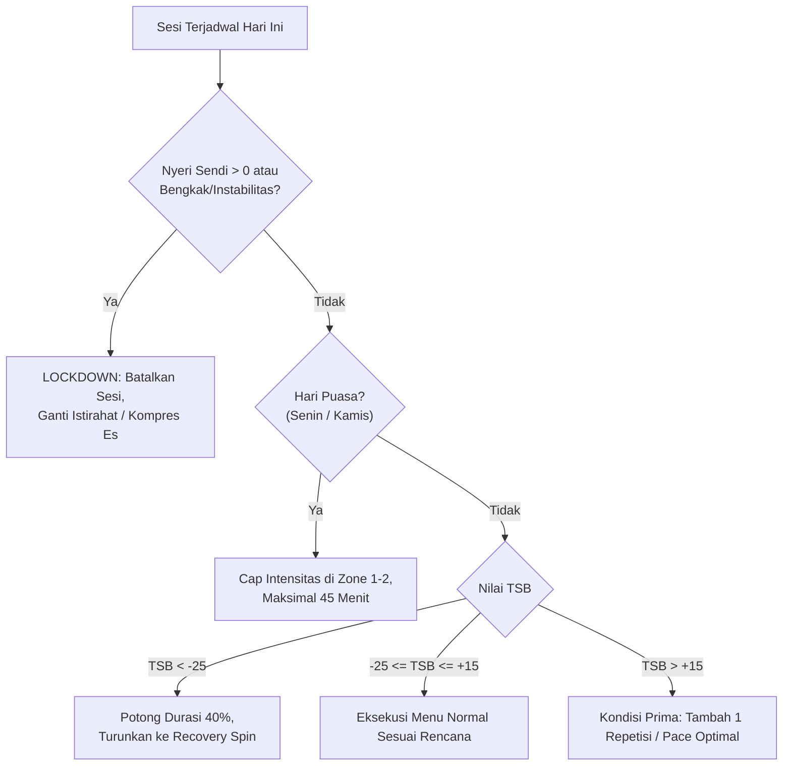

# Real-World AI Coach Intelligence Specification & Physiological Blueprint

- **Dokumen**: `REAL_WORLD_COACH_INTELLIGENCE_SPECIFICATION.md`
- **Lokasi**: `docs/05-domain-logic/REAL_WORLD_COACH_INTELLIGENCE_SPECIFICATION.md`
- **Status**: PROPOSED / RFC (Ready for Implementation)
- **Versi**: 2.0
- **Tanggal**: 2026-11-11
- **Pemilik**: Head of Sports Science & AI Systems Architecture
- **Dokumen Terkait**:
  - [`AI_COACH_INTEGRATION.md`](file:///c:/Users/MyBook%20Hype%20AMD/OneDrive/Documents/kerja/_code/project_strava/docs/05-domain-logic/AI_COACH_INTEGRATION.md)
  - [`TRAINING_LOAD.md`](file:///c:/Users/MyBook%20Hype%20AMD/OneDrive/Documents/kerja/_code/project_strava/docs/05-domain-logic/TRAINING_LOAD.md)
  - [`TRAINING_READINESS_ENGINE.md`](file:///c:/Users/MyBook%20Hype%20AMD/OneDrive/Documents/kerja/_code/project_strava/docs/05-domain-logic/TRAINING_READINESS_ENGINE.md)
  - [`ATHLETE_HEALTH_INTELLIGENCE_SPECIFICATION.md`](file:///c:/Users/MyBook%20Hype%20AMD/OneDrive/Documents/kerja/_code/project_strava/docs/03-architecture/ATHLETE_HEALTH_INTELLIGENCE_SPECIFICATION.md)

---

## 1. Visi & Pernyataan Masalah

### 1.1 Keterbatasan Sistem Saat Ini
Saat ini, logika pelatih cerdas pada `project_strava` beroperasi dengan aturan berbasis ambang batas sederhana (*rule-based threshold*):
1. **Beban Latihan Statis**: Menghitung rasio jarak 7 hari vs 14 hari dengan aturan kenaikan jarak 10%. Belum memperhitungkan intensitas fisiologis sesungguhnya (*cardiac strain*, durasi, atau *power*).
2. **Jadwal Kaku Tanpa Auto-Regulasi**: Latihan yang diresepkan tidak beradaptasi secara otomatis ketika atlet bangun dalam kondisi lelah, stres tinggi, atau melaporkan nyeri sendi.
3. **Ketiadaan Evaluasi Pasca Sesi (*Debrief*)**: Setelah aktivitas diunggah dari Strava atau dicatat manual, sistem belum mengaudit kepatuhan zona (*zone compliance*) maupun memeriksa *aerobic decoupling* (*cardiac drift*).

### 1.2 Standar Pelatih Dunia Nyata (*Real-World Elite Coach*)
Seorang pelatih olahraga ketahanan profesional (*certified endurance coach & sport scientist*) bekerja dengan siklus harian berulang:
$$\text{Audit Telemetri Pasca Latihan} \longrightarrow \text{Evaluasi Kebugaran vs Kelelahan (Banister)} \longrightarrow \text{Triangulasi Kesiapan Pagi Hari} \longrightarrow \text{Auto-Regulasi Resep Latihan Hari Ini}$$

Dokumen ini mendefinisikan spesifikasi matematika, logika fisiologis, dan arsitektur teknis untuk mentransformasikan AI Coach menjadi pelatih dunia nyata.

---

## 2. Pilar 1: Model Kebugaran, Kelelahan, dan Kesegaran (Banister Model)

### 2.1 Perhitungan Beban Sesi: Training Impulse (TRIMP) & TSS
Setiap aktivitas fisik dikonversi menjadi satuan beban latihan tunggal berbasis respons kardiovaskular:

#### A. TRIMP Eksponensial (Banister Model)
Untuk aktivitas berbasis Heart Rate (Lari & Sepeda):
$$\text{HRR} = \frac{\text{HR}_{\text{avg}} - \text{HR}_{\text{rest}}}{\text{HR}_{\text{max}} - \text{HR}_{\text{rest}}}$$
$$\text{TRIMP} = D \times \text{HRR} \times 0.64 \times e^{1.92 \times \text{HRR}}$$
*Di mana:*
- $D$: Durasi latihan dalam satuan menit.
- $\text{HR}_{\text{rest}}$: Detak jantung istirahat atlet (default: 52 bpm).
- $\text{HR}_{\text{max}}$: Detak jantung maksimal atlet (default: 185 bpm).

#### B. Training Stress Score (TSS) untuk Bersepeda (Power / HR)
$$\text{TSS} = \frac{t \times \text{IF}^2 \times 100}{3600} \quad \text{atau estimasi via HR-TSS}$$

---

### 2.2 Kebugaran Kronis (CTL), Kelelahan Akut (ATL), dan Form (TSB)
Akumulasi beban latihan dimodelkan menggunakan persamaan *Exponentially Weighted Moving Average (EWMA)*:

```
                          SESI HARIAN (TRIMP / TSS)
                                     │
                    ┌────────────────┴────────────────┐
                    ▼                                 ▼
         Chronic Training Load (CTL)        Acute Training Load (ATL)
              Time Constant: 42 Hari             Time Constant: 7 Hari
              "Kebugaran Fondasi"                 "Kelelahan Akut"
                    │                                 │
                    └────────────────┬────────────────┘
                                     ▼
                        Training Stress Balance (TSB)
                              TSB = CTL - ATL
                            "Kesegaran Atlet"
```

#### Persamaan Rekursif Harian:
$$\text{CTL}_t = \text{CTL}_{t-1} + \frac{\text{TSS}_t - \text{CTL}_{t-1}}{42}$$
$$\text{ATL}_t = \text{ATL}_{t-1} + \frac{\text{TSS}_t - \text{ATL}_{t-1}}{7}$$
$$\text{TSB}_t = \text{CTL}_t - \text{ATL}_t$$

### 2.3 Matriks Keputusan Berdasarkan Nilai TSB

| Rentang TSB | Status Fisiologis Atlet | Intervensi Pelatih Dunia Nyata |
| :--- | :--- | :--- |
| **$\text{TSB} < -25$** | **High Overreaching / Overload Risk** | 🚨 **Intervensi Wajib**: Pangkas volume 50%, batalkan interval, ganti dengan Zone 1 recovery spin atau istirahat penuh. |
| **$-25 \le \text{TSB} < -10$** | **Optimal Overload Zone** | 🟢 **Fase Adaptasi**: Kebugaran sedang dibangun. Lanjutkan menu latihan selama biomarker nyeri sendi $= 0$. |
| **$-10 \le \text{TSB} \le +10$** | **Neutral / Maintenance** | ⚪ **Transisi Seimbang**: Beban latihan seimbang dengan pemulihan. |
| **$+10 < \text{TSB} \le +25$** | **Peak Race Form (Fresh)** | 🏆 **Kondisi Puncak (Tapering)**: Sangat bugar dan segar. Waktu ideal untuk menembus target 100K Century Ride. |
| **$\text{TSB} > +25$** | **Detraining / Transition** | ⚠️ **Penurunan Kebugaran**: Atlet beristirahat terlalu lama. Jadwalkan sesi aerobik fondasi untuk mencegah hilangnya kapiler mitokondria. |

---

## 3. Pilar 2: Evaluasi Pasca Latihan & Audit Telemetri (*Session Debrief*)

Setiap kali aktivitas baru tercatat di sistem, AI Coach menjalankan **Audit 3 Titik**:

```
                       AKTIVITAS BARU TERCATAT
                                  │
         ┌────────────────────────┼────────────────────────┐
         ▼                        ▼                        ▼
  1. Kepatuhan Zona        2. Cardiac Drift        3. Audit Biomekanika
  (Zone Compliance %)     (Aerobic Decoupling)     (Kadens & Skala Nyeri)
         │                        │                        │
         └────────────────────────┼────────────────────────┘
                                  ▼
                   COACH POST-SESSION DEBRIEF CARD
```

### 3.1 Indeks Kepatuhan Zona (*Zone Compliance Index - ZCI*)
Pelatih mengukur apakah atlet mematuhi intensitas yang diperintahkan:
$$\text{ZCI} = \frac{\text{Waktu di Zona Resep}}{\text{Total Waktu Sesi}} \times 100\%$$
- **Jika Sesi Zone 2**: $\text{ZCI} \ge 75\%$ dianggap **Patuh**. Jika atlet menghabiskan $>25\%$ durasi di Zone 4/5, pelatih memberikan peringatan:
  > *"Kamu memacu detak jantung terlalu tinggi di tanjakan (32% di Zone 4). Ini membakar glikogen dan menunda pemulihan sendi. Di sesi easy ride berikutnya, gunakan rasio gigi paling ringan."*

### 3.2 Aerobic Decoupling / Cardiac Drift ($Pw:\text{HR}$ atau $Pa:\text{HR}$)
Mengukur stabilitas efisiensi aerobik antara paruh pertama (H1) dan paruh kedua (H2) sesi:
$$\text{Efisiensi} = \frac{\text{Kecepatan (atau Power)}}{\text{Detak Jantung}}$$
$$\text{Drift (\%)} = \left( 1 - \frac{\text{Efisiensi}_{\text{H2}}}{\text{Efisiensi}_{\text{H1}}} \right) \times 100\%$$
- **Drift $< 5\%$**: Aerobik stabil, hidrasi dan glikogen optimal.
- **Drift $\ge 5\%$**: *Cardiac drift* terdeteksi. Pelatih mendiagnosis kelelahan kardiovaskular, dehidrasi, atau defisit karbohidrat.

---

## 4. Pilar 3: Auto-Regulasi Jadwal Harian (*Dynamic Daily Adaptation*)

Setiap pagi, sistem mentriangulasikan:
1. Skor kesiapan subjektif atlet (*Morning Wellness*).
2. Skala nyeri sendi & riwayat cedera aktif (Engkel kanan & Tempurung lutut).
3. Nilai $\text{TSB}$ hari ini.
4. Jadwal puasa atlet (Senin & Kamis).

### Matriks Auto-Regulasi Menu Hari Ini:



---

## 5. Pilar 4: Protokol Kembali Berlari (Return to Run / RTR) Berbasis Bukti

Untuk atlet dengan riwayat *inversion ankle sprain* dan *anterior knee pain*, kemajuan lari **TIDAK PERNAH** ditentukan oleh tanggal kalender, melainkan oleh **Gerbang Validasi Fungsional (*Functional Gate Checks*)**:

| Tahap | Nama Tahap | Syarat Pembukaan Gerbang (*Gate Clearance*) | Resep Latihan |
| :---: | :--- | :--- | :--- |
| **1** | **Beban Impak Nol (Aktif Sekarang)** | Riwayat nyeri lari aktif, lari ditunda (`ON_HOLD`). | Sepeda Zone 1–2 flat cadence ($\le 30\text{ km}$), latihan mobilitas pergelangan kaki beban nol. |
| **2** | **Toleransi Beban Dinamis** | Bebas nyeri jalan cepat 45 menit + uji lompat satu kaki (*single-leg hop test*) bebas nyeri. | Lari/Jalan Berselang (Walk/Jog): 1 mnt Jog / 2 mnt Jalan $\times 6$ repetisi di permukaan rata. |
| **3** | **Continuous Easy Jog** | Lolos Tahap 2 selama 2 minggu tanpa pembengkakan pasca 24 jam. | Lari santai kontinu 2.5–3.5 km di Zone 2 (RPE $\le 3$). |
| **4** | **Pembangunan Fondasi 5K** | Lolos Tahap 3 tanpa nyeri $\ge 48$ jam. | Lari kontinu 5 km dengan aturan kenaikan volume mingguan $\le 10\%$. |
| **5** | **Integrasi Menuju Maraton** | Lolos 5K tanpa gejala + verifikasi klinis dokter/fisioterapis. | Blok persiapan Half Marathon (21.1 km) dilanjutkan Full Marathon (42.2 km). |

---

## 6. Pilar 5: Karakter & Gaya Komunikasi Pelatih (*Voice of the Coach*)

Pelatih dunia nyata tidak memberikan instruksi kaku tanpa konteks. Setiap resep selalu dilengkapi:
1. **Rasional Fisiologis (*The Why*)**: Menjelaskan mengapa latihan ini penting.
2. **Instruksi Taktis (*The Execution*)**:
   - Target kadens putaran pedal: $\ge 85\text{ RPM}$ untuk menghemat glikogen dan melindungi sendi lutut.
   - Strategi nutrisi/fueling: $40\text{--}60\text{ g}$ karbohidrat cair per jam pada sesi $>90\text{ menit}$.
3. **Aturan Berhenti Sektika (*Red Flags*)**: Kriteria eksplisit kapan atlet harus menghentikan latihan.

---

## 7. Arsitektur Teknis & Pembagian Kerja (Clean Architecture)

```
[ Frontend: Next.js 16 (React 19) ]
   ├── CoachHub.tsx (Morning Briefing, PMC Chart, Session Debrief)
   └── DailyReadinessBanner.tsx (Interaksi Auto-Regulasi)
           │
           ▼  (REST API JSON)
[ BFF Layer: Next.js Route Handlers (`src/app/api/coach/`) ]
   ├── /api/coach/debrief (Evaluasi pasca latihan)
   ├── /api/coach/pmc (Grafik CTL, ATL, TSB harian)
   └── /api/coach/daily-brief (Sapaan & penyesuaian resep)
           │
           ▼  (HTTP Client)
[ Core Engine: Python FastAPI (`python_engine/domain/physiology/`) ]
   ├── banister_engine.py (Perhitungan TRIMP, CTL, ATL, TSB)
   ├── decoupling_engine.py (Aerobic Decoupling & Zone Compliance)
   └── auto_regulation.py (Logika penyesuaian latihan hari ini)
```

---

## 8. Rencana Implementasi Bertahap

- [ ] **Fase 1 (Python Core Engine)**:
  - Bangun `python_engine/domain/physiology/banister_engine.py` (TRIMP, CTL, ATL, TSB).
  - Bangun `python_engine/domain/physiology/decoupling_engine.py` (Cardiac Drift & Zone Compliance).
  - Tambahkan unit test pytest untuk memvalidasi akurasi formula matematika.
- [ ] **Fase 2 (API & Repositori Integrasi)**:
  - Buat tabel/kolom persistensi metrik harian `athlete_pmc_metrics` di database.
  - Buat endpoint API Next.js `/api/coach/pmc` dan `/api/coach/debrief`.
- [ ] **Fase 3 (Tampilan Antarmuka Interaktif)**:
  - Tambahkan kartu *Performance Management Chart (PMC)* di halaman Coach.
  - Tambahkan pop-up *Post-Session Coach Debrief* setelah atlet menyelesaikan aktivitas.
  - Tambahkan tombol *Acknowledge / Apply Adjustment* untuk auto-regulasi jadwal.

