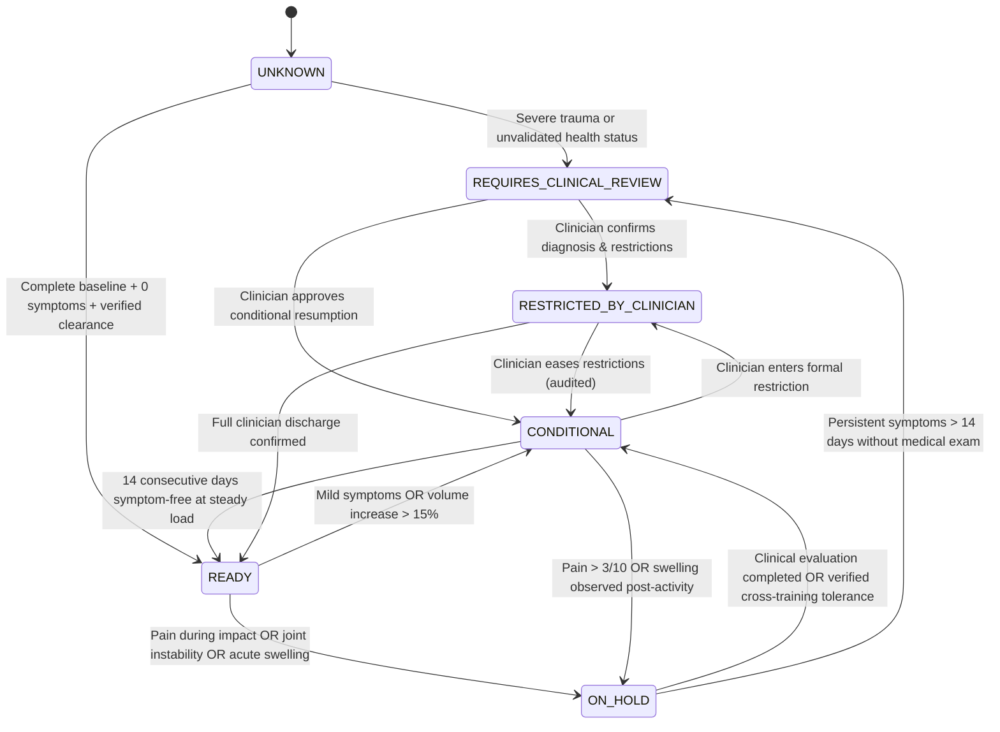

# Deterministic Training Readiness Engine

**Status:** CONFIRMED  
**Version:** 1.0  
**Last Updated:** 2026-11-02  
**Owner:** Sports Science Software Engineer & Exercise Physiology Researcher  
**Related Documents:** [ATHLETE_HEALTH_CONTEXT.md](../03-architecture/ATHLETE_HEALTH_CONTEXT.md), [AI_COACH_INTEGRATION.md](./AI_COACH_INTEGRATION.md)

---

## 1. Engine Philosophy: Zero Autonomous AI Overrides

The Training Readiness Engine (`src/lib/readinessEngine.ts`) is a **deterministic, rule-based safety layer**. The AI coach cannot override readiness states, remove clinician restrictions, or clear an injured athlete autonomously.

---

## 2. Readiness States & Definitions

| State | Semantic Meaning | Permitted Training Actions |
|---|---|---|
| `READY` | Full biomechanical and physiological tolerance verified. | Unrestricted training within progressive overload principles. |
| `CONDITIONAL` | Asymmetric or controlled tolerance (e.g. low-impact cycling allowed; sprinting prohibited). | Zone 1–2 steady aerobic sessions; duration and distance strictly capped. |
| `ON_HOLD` | Active symptoms, acute tissue trauma, or pending clinical evaluation. | High-impact running paused; active rest and gentle mobility only. |
| `REQUIRES_CLINICAL_REVIEW` | Persistent symptoms, unexplained swelling, or joint instability detected. | All structured training suspended; referral to medical professional. |
| `RESTRICTED_BY_CLINICIAN` | Licensed physician/physiotherapist has entered formal boundaries. | Strictly constrained to clinician-prescribed parameters. |
| `UNKNOWN` | Missing or incomplete health data. | Defaulted to conservative maintenance; never treated as `READY`. |

---

## 3. Ten Inviolable Safety Rules

1. **Persistent/Recurring Pain:** Any recurring symptom triggers immediate state re-evaluation.
2. **Acute Swelling Circuit Breaker:** Any report of `swelling_observed = true` immediately transitions both sports to `ON_HOLD`.
3. **Joint Instability Circuit Breaker:** Joint giving way or weight-bearing instability suspends all training and demands clinical examination.
4. **Severe Symptom Block:** Pain scores $> 3/10$ block progressive training recommendations.
5. **Clinician Supremacy:** Clinician-defined restrictions take absolute precedence over AI recommendations.
6. **Progression Lockout:** Unresolved symptoms set `automatic_progression_allowed = false`.
7. **Strava Metrics Fallacy:** Distance and speed alone NEVER establish medical recovery.
8. **Missing Data Policy:** Non-reported symptoms are recorded as `UNKNOWN`, NEVER as $0/10$ ("pain-free").
9. **Safety Gate Validation:** All proposed workouts must pass deterministic validation before publication.
10. **Data Provenance:** The athlete retains the right to correct inaccurate records with full audit trail logging.

