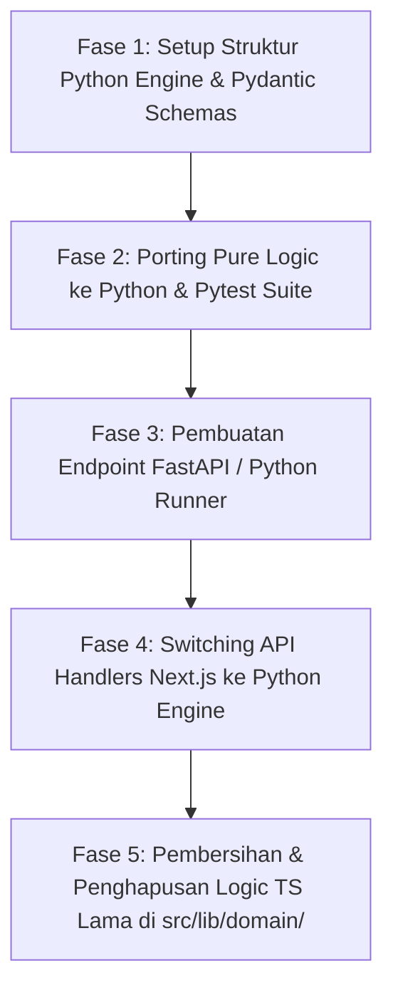

# AUDIT ARSITEKTUR DOMAIN LOGIC: DEKOPEL LENGKAP KALKULASI KE PYTHON

> **Tanggal Audit**: 10 November 2026  
> **Repository**: `a-coach — Athletic Telemetry, Injury-Aware Coaching & Adaptive Periodization Engine`  
> **Tujuan**: Audit menyeluruh seluruh file di repositori untuk mengidentifikasi seluruh logika perhitungan (*calculation logic*) dan memetakan migrasi penuh agar seluruh kalkulasi dijalankan secara eksklusif oleh **Python**.

---

## 1. Executive Summary & Ringkasan Kondisi Saat Ini

Saat ini, platform `a-coach` dibangun di atas arsitektur monolitik **Next.js 16 (App Router) + TypeScript**. Berdasarkan audit mendalam terhadap seluruh direktori kode sumber (`src/`), ditemukan bahwa **hampir 100% logika domain, rumus fisiologi, kalkulasi statistik, dan periodisasi dijalankan di dalam runtime Node.js/TypeScript**, sementara Python saat ini hanya digunakan pada satu utilitas terisolasi yaitu OCR parser citra tangkapan layar Strava ([`scripts/parsers/parse_activity_image.py`](file:///c:/Users/MyBook%20Hype%20AMD/OneDrive/Documents/kerja/_code/project_strava/scripts/parsers/parse_activity_image.py)).

### Status Komparasi Runtime Logika

```mermaid
flowchart LR
    subgraph SaatIni [Kondisi Eksisting (Coupled)]
        TS_UI[Next.js React UI] --> TS_Logic[TypeScript Domain Engines in src/lib/domain/]
        TS_Logic --> PG[(PostgreSQL)]
        OCR_Route[API parse-image] --> Py_OCR[Python OCR Script]
    end

    subgraph TargetArsitektur [Target Arsitektur (Python-Centric Logic)]
        WebUI[Next.js 16 UI / BFF Gateway] -->|JSON API / RPC| PyEngine[Python Sports Science Engine]
        PyEngine --> Physio[Physiology & Heart Rate]
        PyEngine --> Readiness[Readiness & Circuit Breakers]
        PyEngine --> Streak[Streak & Thermodynamics]
        PyEngine --> Period[ACWR & Periodization 12-W]
        PyEngine --> PRs[PR & Kinematics Benchmarks]
        PyEngine --> Recap[Weekly Recaps & Analytics]
        PyEngine --> PG2[(PostgreSQL)]
    end
```

### Keuntungan Strategis Memindahkan Semua Kalkulasi ke Python
1. **Ekosistem Sports Science & Data Analysis**: Python memiliki pustaka standar industri (*NumPy*, *SciPy*, *Pandas*, *Polars*) yang jauh lebih unggul untuk analisis deret waktu (*time-series telemetry*), regresi beban latihan (*Banister impulse-response model*), dan kalkulasi ambang laktat/daya.
2. **Kesiapan Machine Learning / AI Adaptif**: Model prediksi cedera, estimasi kelelahan sistemik, dan rekomendasi beban adaptif dapat menggunakan *scikit-learn*, *PyTorch*, atau *XGBoost* secara native tanpa perlu *bridge* rumit ke Node.js.
3. **Pemisahan Tanggung Jawab (*Separation of Concerns*)**: Next.js murni bertindak sebagai **Presentation Layer & API Gateway (BFF)**, sementara seluruh kecerdasan analitik dan integritas matematika didelegasikan ke mesin Python yang deterministik.

---

## 2. Inventaris Lengkap File Perhitungan Logic di Codebase

Audit mengidentifikasi **14 modul utama** di `src/lib/` dan rute API terkait yang melakukan perhitungan matematika, statistik, atau evaluasi aturan domain:

| No | Modul / File | Lokasi Eksisting | Jenis Kalkulasi / Rumus yang Dilakukan |
| :--- | :--- | :--- | :--- |
| **1** | **Physiology & Biometrics** | [`src/lib/domain/physiology/heartRateZones.ts`](file:///c:/Users/MyBook%20Hype%20AMD/OneDrive/Documents/kerja/_code/project_strava/src/lib/domain/physiology/heartRateZones.ts) | - Formula BMI: $\text{weight} / (\text{height}/100)^2$<br>- Formula Tanaka: $\text{HR}_{\max} = 208 - (0.7 \times \text{age})$<br>- Formula Karvonen HRR: $\text{Target HR} = \text{RHR} + (\% \times (\text{HR}_{\max} - \text{RHR}))$<br>- Pembagian 5 Zona Kardiak (Z1–Z5)<br>- Rasio Daya per Bobot: $\text{Watts} / \text{kg}$<br>- Ambang Kecepatan Lari Fungsional (*Functional Threshold Pace*) |
| **2** | **Safety & Readiness Gatekeeper** | [`src/lib/domain/readiness/readinessEngine.ts`](file:///c:/Users/MyBook%20Hype%20AMD/OneDrive/Documents/kerja/_code/project_strava/src/lib/domain/readiness/readinessEngine.ts) | - Skor Kesiapan Latihan (0–100%)<br>- Evaluasi ambang nyeri maksimal ($\max(\text{pain scores})$)<br>- Deteksi *circuit-breaker* sendi (bengkak & instabilitas sendi)<br>- Skala Borg CR10 RPE dan toleransi beban empiris bersepeda vs lari<br>- Penentuan status atlet: `OPTIMAL_CLEAR`, `ACTIVE_WITH_UNRESOLVED_SYMPTOMS`, `CONTRAINDICATED` |
| **3** | **Streak & Thermodynamics** | [`src/lib/domain/streak/streakEngine.ts`](file:///c:/Users/MyBook%20Hype%20AMD/OneDrive/Documents/kerja/_code/project_strava/src/lib/domain/streak/streakEngine.ts) | - Partisi kalender ISO (Senin 00:00:00 s.d. Minggu 23:59:59)<br>- Algoritma deteksi rentetan mingguan kontinu & rekor terpanjang<br>- Perhitungan sisa hari menuju akhir pekan<br>- Pemetaan 6 Tahap Termodinamika Spektrum Api (Merah, Oranye, Kuning, Putih, Cyan, Plasma) |
| **4** | **Personal Records (PR)** | [`src/lib/domain/records/personalRecordsEngine.ts`](file:///c:/Users/MyBook%20Hype%20AMD/OneDrive/Documents/kerja/_code/project_strava/src/lib/domain/records/personalRecordsEngine.ts) | - Algoritma reduksi laju tercepat (Pace per km)<br>- Benchmark 5K ($\ge 4.900\text{ m}$), 10K ($\ge 9.800\text{ m}$)<br>- Rekor jarak terjauh lari & sepeda<br>- Rekor elevasi daki tertinggi (*climb*), daya puncak (*watts*), dan kecepatan maksimal |
| **5** | **AI Coach & Workload (ACWR)** | [`src/lib/domain/coach/aiCoachEngine.ts`](file:///c:/Users/MyBook%20Hype%20AMD/OneDrive/Documents/kerja/_code/project_strava/src/lib/domain/coach/aiCoachEngine.ts) | - **ACWR (Acute:Chronic Workload Ratio)**:<br>  $$\text{ACWR} = \frac{\text{Acute Distance (7 Hari)}}{\text{Chronic Distance (28 Hari)} / 4}$$<br>- Rule lonjakan volume mingguan >10% (*10% Rule Injury Spike*)<br>- Evaluasi dampak benturan mekanis lari ($2.5–3\times$ bobot tubuh)<br>- Penyeimbangan beban asimetris lari vs sepeda |
| **6** | **Periodization Generators** | [`src/lib/training/generators/century100kGenerator.ts`](file:///c:/Users/MyBook%20Hype%20AMD/OneDrive/Documents/kerja/_code/project_strava/src/lib/training/generators/century100kGenerator.ts)<br>[`climbingGenerator.ts`](file:///c:/Users/MyBook%20Hype%20AMD/OneDrive/Documents/kerja/_code/project_strava/src/lib/training/generators/climbingGenerator.ts)<br>[`marathonRehabGenerator.ts`](file:///c:/Users/MyBook%20Hype%20AMD/OneDrive/Documents/kerja/_code/project_strava/src/lib/training/generators/marathonRehabGenerator.ts)<br>[`consistencyGenerator.ts`](file:///c:/Users/MyBook%20Hype%20AMD/OneDrive/Documents/kerja/_code/project_strava/src/lib/training/generators/consistencyGenerator.ts) | - Algoritma progresi beban 12 pekan berbasis *progressive overload*<br>- Faktor reduksi pekan deload (pekan 4 & 8: $-35\%$ hingga $-40\%$ volume)<br>- Kalkulasi alokasi sesi Selasa (Easy), Jumat (Mobilitas), Minggu (Long Ride)<br>- Ramp jarak mingguan Century Ride (10 km $\rightarrow$ 100 km) |
| **7** | **Workout Matching Engine** | [`src/lib/domain/matching/matchingEngine.ts`](file:///c:/Users/MyBook%20Hype%20AMD/OneDrive/Documents/kerja/_code/project_strava/src/lib/domain/matching/matchingEngine.ts) | - Persentase kepatuhan rencana ($\text{actual} / \text{target} \times 100\%$)<br>- Kalkulasi delta jarak ($\Delta\text{dist}$) dan durasi ($\Delta\text{dur}$)<br>- Kalkulasi deviasi pace target vs aktual<br>- Algoritma kompatibilitas cabang olahraga |
| **8** | **Weekly Recap & Workload** | [`src/lib/domain/analytics/weeklyRecapEngine.ts`](file:///c:/Users/MyBook%20Hype%20AMD/OneDrive/Documents/kerja/_code/project_strava/src/lib/domain/analytics/weeklyRecapEngine.ts)<br>[`weeklyRecapActivity.ts`](file:///c:/Users/MyBook%20Hype%20AMD/OneDrive/Documents/kerja/_code/project_strava/src/lib/domain/analytics/weeklyRecapActivity.ts)<br>[`weeklyRecapInjury.ts`](file:///c:/Users/MyBook%20Hype%20AMD/OneDrive/Documents/kerja/_code/project_strava/src/lib/domain/analytics/weeklyRecapInjury.ts) | - Agregasi matriks 7-hari mingguan (Senin–Minggu)<br>- Distribusi volume per cabang olahraga (Lari vs Sepeda vs Mobilitas)<br>- Korelasi beban latihan terhadap skor nyeri sendi per regio anatomi<br>- Kalkulasi rata-rata kadens, pace, dan kecepatan mingguan |
| **9** | **Volume Progression Bucketer** | [`src/lib/domain/analytics/volumeBucketer.ts`](file:///c:/Users/MyBook%20Hype%20AMD/OneDrive/Documents/kerja/_code/project_strava/src/lib/domain/analytics/volumeBucketer.ts) | - Pengelompokan deret waktu (*timeframe bucketing*): 7D, 30D, 12W, YTD, ALL<br>- Normalisasi tanggal kalender & sorting agregasi volume harian/mingguan |
| **10** | **Summary Dashboard Telemetry** | [`src/lib/shared/analytics.ts`](file:///c:/Users/MyBook%20Hype%20AMD/OneDrive/Documents/kerja/_code/project_strava/src/lib/shared/analytics.ts) | - Total akumulasi jarak dan durasi aktif pekan berjalan<br>- Rata-rata laju lari tertimbang ($\sum\text{dur} / \sum\text{dist}$)<br>- Skor konsistensi kepatuhan jadwal (0–100%) |
| **11** | **Kinematics & Sports Utilities** | [`src/lib/domain/sports/sportUtils.ts`](file:///c:/Users/MyBook%20Hype%20AMD/OneDrive/Documents/kerja/_code/project_strava/src/lib/domain/sports/sportUtils.ts)<br>[`src/lib/shared/formatters.ts`](file:///c:/Users/MyBook%20Hype%20AMD/OneDrive/Documents/kerja/_code/project_strava/src/lib/shared/formatters.ts) | - Konversi $m/s \rightarrow \text{menit/km}$ dan $m/s \rightarrow km/h$<br>- Kalkulasi kecepatan rata-rata dari jarak dan waktu bergerak<br>- Perhitungan elevasi kumulatif |
| **12** | **OCR Vision & Parsers** | [`scripts/parsers/parse_activity_image.py`](file:///c:/Users/MyBook%20Hype%20AMD/OneDrive/Documents/kerja/_code/project_strava/scripts/parsers/parse_activity_image.py) *(sudah Python)* | - Masking watermark citra tangkapan layar Strava<br>- Deteksi teks OCR via Tesseract/pytesseract<br>- Ekstraksi regex angka telemetri (jarak km, waktu bergerak, elevasi, kecepatan rata-rata) |

---

## 3. Detail Analisis Setiap Mesin Perhitungan

### A. Mesin Fisiologi & Kapasitas Biometrik (`heartRateZones.ts`)
* **Masukan (*Inputs*)**: `age`, `height_cm`, `weight_kg`, `resting_heart_rate`, `max_heart_rate`, `ftp_watts`.
* **Keluaran (*Outputs*)**: `bmi`, `bmiCategory`, `hrMaxEstimated`, `heartRateReserve`, `zones` (Array Z1–Z5 dengan batas BPM), `wattsPerKg`.
* **Mengapa Sangat Cocok untuk Python**:
  Di Python, perhitungan zona latihan dapat diintegrasikan dengan modul ilmiah seperti `scipy.signal` untuk menganalisis data file FIT/TCX/GPX mentah atlet (denyut jantung per detik) serta menghitung *Heart Rate Variability* (HRV) rmssd dan rMSSD baseline.

### B. Mesin Kesiapan Latihan & Pintu Keamanan Medis (`readinessEngine.ts`)
* **Masukan (*Inputs*)**: `injuries`, `recentPainLogs`, `recentResponses`, `clinicianRestrictions`, `todayWellness`.
* **Keluaran (*Outputs*)**: Status kesiapan per cabang (`running_readiness`: `READY` / `CONDITIONAL` / `ON_HOLD`), `cycling_readiness`, `athlete_status`, serta daftar `trigger_symptoms` dan `rationale`.
* **Mengapa Sangat Cocok untuk Python**:
  Python memungkinkan pembuatan model probabilistik *Bayesian Network* atau pohon keputusan (*Decision Trees*) untuk memprediksi probabilitas kekambuhan cedera (*re-injury risk score*) berdasarkan riwayat nyeri sendi dan volume masa lampau.

### C. Mesin AI Coach & Rasio Beban Akut:Kronis (`aiCoachEngine.ts`)
* **Masukan (*Inputs*)**: Riwayat aktivitas (28 hari terakhir), jadwal latihan, target kebugaran, status kesehatan.
* **Keluaran (*Outputs*)**: Array `TrainingInsight` dengan kalkulasi ACWR, deteksi pelanggaran aturan kenaikan beban 10%, dan arahan penyeimbangan asimetris lari-ke-sepeda.
* **Mengapa Sangat Cocok untuk Python**:
  Perhitungan ACWR standar olahraga ketahanan (Banister EWMA - *Exponentially Weighted Moving Average*) membutuhkan konvolusi matematis yang sangat lambat di JS tetapi hanya membutuhkan 1 baris di Python Pandas (`series.ewm(span=7).mean() / series.ewm(span=28).mean()`).

### D. Mesin Retensi Streak & Termodinamika Api (`streakEngine.ts`)
* **Masukan (*Inputs*)**: Array timestamp sesi aktivitas dan latihan terjadwal yang selesai.
* **Keluaran (*Outputs*)**: `currentStreakWeeks`, `longestStreakWeeks`, rentang tanggal, status `isFlameBurning`, `isFlameAtRisk`, serta `heatTier` (tahap 1–6 warna dan temperatur fisik).
* **Mengapa Sangat Cocok untuk Python**:
  Manipulasi kalender ISO dan partisi interval waktu (*resampling* mingguan) adalah kapabilitas inti Pandas (`df.resample('W-MON')`).

### E. Mesin Deteksi Rekor Personal (`personalRecordsEngine.ts`)
* **Masukan (*Inputs*)**: Seluruh koleksi aktivitas atlet.
* **Keluaran (*Outputs*)**: Daftar rekor terverifikasi (Pace 5K tercepat, 10K, jarak terjauh, daki tertinggi, power tertinggi).
* **Mengapa Sangat Cocok untuk Python**:
  Python dapat melakukan rolling window min/max secara tervektorisasi pada GPS stream telemetri untuk mencari sub-segmen 1 km / 5 km tercepat secara eksak.

---

## 4. Cetak Biru Arsitektur Target: Python Sports Science Engine

Untuk memastikan **semua perhitungan logic hanya dilakukan oleh Python**, direkomendasikan pola arsitektur **Python Micro-Engine Service** atau **Python Direct Invocation Subprocess**:

### Opsi A (Sangat Direkomendasikan): Python FastAPI Sports Science Microservice

```
project_strava/
├── src/                                  # FRONTEND & API GATEWAY TIER (Next.js 16)
│   ├── app/                              # Next.js Pages & Presentation UI
│   │   ├── api/                          # Gateway Handlers (Proxy ke Python Engine)
│   ├── components/                       # React 19 UI Components (Presentasi murni)
│   └── lib/
│       ├── api/pythonClient.ts          # Klien HTTP terpadu untuk komunikasi ke Python
│       └── db/                           # Relational Database Repository (PostgreSQL)
│
├── python_engine/                        # PURE DOMAIN & CALCULATION ENGINE (Python 3.11+)
│   ├── main.py                           # FastAPI / Uvicorn Server (Port 8000)
│   ├── requirements.txt                  # fastapi, uvicorn, pydantic, numpy, pandas
│   ├── domain/
│   │   ├── physiology/                   # Rumus HR Max, Karvonen, BMI, Watts/kg
│   │   │   └── zones.py
│   │   ├── readiness/                    # Clinical Circuit Breakers, Borg CR10, Safety Gate
│   │   │   └── readiness_engine.py
│   │   ├── streak/                       # ISO Calendar Resampling, Thermodynamic Flame Stages
│   │   │   └── streak_engine.py
│   │   ├── records/                      # Algoritma Deteksi Rekor Personal (5K, 10K, PRs)
│   │   │   └── pr_engine.py
│   │   ├── coach/                        # ACWR (EWMA), 10% Volume Rule, AI Training Insights
│   │   │   ├── acwr_engine.py
│   │   │   └── insight_generator.py
│   │   ├── periodization/                # 12-Week Progressive Overload Plan Generators
│   │   │   └── periodization_engine.py
│   │   ├── analytics/                    # Weekly Recap & Workload Aggregations
│   │   │   └── recap_engine.py
│   │   └── kinematics/                   # Konversi Pace, Speed, Metrik Olahraga
│   │       └── sports_math.py
│   └── tests/                            # Pytest Test Suites (Verifikasi matematika 100%)
│       ├── test_physiology.py
│       ├── test_readiness.py
│       ├── test_streak_thermodynamics.py
│       └── test_acwr_periodization.py
```

### Kontrak Komunikasi Antar Layer
1. **Frontend / Gateway (Next.js)**:
   - Bertanggung jawab mengambil data dari PostgreSQL (`db.ts`).
   - Mengirimkan payload JSON mentah ke Python:
     `POST http://localhost:8000/api/v1/compute/dashboard-telemetry`
2. **Python Engine**:
   - Memvalidasi schema via `Pydantic`.
   - Menjalankan seluruh komputasi matematis secara deterministik dan terisolasi.
   - Mengembalikan hasil kalkulasi siap render (*pre-computed metrics*) ke Next.js.
3. **Komponen UI**:
   - Murni merender angka tabular dan grafik SVG tanpa melakukan komputasi bisnis di browser.

---

## 5. Rencana Pelaksanaan & Roadmap Migrasi Bertahap

Untuk bermigrasi ke Python tanpa merusak aplikasi yang sedang berjalan (*zero downtime & zero regressions*), berikut adalah 4 tahapan eksekusi:



### Rincian Tiap Fase:
1. **Fase 1: Fondasi Modul Python (`python_engine/`)**:
   - Membuat direktori `python_engine/` beserta `requirements.txt` (`fastapi`, `pydantic`, `pytest`, `numpy`, `pandas`).
   - Menerjemahkan type definitions di `src/types/` ke model Pydantic Python.
2. **Fase 2: Porting Logika Domain ke Python**:
   - **Sprint 2.1**: Porting `streakEngine.ts` $\rightarrow$ `python_engine/domain/streak/streak_engine.py` (termasuk 6 tahap termodinamika api).
   - **Sprint 2.2**: Porting `heartRateZones.ts` $\rightarrow$ `python_engine/domain/physiology/zones.py`.
   - **Sprint 2.3**: Porting `readinessEngine.ts` $\rightarrow$ `python_engine/domain/readiness/readiness_engine.py`.
   - **Sprint 2.4**: Porting `personalRecordsEngine.ts` $\rightarrow$ `python_engine/domain/records/pr_engine.py`.
   - **Sprint 2.5**: Porting `aiCoachEngine.ts` & periodisasi $\rightarrow$ `python_engine/domain/coach/`.
   - Menjalankan `pytest` untuk menjamin 100% kesamaan hasil dengan tes JS yang sudah ada.
3. **Fase 3: API Endpoints Python**:
   - Membuka endpoint REST internal `/compute/readiness`, `/compute/streak`, `/compute/recap`, `/compute/plan`.
4. **Fase 4: Integrasi Gateway Next.js**:
   - Mengganti pemanggilan fungsi TS di `src/app/page.tsx` dan `src/app/api/**` dengan pemanggilan HTTP klien ke Python Engine.
5. **Fase 5: Audit & Penghapusan Kode TS yang Redundan**:
   - Menghapus logika matematika di `src/lib/domain/*` sehingga TypeScript hanya berfungsi sebagai jembatan data dan render antarmuka.

---

## 6. Kesimpulan & Rekomendasi Tindak Lanjut

Audit ini mengonfirmasi bahwa seluruh logika kalkulasi domain dapat dipindahkan ke Python dengan arsitektur yang bersih, modular, dan terukur. Langkah awal yang direkomendasikan adalah menginisialisasi modul `python_engine/` dan mem-porting modul pertama (**Streak & Thermodynamic Flame Engine** atau **Readiness Circuit Breaker**) sebagai pembuktian integrasi (*proof-of-concept*) sebelum memigrasikan seluruh 12 modul lainnya.
