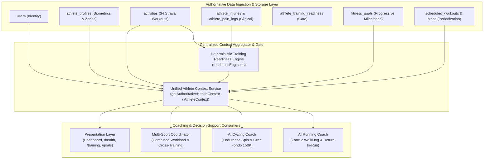

# Coach Data Dependency Map & Unified Context Architecture

**Status:** CONFIRMED & AUDITED  
**Version:** 1.0  
**Audit Date:** 2026-11-03  
**Auditor:** Principal AI Systems Architect & Sports Science Data Engineer  
**Scope:** Running Coach, Cycling Coach, Multi-Sport Coordinator & Athlete Context  
**Related Documents:** [athlete-data-audit.md](./athlete-data-audit.md), [existing-database-reconciliation.md](./existing-database-reconciliation.md)

---

## 1. Architectural Concept: Unified Athlete Context

All coaching engines—whether AI Running Coach, AI Cycling Coach, or Multi-Sport Coordinator—**MUST consume from a single authoritative Athlete Context service** rather than building isolated or conflicting data models.



---

## 2. Coach-by-Coach Data Dependency Matrix

| Data Domain / Entity | Running Coach | Cycling Coach | Multi-Sport Coordinator | Authoritative Database Source |
| :--- | :---: | :---: | :---: | :--- |
| **Identity & Account ID** | Required | Required | Required | `users.id` |
| **Physical Biometrics (Weight, Height, BMI)** | Required (Impact g calc) | Required (W/kg baseline) | Required | `athlete_profiles` |
| **Resting & Maximum Heart Rate** | Required (HR zones) | Required (Aerobic threshold) | Required | `athlete_profiles.resting_heart_rate`, `users.max_heart_rate` |
| **Physiological Zones (LTHR, VO2max, FTP)** | Required (Threshold pace) | Required (Power zones) | Required | `athlete_profiles.physiological_measurements` |
| **Active Goals & Deadlines** | Required (Running targets) | Required (Cycling targets) | Required (Priority arbitration) | `fitness_goals` |
| **Progressive Milestone Status** | Required (e.g. Marathon 42K) | Required (Century Ride 100K) | Required | `fitness_goals.is_achieved` |
| **Recent Training Telemetry (7d / 28d)** | Required (Running volume) | Required (Cycling volume) | Required (Combined ACWR) | `activities` |
| **Pace Trends & Speed Progression** | Required | Required | Supporting | `activities.average_speed_mps` |
| **Sport-Specific Readiness Status** | **MANDATORY (`ON_HOLD`)** | **MANDATORY (`CONDITIONAL`)**| **MANDATORY** | `athlete_training_readiness` |
| **Clinical Injury History** | **MANDATORY** (Ankle, Knees) | **MANDATORY** (Knees) | **MANDATORY** | `athlete_injuries` |
| **Clinician Restrictions** | **ABSOLUTE OVERRIDE** | **ABSOLUTE OVERRIDE** | **ABSOLUTE OVERRIDE** | `athlete_injuries.clinician_restrictions` |
| **Post-Session Pain Check-ins** | Required | Required | Required | `athlete_pain_logs` |
| **Session RPE & Fatigue Response** | Required | Required | Required | `athlete_training_responses` |
| **Scheduled Periodization Calendar** | Required | Required | Required (Calendar balancing)| `scheduled_workouts`, `training_plans` |
| **Planned vs Actual Delta Adherence** | Required | Required | Required | `workout_activity_matches` |

---

## 3. Data Provenance & Verification Hierarchy

To prevent subjective interpretations or hallucinations from corrupting training recommendations, data within the Athlete Context is tagged with its provenance level:

```text
Level 1: CLINICIAN_CONFIRMED  -> Absolute authority. Cannot be overridden by AI or athlete self-reports.
Level 2: SENSOR_VERIFIED      -> Authentic Strava GPS, heart-rate, power meter, or cadence telemetry.
Level 3: ATHLETE_REPORTED     -> Subjective RPE, pain score (0-10), symptoms, weight, self-reported availability.
Level 4: DERIVED_ANALYTICS    -> Deterministic math (ACWR ratio, weekly volume deltas, PR detection).
Level 5: AI_RECOMMENDATION    -> Advisory prescriptions strictly bounded by Level 1 and Level 2 data.
```

### Inviolable Safety Overrides
1. **Medical Clearance Boundary**: If `athlete_injuries.medical_evaluation_status = 'PENDING_CLINICAL_ASSESSMENT'` or active clinician restrictions exist, the Running Coach is **strictly forbidden** from generating high-impact running progression.
2. **Asymmetric Loading Permission**: Cycling Coach may prescribe non-impact seated rides ($\le 30$ km, flat terrain, 85–95 RPM) even while Running Coach is on hold, provided `athlete_pain_logs.pain_score <= 2/10`.
3. **Multi-Sport Volume Arbiter**: If the athlete completes an unscheduled 30 km cycling session, the Multi-Sport Coordinator must automatically calculate the acute fatigue response and adjust the next day's workout to protect recovery, rather than allowing both coaches to independently schedule full sessions.

---

## 4. Multi-Sport Extensibility Blueprint

When new endurance sports modules are activated, they plug directly into this unified context without modifying the database architecture:

```text
+---------------------+-------------------------------+-----------------------------------+
| Sport Module        | Key Telemetry Consumed        | Primary Biomechanical Gate        |
+---------------------+-------------------------------+-----------------------------------+
| AI Running Coach    | Distance, Pace, Cadence, HR   | Impact tolerance on ankle & knee  |
| AI Cycling Coach    | Distance, Speed, Watts, RPM   | Non-impact torque & knee flexion  |
| AI Swimming Coach   | Distance, Swolf, Stroke Rate  | Shoulder joint mobility & rotator |
| AI Strength Coach   | Reps, Sets, Estimated 1RM     | Lumbar spine & eccentric load     |
| AI Hiking Coach     | Elevation D+, Grade, Pack Wt  | Ankle stability on uneven terrain |
+---------------------+-------------------------------+-----------------------------------+
```
All modules derive athlete state from `src/lib/db/healthRepo.ts` and `src/lib/readinessEngine.ts`.

