# Arsitektur Decoupled Multi-Agent AI Coach: Spesifikasi Mesin Mandiri 33 Cabor

- **Tanggal Rilis**: 2026-11-17 14:55:00 WIB
- **Pola Arsitektur**: **Decoupled Domain-Driven Multi-Agent Micro-Engines**
- **Aturan Non-Negosiasi**: **Setiap cabor memiliki AI Engine mandiri; DILARANG DIGABUNG (Anti-Monolith)**
- **Lokasi Dokumen**: `docs/11-ai/03-ARSITEKTUR_DECOUPLED_MULTI_AGENT_AI_COACH.md`

---

## 1. Prinsip Desain: Anti-Monolith & Domain Isolation

Dalam arsitektur perangkat lunak modern dan rekayasa kecerdasan buatan, menggabungkan domain yang berbeda ke dalam satu model monolitik generic ("One Coach to Rule Them All") menyebabkan kegagalan katastropik:
1. **Halusinasi Metrik Silang**: Menghitung kalori angkat beban dengan formula VO2max lari maraton, atau menyarankan deload 50 km lari untuk atlet tinju yang sedang memotong berat badan.
2. **Degradasi Konteks Prompt**: Token konteks terbuang untuk aturan olahraga yang tidak relevan, menurunkan akurasi inferensi.
3. **Rigiditas Perubahan**: Mengubah model pemulihan hamstring pesepak bola berisiko merusak model pemulihan bahu perenang.

Solusi arsitektural yang diterapkan adalah **Decoupled Multi-Agent AI Coaching Architecture**:

```mermaid
flowchart TD
    Ingress[Sensor / User Telemetry Ingress] --> Router[Multi-Sport Telemetry Coordinator & Router]

    subgraph Klaster1 [Klaster 1: Pure Cyclic Endurance Engines]
        A1[Distance Running AI Coach]
        A2[Road Cycling AI Coach]
        A3[MTB XC AI Coach]
        A4[Swimming AI Coach]
        A5[Rowing AI Coach]
        A6[Triathlon AI Coach]
    end

    subgraph Klaster2 [Klaster 2: Maximum Strength & Power Engines]
        B1[Powerlifting SBD AI Coach]
        B2[Olympic Weightlifting AI Coach]
        B3[Calisthenics AI Coach]
        B4[Strongman AI Coach]
        B5[Bodybuilding AI Coach]
    end

    subgraph Klaster3 [Klaster 3: Combat & Martial Arts Engines]
        C1[Boxing AI Coach]
        C2[MMA AI Coach]
        C3[BJJ & Grappling AI Coach]
        C4[Pencak Silat AI Coach]
        C5[Judo AI Coach]
        C6[Muay Thai AI Coach]
    end

    subgraph Klaster4 [Klaster 4: Team Field & Court Engines]
        D1[Football Soccer AI Coach]
        D2[Basketball AI Coach]
        D3[Volleyball AI Coach]
        D4[Futsal AI Coach]
        D5[Rugby AI Coach]
        D6[Field Hockey AI Coach]
    end

    subgraph Klaster5 [Klaster 5: Racquet & Precision Engines]
        E1[Badminton AI Coach]
        E2[Tennis AI Coach]
        E3[Table Tennis AI Coach]
        E4[Archery AI Coach]
        E5[Shooting AI Coach]
    end

    subgraph Klaster6 [Klaster 6: Functional & Extreme Engines]
        F1[CrossFit / Hyrox AI Coach]
        F2[Sport Climbing AI Coach]
        F3[Gymnastics AI Coach]
        F4[Surfing AI Coach]
        F5[Skateboarding AI Coach]
    end

    Router -->|sport_code == RUNNING| A1
    Router -->|sport_code == CYCLING| A2
    Router -->|sport_code == POWERLIFTING| B1
    Router -->|sport_code == BOXING| C1
    Router -->|sport_code == FOOTBALL| D1
    Router -->|sport_code == BADMINTON| E1
    Router -->|sport_code == CLIMBING| F2

    A1 --> SafePrescription[Grounded Evidence-Based Athlete Prescription]
    B1 --> SafePrescription
    C1 --> SafePrescription
    D1 --> SafePrescription
    E1 --> SafePrescription
    F2 --> SafePrescription
```



---

## 2. Kontrak Antarmuka Standar Agen Cabor (`ISportCoachAgent`)

Setiap agen cabor **wajib** mengimplementasikan kontrak interface murni TypeScript berikut secara independen:

```typescript
export interface SportTelemetryPayload<TData = Record<string, unknown>> {
  sessionId: string;
  athleteId: string;
  sportCode: string; // e.g. 'SPORT_POWERLIFTING', 'SPORT_BOXING'
  timestamp: string;
  durationMinutes: number;
  sessionRpe: number; // Skala Foster 1 - 10
  sportSpecificMetrics: TData; // Tipe spesifik per cabor
  subjectiveSymptoms?: {
    painLocations: string[];
    painScoreScale10: number;
    jointInstabilityReported: boolean;
    swellingObserved: boolean;
  };
}

export interface SportPrescriptionOutput {
  coachIdentity: string; // e.g. "Olympic Weightlifting Technical AI Coach"
  governingStandard: string; // e.g. "IWF & NSCA Essentials (4th Ed)"
  workloadScore: {
    externalLoad: number; // Metrik eksternal (Tonase, KM, Jumps, dsb.)
    externalUnit: string;
    internalStrain: number; // Regangan metabolik/neuromuskular
    internalMethod: 'TRIMP_BANISTER' | 'SESSION_RPE_FOSTER' | 'NEUROMUSCULAR_TONNAGE' | 'PLAYER_LOAD_AU';
  };
  safetyCircuitBreakers: {
    isProgressiveOverloadAllowed: boolean;
    haltDirectives: string[];
    contraindicatedMovements: string[];
    rehabilitationAlternative: string;
  };
  periodizationDirective: {
    mesocyclePhase: string;
    targetIntensityZone: string;
    recommendedRestHours: number;
    nextSessionPrescription: string;
  };
  nutritionalPrescription: {
    carbohydrateTargetGramsPerKg: number;
    proteinTargetGramsPerKg: number;
    hydrationElectrolyteProtocol: string;
    supplementationEvidenceTierA: string[];
  };
}

export interface ISportCoachAgent<TData = Record<string, unknown>> {
  readonly sportCode: string;
  readonly sportNameId: string;
  readonly primaryEnergySystem: 'OXIDATIVE' | 'PHOSPHAGEN_ATP_PC' | 'ANAEROBIC_GLYCOLYTIC' | 'MIXED_INTERMITTENT';

  // 1. Parsing & Validasi Telemetri Spesifik Cabor
  validateAndParseTelemetry(payload: SportTelemetryPayload<TData>): boolean;

  // 2. Komputasi Beban Fisiologis & Mekanis Khusus
  computeSportSpecificLoad(payload: SportTelemetryPayload<TData>): { external: number; internal: number };

  // 3. Evaluasi Gerbang Keamanan & Cedera Spesifik Anatomi
  evaluateBiomechanicalSafety(payload: SportTelemetryPayload<TData>): { isSafe: boolean; violations: string[] };

  // 4. Sintesis Preskripsi Berbasis Bukti Ilmiah (Evidence-Based)
  generatePrescription(payload: SportTelemetryPayload<TData>): Promise<SportPrescriptionOutput>;
}
```

---

## 3. Spesifikasi Arsitektur 6 Klaster Cabor Mandiri

### A. Klaster 1: Pure Cyclic Endurance Engine
- **Mesin Komputasi Utama**: Model Impuls-Respons Banister TRIMP & Normalized Graded Pace (NGP) / Normalized Power (NP).
- **Formula Beban Internal**:
  $$\text{TRIMP} = D \times \frac{\text{HR}_{\text{ex}} - \text{HR}_{\text{rest}}}{\text{HR}_{\text{max}} - \text{HR}_{\text{rest}}} \times 0.64 e^{1.92 \left(\frac{\text{HR}_{\text{ex}} - \text{HR}_{\text{rest}}}{\text{HR}_{\text{max}} - \text{HR}_{\text{rest}}}\right)}$$
- **Logika Pencegahan Cedera**:
  - Pelari: Pemantauan rasio beban mingguan (maksimal kenaikan jarak 10% per minggu / *Acute:Chronic Workload Ratio* < 1.3).
  - Perenang: Pemantauan rasio volume gaya bebas vs gaya punggung (*rotator cuff anterior:posterior balance*).

### B. Klaster 2: Maximum Strength & Power Engine
- **Mesin Komputasi Utama**: Volume Load (Tonase) + Velocity-Based Training (VBT) + Repetitions in Reserve (RIR).
- **Formula Beban Eksternal**:
  $$\text{Tonnage} = \sum_{i=1}^{n} (\text{Sets}_i \times \text{Reps}_i \times \text{Load}_i)$$
- **Formula Beban Neuromuskular Relatif (INOL - Intensity Number of Lifts)**:
  $$\text{INOL} = \sum \frac{\text{Reps}}{100 - \%1\text{RM}}$$
  *(INOL > 2.0 per minggu pada satu pola gerak memicu alarm overtraining sistem saraf pusat / CNS).*
- **Logika Pencegahan Cedera**:
  - Powerlifting: Menolak peningkatan beban jika terjadi deviasi lutut (*valgus collapse*) atau fleksi tulang belakang lumbal saat *concentric sticking point*.
  - Weightlifting: Memantau kelelahan *wrist extension* dan kedalaman mobilitas pergelangan kaki (*ankle dorsiflexion*).

### C. Klaster 3: High-Intensity Combat & Martial Arts Engine
- **Mesin Komputasi Utama**: Work-to-Rest Round Density + Sparring Contact Telemetry + High-Speed Footwork Recovery.
- **Formula Beban Intermiten**:
  $$\text{Combat Load (AU)} = \text{Session RPE (1-10)} \times \text{Active Rounds Duration (Menit)}$$
- **Protokol Keselamatan Kritis (Concussion Safety Circuit Breaker)**:
  - Mengimplementasikan **SCAT6 (*Sport Concussion Assessment Tool 6th Edition*) Protocols**: Jika atlet melaporkan benturan kepala keras, sakit kepala, atau pusing pasca-sparring $\to$ **MANDATORY 14-DAY SUSPENSION FROM SPARRING**, hanya diizinkan jalan kaki ringan tanpa beban aksial.

### D. Klaster 4: Intermittent Multi-Directional Team Field & Court Engine
- **Mesin Komputasi Utama**: Player Load Tri-Axial Accelerometry + Acute:Chronic Workload Ratio (ACWR oleh Tim Gabbett).
- **Formula Beban**:
  $$\text{ACWR} = \frac{\text{Acute Workload (Beban 7 Hari Terakhir)}}{\text{Chronic Workload (Rata-rata 28 Hari Terakhir)}}$$
  - *Sweet Spot*: $0.8 \le \text{ACWR} \le 1.3$ (Risiko cedera minimal, kebugaran optimal).
  - *Danger Zone*: $\text{ACWR} \ge 1.5$ (Risiko robekan hamstring/tendon patela meningkat 300–400%!).
- **Logika Pencegahan Cedera**:
  - Integrasi protokol pencegahan cedera **FIFA 11+** dan *Nordic Hamstring Curl volume tracking*.

### E. Klaster 5: Racquet, High-Velocity Reaction & Precision Sports Engine
- **Mesin Komputasi Utama**: Rally Length Kinematics + Jump Smash Counter + Explosive Lateral Lunge Frequency.
- **Logika Pencegahan Cedera**:
  - Bulu Tangkis: Deteksi kelelahan mendarat satu kaki (*single-leg landing after round-the-head smash*). Jika jump count melebihi 150 kali dalam satu sesi, kunci sesi plyometrik pada 48 jam berikutnya untuk melindungi tendon Achilles.
  - Panahan/Menembak: Pemantauan getaran isometrik postural (*tremor stability index*) dan kelelahan trapezius superior.

### F. Klaster 6: Functional Fitness, Anaerobic Capacity & Extreme Sports Engine
- **Mesin Komputasi Utama**: Mixed-Modal Density Rate (Work per Minute) + Blood Lactate Clearance Proxy.
- **Logika Keselamatan Kritis**:
  - **Rhabdomyolysis Prevention**: Deteksi beban eksentrik volume tinggi berulang (misal: 100+ pull-ups, GHD sit-ups, atau jumping lunges dalam cuaca panas).
  - Jika urin berwarna gelap atau nyeri otot ekstrem muncul $\to$ **EMERGENCY MEDICAL GATE (Halt All Workouts, Immediate Medical Urinalysis)**.
  - Panjat Tebing: Pemantauan ketat beban katrol jari (*A2/A4 pulley tendon strain*). Batasi sesi *campus board* dan *crimp* maksimal 2 kali per minggu.

---

## 4. Struktur Database & Skema Terisolasi

Untuk memastikan data tidak tercampur aduk, setiap cabor memiliki tabel telemetri khusus atau JSONB ber-skema tervalidasi Zod (*Zod-validated domain schemas*):

```sql
-- Skema Tabel Log Aktivitas Terisolasi Multi-Cabor
CREATE TABLE sport_activity_telemetry (
  id UUID PRIMARY KEY DEFAULT gen_random_uuid(),
  user_id UUID NOT NULL REFERENCES users(id) ON DELETE CASCADE,
  sport_code VARCHAR(50) NOT NULL, -- e.g. 'SPORT_POWERLIFTING'
  session_timestamp TIMESTAMPTZ NOT NULL,
  duration_minutes INTEGER NOT NULL,
  session_rpe NUMERIC(3,1) NOT NULL, -- Foster RPE 1-10
  
  -- Payload spesifik cabor (divalidasi oleh Zod schema per cabor)
  telemetry_data JSONB NOT NULL,
  
  -- Output hasil analisa agen cabor
  agent_prescription JSONB NOT NULL,
  
  created_at TIMESTAMPTZ DEFAULT NOW()
);

-- Indeks performa untuk per cabor query
CREATE INDEX idx_sport_telemetry_user_code ON sport_activity_telemetry(user_id, sport_code);
```
