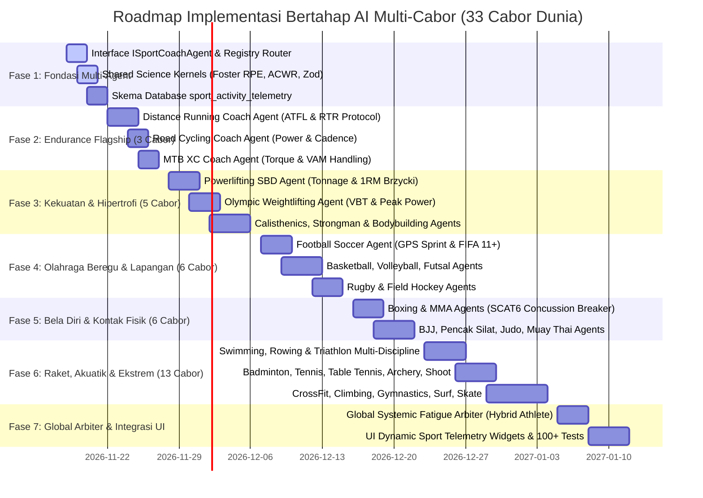

# Roadmap Implementasi Bertahap: Arsitektur AI Multi-Cabor Olahraga (33 Cabor)

- **Tanggal Rilis**: 2026-11-18 09:55:00 WIB
- **Pola Rekayasa**: **Multi-Phase Incremental Rollout (Zero-Regression Policy)**
- **Standar Arsitektur**: **Clean Architecture, Decoupled Domain-Driven Agents, Strict < 300 Lines/File**
- **Lokasi Dokumen**: `docs/11-ai/07-ROADMAP_IMPLEMENTASI_BERTAHAP.md`

---

## 🏛️ 1. Diagram Alur & Timeline Implementasi (Execution Roadmap)

---

## 🎯 2. Rincian Eksekusi Per Fase

---

### FASE 1: Fondasi Multi-Agent Infrastructure & Shared Science Kernels

- **Tujuan Utama**: Membangun fondasi perangkat lunak *decoupled*, kontrak antarmuka universal, registri router cabor, dan skema penyimpanan terisolasi tanpa menyentuh kestabilan sistem eksisting.
- **Deliverables Rekayasa**:
  1. [`src/lib/domain/coach/agents/contracts.ts`](file:///c:/Users/MyBook%20Hype%20AMD/OneDrive/Documents/kerja/_code/project_strava/src/lib/domain/coach/agents/contracts.ts): Deklarasi interface murni `ISportCoachAgent`, `SportTelemetryPayload`, dan `SportPrescriptionOutput`.
  2. [`src/lib/domain/coach/agents/SportCoordinatorRouter.ts`](file:///c:/Users/MyBook%20Hype%20AMD/OneDrive/Documents/kerja/_code/project_strava/src/lib/domain/coach/agents/SportCoordinatorRouter.ts): Router dengan pattern *Registry & Factory* yang memetakan kode cabor (`sportCode`) ke agen yang tepat.
  3. [`src/lib/domain/coach/kernels/`](file:///c:/Users/MyBook%20Hype%20AMD/OneDrive/Documents/kerja/_code/project_strava/src/lib/domain/coach/kernels/): Modul pustaka sains bersama:
     - `fosterSessionRpeKernel.ts` (Kalkulasi Training Load AU).
     - `gabbettAcwrKernel.ts` (Rasio Beban Akut:Kronis 7/28 hari).
     - `issurinBlockPeriodizationKernel.ts` (Manajemen fase Akumulasi, Transmutasi, Realisasi).
  4. Skema Database Terisolasi: Penambahan tabel `sport_activity_telemetry` pada PostgreSQL dan sinkronisasi fallback di `store.json`.
- **Exit Criteria**:
  - `npx tsc --noEmit` lolos 0 error.
  - Test suite baru: `scripts/tests/test_multi_sport_coordinator.js` lulus 100%.
  - Zero regression: 88/88 test cases eksisting tetap hijau.

---

### FASE 2: Decoupled Endurance Flagship (Running, Road Cycling, MTB XC)

- **Tujuan Utama**: Merefaktor logika cabor lari dan sepeda yang saat ini monolitik di `aiCoachEngine.ts` ke dalam agen terisolasi pertama, sekaligus menambahkan cabor *Road Cycling* dan *MTB XC* secara mandiri.
- **Cabor Tercover (3 Cabor)**:
  1. `SPORT_DISTANCE_RUNNING`: `DistanceRunningCoachAgent.ts`
  2. `SPORT_ROAD_CYCLING`: `RoadCyclingCoachAgent.ts`
  3. `SPORT_MTB_XC`: `MtbXcCoachAgent.ts`
- **Fitur Khusus per Agen**:
  - **Running**: Integrasi penuh *Return-to-Run (RTR)* 4-fase, batas kenaikan jarak mingguan 10%, dan *Biological Circuit Breaker* proteksi ligamen pergelangan kaki (*Right Ankle ATFL*).
  - **Road Cycling**: Komputasi Normalized Power (NP), Watts/kg, pedaling cadence efficiency (>85 RPM), dan deplesi glikogen per 60 menit.
  - **MTB XC**: Torsi tanjakan curam (*low cadence high torque strain*), pemantauan elevasi VAM (*Vertical Ascent in Meters/Hour*), dan proteksi sendi patela.
- **Exit Criteria**:
  - Seluruh file agen berukuran **< 300 baris**.
  - Rute `/coach/cycling` dan `/coach/running` menggunakan agen baru tanpa merusak UI.

---

### FASE 3: Klaster Kekuatan & Daya Maksimal (Strength, Power & Hypertrophy)

- **Tujuan Utama**: Menghadirkan kapabilitas AI Coaching untuk cabor beban dan kekuatan yang 100% non-aerobik (didominasi jalur fosfagen ATP-PCr dan glikolitik anaerobik).
- **Cabor Tercover (5 Cabor)**:
  4. `SPORT_POWERLIFTING`: `PowerliftingCoachAgent.ts` (Squat, Bench Press, Deadlift).
  5. `SPORT_WEIGHTLIFTING`: `OlympicWeightliftingCoachAgent.ts` (Snatch, Clean & Jerk).
  6. `SPORT_CALISTHENICS`: `CalisthenicsCoachAgent.ts` (Bodyweight Strength & Skill Levers).
  7. `SPORT_STRONGMAN`: `StrongmanCoachAgent.ts` (Heavy Carries & Axial Loads).
  8. `SPORT_BODYBUILDING`: `BodybuildingCoachAgent.ts` (Hypertrophy Volume & Hard Sets).
- **Formula Sains & Logika Unik**:
  - **Volume Load (Tonase)**: $\sum (\text{Sets} \times \text{Reps} \times \text{Beban})$.
  - **Formula Estimasi 1RM Brzycki**: $\text{1RM} = \text{Load} \times (1 + \text{Reps}/30)$ untuk repetisi $\le 10$.
  - **INOL Limiter**: Batas intensitas kumulatif mingguan (< 2.0 per pola gerak) untuk mencegah kelelahan sistem saraf pusat (CNS).
  - **Circuit Breaker Biomekanika**: Deteksi kelelahan fleksi lumbal dan valgus lutut saat mendekati *failure* (RIR 0).
- **Exit Criteria**:
  - Uji validasi tonase dan estimasi 1RM tanpa fabrikasi angka palsu.

---

### FASE 4: Klaster Olahraga Beregu & Lapangan Intermiten (Team Field & Court)

- **Tujuan Utama**: Menghadirkan analitik akselerasi-deselerasi, pola lari *Repeated Sprint Ability (RSA)*, dan pencegahan cedera berbasis gerakan multi-arah (*multi-directional movement*).
- **Cabor Tercover (6 Cabor)**:
  9. `SPORT_FOOTBALL`: `FootballCoachAgent.ts` (Sepak Bola).
  10. `SPORT_BASKETBALL`: `BasketballCoachAgent.ts` (Bola Basket).
  11. `SPORT_VOLLEYBALL`: `VolleyballCoachAgent.ts` (Bola Voli).
  12. `SPORT_FUTSAL`: `FutsalCoachAgent.ts` (Futsal Lapangan Keras).
  13. `SPORT_RUGBY`: `RugbyCoachAgent.ts` (Rugby Union/Sevens).
  14. `SPORT_FIELD_HOCKEY`: `FieldHockeyCoachAgent.ts` (Hoki Lapangan).
- **Formula Sains & Logika Unik**:
  - **Pemantauan High-Speed Running (HSR)**: Segmentasi lari berkecepatan tinggi (>19.8 km/h) dan sprint (>25.2 km/h).
  - **Gabbett ACWR Alert**: Mengunci beban sprint jika rasio akut:kronis melompat $>1.5$.
  - **Pencegahan Cedera Terintegrasi**: Protokol pencegahan cedera ligamen lutut dan hamstring berbasis **FIFA 11+** dan *Nordic Hamstring Curvatures*.
- **Exit Criteria**:
  - Simulasi pertandingan 90 menit dan evaluasi pemulihan 48 jam pasca-laga.

---

### FASE 5: Klaster Bela Diri & Olahraga Kontak (Combat & Martial Arts)

- **Tujuan Utama**: Menghadirkan pemantauan densitas ronde, toleransi asam laktat darah tinggi, dan penegakan ketat protokol gegar otak.
- **Cabor Tercover (6 Cabor)**:
  15. `SPORT_BOXING`: `BoxingCoachAgent.ts` (Tinju).
  16. `SPORT_MMA`: `MmaCoachAgent.ts` (Mixed Martial Arts).
  17. `SPORT_BJJ`: `BjjCoachAgent.ts` (Brazilian Jiu-Jitsu & Grappling).
  18. `SPORT_PENCAK_SILAT`: `PencakSilatCoachAgent.ts` (Pencak Silat Tanding & Seni).
  19. `SPORT_JUDO`: `JudoCoachAgent.ts` (Judo & Sambo).
  20. `SPORT_MUAY_THAI`: `MuayThaiCoachAgent.ts` (Muay Thai & Kickboxing).
- **Formula Sains & Logika Unik**:
  - **Deterministic Concussion Circuit Breaker (SCAT6)**: Jika atlet melaporkan benturan kepala keras dengan pusing atau disorientasi, AI **wajib mengunci status kesiapan selama 14 hari** dari seluruh aktivitas kontak.
  - **Pemantauan Pemotongan Berat Badan (*Weight-Cut Safety*)**: Membatasi defisit cairan akut maksimal 2–3% massa tubuh; menolak keras penurunan air ekstrem yang membahayakan fungsi ginjal dan cairan serebrospinal otak.
- **Exit Criteria**:
  - Pengujian unit memverifikasi bahwa AI tidak dapat dipaksa mengizinkan sparring jika protokol SCAT6 aktif.

---

### FASE 6: Klaster Raket, Presisi, Akuatik & Kebugaran Fungsional (13 Cabor)

- **Tujuan Utama**: Melengkapi seluruh taksonomi 33 cabor dunia dengan agen-agen spesialisasi tinggi.
- **Cabor Tercover (13 Cabor)**:
  - *Akuatik & Multi-Sport*:
    21. `SPORT_SWIMMING`: `SwimmingCoachAgent.ts` (SWOLF, Stroke Rate, Subacromial Impingement).
    22. `SPORT_ROWING`: `RowingCoachAgent.ts` (500m Split Pace, Drive/Catch, Rib Stress Alert).
    23. `SPORT_TRIATHLON`: `TriathlonCoachAgent.ts` (Brick Transition, Multi-Substrate Depletion).
  - *Raket & Presisi*:
    24. `SPORT_BADMINTON`: `BadmintonCoachAgent.ts` (Jump Smash Count, Achilles Strain).
    25. `SPORT_TENNIS`: `TennisCoachAgent.ts` (Rotational Torque, Tennis Elbow Guardrail).
    26. `SPORT_TABLE_TENNIS`: `TableTennisCoachAgent.ts` (Reaction Speed ms, Wrist Sprain).
    27. `SPORT_ARCHERY`: `ArcheryCoachAgent.ts` (Draw Weight x Volume, Tremor Index).
    28. `SPORT_SHOOTING`: `ShootingCoachAgent.ts` (Postural Tremor, Parasympathetic Heart Rate Dip).
  - *Kebugaran Fungsional & Ekstrem*:
    29. `SPORT_FUNCTIONAL_FITNESS`: `FunctionalFitnessCoachAgent.ts` (AMRAP Density, Rhabdomyolysis Alarm).
    30. `SPORT_CLIMBING`: `SportClimbingCoachAgent.ts` (A2/A4 Finger Pulley Strain, Hangboard TUT).
    31. `SPORT_GYMNASTICS`: `GymnasticsCoachAgent.ts` (Peak G-Landing, Spondylolysis Spine Alert).
    32. `SPORT_SURFING`: `SurfingCoachAgent.ts` (Paddle Volume, Wave Pop-up Reaction).
    33. `SPORT_SKATEBOARDING`: `SkateboardingCoachAgent.ts` (Pop Height, Wrist Fracture Protection).
- **Exit Criteria**:
  - Seluruh 33 agen terdaftar aktif pada `SportCoordinatorRouter`.
  - 100% agen memiliki unit test mandiri.

---

### FASE 7: Global Systemic Fatigue Arbiter & Hybrid Multi-Sport Athlete Integration

- **Tujuan Utama**: Menghubungkan agen-agen mandiri ke level komando global untuk atlet yang melakukan latihan silang (*cross-training* / atlet hibrida).
- **Deliverables Rekayasa**:
  1. [`GlobalSystemicFatigueArbiter.ts`](file:///c:/Users/MyBook%20Hype%20AMD/OneDrive/Documents/kerja/_code/project_strava/src/lib/domain/coach/GlobalSystemicFatigueArbiter.ts): Mengintegrasikan beban dari berbagai cabor menggunakan **Session-RPE Foster Normalization** dan **Resting Heart Rate Deviation** tanpa kontaminasi silang aturan lokal.
  2. Resolusi Konflik Preskripsi: Jika atlet baru saja menyelesaikan sesi beban maksimal (Squat 90% 1RM), agen lari otomatis mengubah sesi hari berikutnya dari *tempo run* menjadi *low-impact recovery walk*.
- **Exit Criteria**:
  - Pengujian simulasi atlet hybrid (MMA + Lari 30 km + Angkat Beban 2x) menghasilkan preskripsi yang harmonis dan mencegah cedera overtraining.

---

### FASE 8: UI Ingress, Telemetry Widgets & Full Production Deployment

- **Tujuan Utama**: Menyajikan pengalaman visual interaktif berstandar *Obsidian Telemetry* untuk seluruh cabor pada antarmuka aplikasi.
- **Deliverables Antarmuka**:
  1. Modal Pemilih Cabor Dinamis pada `AddActivityModal`: Menampilkan field telemetri yang relevan sesuai cabor yang dipilih (misal: Tonase untuk Powerlifting, Rounds untuk Boxing, Jarak/Pace untuk Lari).
  2. Widget KPI Khusus Cabor pada Halaman `/activities` dan `/profile`.
  3. Dashboard Multi-Sport Radar Chart pada `/dashboard`.
- **Exit Criteria**:
  - `npm run build` sukses 34/34 rute dengan Next.js 16.4.6 dan Turbopack.
  - `npm run test:all` lulus 100% tanpa error.
  - Seluruh file di `src/` tetap patuh ketat **< 300 baris**.

---

## 📊 Matriks Ringkasan Roadmap & Dependensi

| Fase | Fokus Cabor / Modul | Jumlah Agen Baru | Target Durasi | Kriteria Keberhasilan Utama |
| :---: | :--- | :---: | :---: | :--- |
| **Fase 1** | Fondasi Multi-Agent & Shared Kernels | 0 (Arsitektur Inti) | 3 Hari | Router `ISportCoachAgent` lolos unit test; 88 tes lama tetap hijau. |
| **Fase 2** | Endurance Flagship (Lari, Sepeda Jalan, MTB) | 3 Agen | 5 Hari | Refaktor bersih tanpa regresi; proteksi ATFL tetap aktif. |
| **Fase 3** | Kekuatan & Daya Maksimal (Powerlifting, dll.) | 5 Agen | 7 Hari | Kalkulasi Tonase, 1RM Brzycki, dan INOL < 2.0 berfungsi presisi. |
| **Fase 4** | Olahraga Beregu (Sepak Bola, Basket, dll.) | 6 Agen | 7 Hari | ACWR Gabbett & mitigasi cedera FIFA 11+ terintegrasi. |
| **Fase 5** | Bela Diri & Kontak (Tinju, MMA, BJJ, Silat, dll.) | 6 Agen | 7 Hari | Protokol Gegar Otak SCAT6 mengunci 14 hari istirahat deterministik. |
| **Fase 6** | Raket, Presisi, Akuatik & Ekstrem (13 Cabor) | 13 Agen | 10 Hari | Seluruh 33 cabor dunia terdaftar dan beroperasi mandiri. |
| **Fase 7** | Global Fatigue Arbiter (Atlet Hybrid) | Arbiter Engine | 4 Hari | Beban multi-cabor atlet hibrida terharmonisasi tanpa benturan. |
| **Fase 8** | Antarmuka Pengguna (UI) & Final Hardening | UI Widgets & Polish | 5 Hari | Turbopack build sukses, 100% tes lulus, semua file < 300 baris. |

---

## 🛡️ Tata Kelola Arsitektur & Aturan Non-Negosiasi

1. **Aturan 300 Baris (*Strict Line Limit*)**: Tidak ada file agen atau komponen UI yang boleh menyentuh $\ge$ 300 baris kode. Jika kode mendekati 250 baris, pecah kalkulator matematisnya ke dalam direktori `kernels/`.
2. **Anti-AI-Slop Governance**: Tidak boleh mengarang angka metrik tanpa sensor nyata. Gunakan status `UNKNOWN` jika metrik fisiologis belum dikalibrasi di laboratorium.
3. **Pemberitahuan Medis Terbuka**: Seluruh saran pencegahan cedera wajib menyertakan rujukan klinis dan batasan bahwa AI bukan pengganti dokter spesialis kedokteran olahraga.
