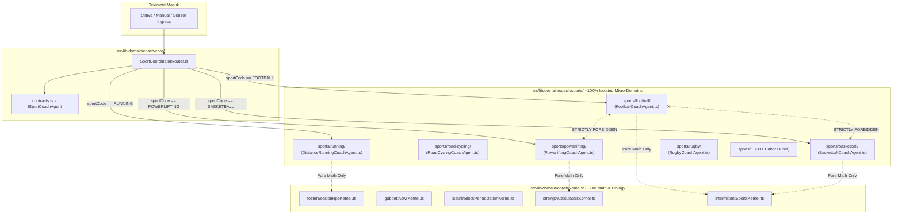

# Spesifikasi Arsitektur Clean: Vertical Slice per Cabang Olahraga (Anti-Monolith & High Cohesion)

- **Tanggal Rilis**: 2026-11-18 19:55:00 WIB
- **Pola Arsitektur**: **Vertical Slice Architecture by Sport (Clean Domain-Driven Slices)**
- **Status**: **CONFIRMED & AUDITED**
- **Klasifikasi**: Software Architecture, Clean Code, Anti-Slop Domain Engineering
- **Lokasi Dokumen**: `docs/11-ai/08-SPESIFIKASI_ARSITEKTUR_CLEAN_VERTICAL_SLICE_CABOR.md`

---

## 1. Latar Belakang & Evaluasi Kritis Arsitektur

### A. Masalah Struktur Flat (`agents/` Direktori Tunggal)
Pada fase awal pengembangan AI Multi-Cabor (Phase 1 hingga Phase 4), seluruh agen cabor diletakkan dalam satu direktori flat di [`src/lib/domain/coach/agents/`](file:///c:/Users/MyBook%20Hype%20AMD/OneDrive/Documents/kerja/_code/project_strava/src/lib/domain/coach/agents/). Seiring bertambahnya cabor:
- **Phase 2**: 3 agen endurance
- **Phase 3**: 5 agen kekuatan & daya
- **Phase 4**: 6 agen cabor beregu lapangan & gelanggang
- Terdapat 17 berkas bercampur dalam satu folder (termasuk kontrak dan router).

Ketika sistem diperluas ke seluruh 33 cabor dunia (Phase 5, 6, dan 7), struktur flat ini akan membengkak menjadi **>36 berkas**, yang menimbulkan masalah serius:
1. **Tingginya Beban Kognitif (*High Cognitive Load*)**: Pengembang dan auditor sains kesulitan menemukan berkas spesifik suatu cabor di tengah puluhan berkas sejenis.
2. **Pelanggaran *Screaming Architecture***: Struktur folder tidak langsung mencerminkan nama cabang olahraganya.
3. **Risiko Polusi Import Silang**: Berkas yang berada di satu folder rentan diimpor silang secara keliru antar cabor yang berbeda karakteristik biologisnya.

---

### B. Evaluasi Kritis Opsi 1 (Klastering Makro Fisiologis)
Pada awalnya dipertimbangkan pengelompokan cabor ke dalam subfolder klaster besar seperti:
`agents/endurance/`, `agents/strength/`, dan `agents/team/`.

**Mengapa Opsi 1 Ditolak:**
1. **Mengaburkan Identitas Mandiri Cabor**: Menyatukan Sepak Bola, Bola Basket, Futsal, dan Rugby ke dalam folder `team/` masih merupakan bentuk penggabungan cabor (*semi-monolithic grouping*).
2. **Menyulitkan Audit Independen**: Jika seorang fisioterapis atau dokter tim ingin mengaudit protokol cedera *Jumper's Knee* pada Bola Basket, mereka tetap harus menyortir berkas di antara kode Sepak Bola dan Rugby.
3. **Melanggar Prinsip Dasar Pengguna**: Sejak awal instruksi menyatakan: *"setiap cabor jangan digabung, buatkan ai untuk masing-masing cabor secara mandiri"*.

---

### C. Komparasi Mendalam: Opsi 2 (Hexagonal) vs Opsi 3 (Vertical Slice)

| Dimensi Arsitektur | Opsi 2: Hexagonal (Ports & Adapters) | Opsi 3: Vertical Slice Architecture by Sport |
| :--- | :--- | :--- |
| **Batas Domain Cabor** | Cabor tersembunyi sebagai `adapters/*`, terpisah dari ports di layer lain. | **Setiap cabor memiliki folder sendiri (`sports/<cabor>/`)**. Sangat eksplisit. |
| **Isolasi Domain (*Anti-Monolith*)** | Cabor terisolasi teknis, namun terikat kontrak port global yang kaku. | **100% Mandiri**. Setiap cabor memiliki siklus hidup dan evolusi independen. |
| **Kemudahan Audit Sains & Medis** | Harus melacak berkas di `ports/`, `adapters/`, dan `mappers/`. | **Sangat Cepat & Intuitif**. Cukup membuka satu folder cabor yang dituju. |
| **Overhead & Kompleksitas Kode** | Tinggi (*boilerplate* interface port dan mapper perantara). | **Rendah & Berkinerja Tinggi** (*Direct, High Cohesion, Low Coupling*). |
| **Pencegahan Redundansi Rumus** | Rumus sains dapat diisolasi di core domain. | **Sangat Bersih via `kernels/`** (Shared Scientific Engines). |
| **Kepatuhan Batas < 300 Baris** | Menghasilkan terlalu banyak berkas kecil (<30 baris). | **Sangat Alami & Ramping** (160–210 baris per agen cabor). |

**Keputusan Arsitektural**: **OPSI 3 (Vertical Slice Architecture by Sport) ditetapkan sebagai arsitektur resmi**.

---

## 2. Prinsip Rekayasa Vertical Slice Multi-Cabor

Arsitektur ini mengadopsi 5 aturan non-negosiasi:



### 1. Prinsip 1: Total Isolation per Cabor (Screaming Folder by Sport)
Setiap cabor mendapatkan foldernya sendiri di bawah `src/lib/domain/coach/sports/<nama-cabor>/`. Tidak ada dua cabor yang berbagi folder yang sama.

### 2. Prinsip 2: Zero Inter-Sport Coupling (Larangan Impor Silang Antar-Cabor)
Folder `sports/football/` **DILARANG KERAS** mengimpor kode, tipe, atau logika dari `sports/basketball/`, `sports/running/`, atau cabor lainnya. Setiap cabor harus dapat dihapus, diganti, atau di-refactor secara independen tanpa menimbulkan efek samping (*zero side-effects*) pada cabor lain.

### 3. Prinsip 3: Shared Pure Scientific Kernels (`kernels/`)
Hukum fisika, matematika, dan biologi olahraga universal (seperti Banister TRIMP, Foster sRPE, Gabbett ACWR, Brzycki 1RM, Bradley HSR) **bukan milik satu cabor**. Rumus-rumus ini ditempatkan di [`src/lib/domain/coach/kernels/`](file:///c:/Users/MyBook%20Hype%20AMD/OneDrive/Documents/kerja/_code/project_strava/src/lib/domain/coach/kernels/) sebagai fungsi murni (*pure mathematical functions*). Agen cabor mana pun boleh mengimpor fungsi kernel murni ini.

### 4. Prinsip 4: Central Orchestration & Routing (`core/`)
Infrastruktur orkestrasi global (kontrak antarmuka `ISportCoachAgent`, penanganan keamanan BOLA, dan `SportCoordinatorRouter`) dipusatkan di `src/lib/domain/coach/core/`. Agen cabor tidak perlu mengetahui detail routing sistem; mereka hanya mengimplementasikan kontrak yang ditentukan.

### 5. Prinsip 5: Zero Breaking Changes via Root Facade
Untuk menjaga kompatibilitas penuh dengan rute API (`src/app/api/...`) dan seluruh 184 pengujian otomatis yang ada, berkas fasad di [`src/lib/domain/coach/agents/index.ts`](file:///c:/Users/MyBook%20Hype%20AMD/OneDrive/Documents/kerja/_code/project_strava/src/lib/domain/coach/agents/index.ts) mengekspor ulang seluruh modul dari `core/` dan `sports/`.

---

## 3. Cetak Biru Struktur Direktori (*Target Directory Map*)

```
src/lib/domain/coach/
│
├── core/                                      # 🏛️ Kontrak & Orkestrator Sistem Sentral
│   ├── contracts.ts                           # Interface universal (ISportCoachAgent, Telemetry, Output)
│   ├── SportCoordinatorRouter.ts              # Router registry & dynamic dispatcher
│   └── index.ts                               # Re-export fondasi orkestrasi
│
├── kernels/                                   # 🔬 Shared Pure Scientific Math Engines
│   ├── fosterSessionRpeKernel.ts              # sRPE, AU, Monotony, Strain (Foster 1998)
│   ├── gabbettAcwrKernel.ts                   # Acute:Chronic Workload Ratio (Gabbett 2016)
│   ├── issurinBlockPeriodizationKernel.ts     # Issurin Block Periodization (Issurin 2008)
│   ├── strengthCalculatorsKernel.ts           # 1RM Brzycki, Volume Tonase, Sheiko INOL
│   └── intermittentSportsKernel.ts            # Bradley HSR, Catapult PlayerLoad, FIFA 11+
│
└── sports/                                    # 🎯 VERTICAL SLICES PER CABOR (100% MANDIRI)
    │
    ├── running/                               # 🏃 01. Distance Running (Lari Jarak Jauh)
    │   ├── DistanceRunningCoachAgent.ts
    │   └── index.ts
    │
    ├── road-cycling/                          # 🚴 02. Road Cycling (Balap Sepeda Jalan Raya)
    │   ├── RoadCyclingCoachAgent.ts
    │   └── index.ts
    │
    ├── mtb-xc/                                # 🚵 03. Mountain Biking Cross-Country
    │   ├── MtbXcCoachAgent.ts
    │   └── index.ts
    │
    ├── powerlifting/                          # 🏋️ 04. Powerlifting (SBD)
    │   ├── PowerliftingCoachAgent.ts
    │   └── index.ts
    │
    ├── weightlifting/                         # 🏋️ 05. Olympic Weightlifting (Angkat Besi)
    │   ├── OlympicWeightliftingCoachAgent.ts
    │   └── index.ts
    │
    ├── calisthenics/                          # 🤸 06. Calisthenics & Street Workout
    │   ├── CalisthenicsCoachAgent.ts
    │   └── index.ts
    │
    ├── strongman/                             # 🗿 07. Strongman & Heavy Carries
    │   ├── StrongmanCoachAgent.ts
    │   └── index.ts
    │
    ├── bodybuilding/                          # 💪 08. Bodybuilding & Hypertrophy
    │   ├── BodybuildingCoachAgent.ts
    │   └── index.ts
    │
    ├── football/                              # ⚽ 09. Football / Soccer (11v11)
    │   ├── FootballCoachAgent.ts
    │   └── index.ts
    │
    ├── basketball/                            # 🏀 10. Basketball (5v5 & 3x3)
    │   ├── BasketballCoachAgent.ts
    │   └── index.ts
    │
    ├── volleyball/                            # 🏐 11. Volleyball (Indoor & Beach)
    │   ├── VolleyballCoachAgent.ts
    │   └── index.ts
    │
    ├── futsal/                                # 👟 12. Futsal (Indoor Court 5v5)
    │   ├── FutsalCoachAgent.ts
    │   └── index.ts
    │
    ├── rugby/                                 # 🏉 13. Rugby Union / League / Sevens
    │   ├── RugbyCoachAgent.ts
    │   └── index.ts
    │
    ├── field-hockey/                          # 🏑 14. Field Hockey (Hoki Lapangan)
    │   ├── FieldHockeyCoachAgent.ts
    │   └── index.ts
    │
    ├── boxing/                                # 🥊 15. Boxing (Siap Phase 5)
    ├── mma/                                   # 🥋 16. Mixed Martial Arts (Siap Phase 5)
    ├── bjj/                                   # 🥋 17. Brazilian Jiu-Jitsu (Siap Phase 5)
    ├── pencak-silat/                          # 🥋 18. Pencak Silat (Siap Phase 5)
    ├── judo/                                  # 🥋 19. Judo (Siap Phase 5)
    ├── muay-thai/                             # 🥊 20. Muay Thai (Siap Phase 5)
    │
    ├── badminton/                             # 🏸 21. Badminton (Siap Phase 6)
    ├── tennis/                                # 🎾 22. Tennis (Siap Phase 6)
    ├── table-tennis/                          # 🏓 23. Table Tennis (Siap Phase 6)
    ├── archery/                               # 🏹 24. Archery (Siap Phase 6)
    ├── shooting/                              # 🎯 25. Sport Shooting (Siap Phase 6)
    ├── swimming/                              # 🏊 26. Swimming (Siap Phase 6)
    ├── rowing/                                # 🚣 27. Rowing (Siap Phase 6)
    ├── triathlon/                             # 🏊🚴🏃 28. Triathlon (Siap Phase 6)
    │
    ├── crossfit-hyrox/                        # 🏋️🏃 29. Functional Fitness (Siap Phase 7)
    ├── climbing/                              # 🧗 30. Sport Climbing / Bouldering (Siap Phase 7)
    ├── gymnastics/                            # 🤸 31. Artistic Gymnastics (Siap Phase 7)
    ├── surfing/                               # 🏄 32. Surfing (Siap Phase 7)
    ├── skateboarding/                         # 🛹 33. Skateboarding (Siap Phase 7)
    │
    └── index.ts                               # 🌐 Master Registry & Automatic Ingress Bootstrap
```

---

## 4. Standar Berkas di Dalam Setiap Vertical Slice Cabor

Setiap folder `src/lib/domain/coach/sports/<sport>/` memiliki struktur internal minimal yang seragam:

### 1. `<SportName>CoachAgent.ts`
- Implementasi kelas murni yang mengimplementasikan interface `ISportCoachAgent`.
- Memiliki konstanta `sportCode` dan array `supportedAliases`.
- Menerapkan method `canHandle(sportCode: string): boolean`.
- Menjalankan evaluasi telemetri khusus cabor:
  - Ekstraksi parameter spesifik cabor.
  - Pengecekan sirkuit pemutus keamanan cedera (*Biomechanical Circuit Breaker*).
  - Penghitungan beban sesi dan rekomendasi pemulihan berbasis sains.
- **Wajib patuh batas < 300 baris kode per berkas**.

### 2. `index.ts`
- Berkas *barrel export* yang mengekspor agen cabor tersebut.
- Menyediakan fungsi bootstrapping registrasi mandiri, misalnya:
  ```typescript
  export * from './FootballCoachAgent';
  export function registerFootballAgent(router: SportCoordinatorRouter): void {
    if (!router.hasAgent('SPORT_FOOTBALL')) {
      router.registerAgent(new FootballCoachAgent());
    }
  }
  ```

---

## 5. Protokol Migrasi & Jaminan Nol Kerusakan (*Zero Regression Protocol*)

Untuk memastikan migrasi dari struktur lama ke Vertical Slice berjalan aman tanpa mematahkan kode produksi atau pengujian yang sudah berjalan:

1. **Pemisahan Inti Orkestrasi**:
   Pindahkan `contracts.ts` dan `SportCoordinatorRouter.ts` ke dalam `src/lib/domain/coach/core/`.
2. **Pembentukan Direktori Slices**:
   Bentuk folder `sports/<cabor>/` untuk ke-14 agen cabor yang telah teruji (Phase 2, 3, dan 4).
3. **Penyelarasan Master Facade (`src/lib/domain/coach/agents/index.ts`)**:
   Pertahankan berkas `src/lib/domain/coach/agents/index.ts` sebagai *backward-compatible bridge*:
   ```typescript
   export * from '../core';
   export * from '../sports';
   ```
4. **Verifikasi Otomatis 100%**:
   Jalankan `npm run test:all` untuk membuktikan seluruh **184 pengujian** tetap lulus hijau (`184 passed, 0 failed`) dan kompilasi `npm run build` tetap bersih.
