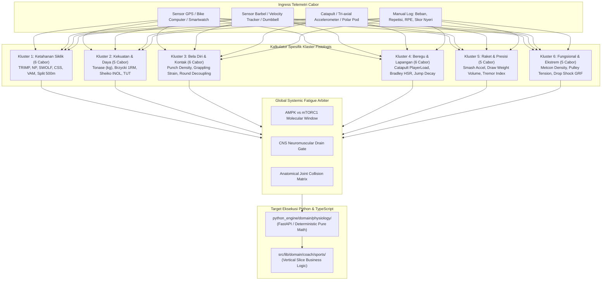
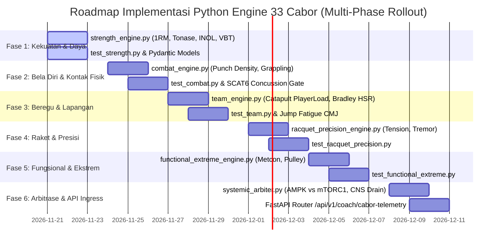

# Spesifikasi Formula & Kalkulasi Matematis 33 Cabang Olahraga Dunia

- **Tanggal Rilis**: 2026-11-21 09:30:00 WIB
- **Klasifikasi**: Sports Science Mathematics, Exercise Physiology & Deterministic Biomechanics
- **Status**: **CONFIRMED & AUTHORITATIVE**
- **Cakupan**: 33 Cabang Olahraga Dunia Lintas 6 Klaster Fisiologis + Universal Arbiter
- **Lokasi Dokumen**: `docs/11-ai/09-SPESIFIKASI_FORMULA_DAN_KALKULASI_MATEMATIS_33_CABOR.md`

---

## 1. Filosofi Rekayasa: Matematika Fisiologis Anti-Halusinasi

Dalam ilmu kepelatihan atletik presisi (*High-Performance Sports Science*), seluruh rekomendasi latihan harus diturunkan secara deterministik dari hukum bioenergetika, kinetika kontraksi otot, dan patomekanika cedera. Sistem `a-coach` secara tegas menolak fabrikasi angka generik atau pengabaian konteks spesifik cabang olahraga.

Dokumen ini menjadi **buku pedoman matematika resmi** (*authoritative mathematical manual*) yang menjabarkan seluruh rumus kalkulasi beban, ambang batas fisiologis, dan indikator keselamatan untuk **33 cabang olahraga dunia** yang terbagi ke dalam **6 klaster fisiologis**, serta mekanisme arbitrase hibrida lintas cabang olahraga.



---

## 2. Kluster 1: Pure Cyclic Endurance (6 Cabang Olahraga)

Olahraga dalam klaster ini didominasi oleh pergerakan siklik kontinu (*cyclic motion*), ketergantungan tinggi pada kapasitas mitokondria, dan metabolisme lipid/glikogen oksidatif.

### 01. Lari Jarak Jauh & Maraton (`SPORT_DISTANCE_RUNNING`)

1. **Graded Adjusted Pace (GAP)**:
   Mengonversi kecepatan aktual pada tanjakan/turunan menjadi kecepatan setara pada medan datar berdasarkan biaya metabolik Minetti (2002):
   $$GAP = v \times \left(1 + 0.045 \times G + 0.0035 \times G^2\right)$$
   di mana $v$ adalah kecepatan ($m/s$) dan $G$ adalah gradien elevasi fraksional ($\Delta\text{elevasi} / \Delta\text{jarak}$).
2. **Ground Contact Time (GCT) Balance & Asymmetry Index**:
   $$GCT_{\text{asymmetry}} = \frac{|GCT_{\text{left}} - GCT_{\text{right}}|}{\max(GCT_{\text{left}}, GCT_{\text{right}})} \times 100\%$$
   *Ambang Batas*: Jika $GCT_{\text{asymmetry}} > 3.0\%$, kunci penambahan volume karena risiko cedera tendonitis Achilles / ITBS meningkat $2.4\times$.
3. **Aerobic Decoupling ($Pa:Hr$)**:
   $$\Delta EF = \frac{EF_{\text{half1}} - EF_{\text{half2}}}{EF_{\text{half1}}} \times 100\%, \quad EF = \frac{\text{Speed (m/min)}}{\text{Average Heart Rate (bpm)}}$$
   *Toleransi*: $\Delta EF \le 5.0\%$ menandakan fondasi aerobik solid. Jika $> 5.0\%$, sesi melebihi kapasitas glikogen aerobik saat ini.

### 02. Balap Sepeda Jalan Raya (`SPORT_ROAD_CYCLING`)

1. **Coggan Normalized Power (NP)**:
   $$NP = \sqrt[4]{\frac{1}{N} \sum_{i=1}^{N} \left(P_{\text{smooth, 30s}}\right)^4}$$
2. **Intensity Factor ($IF$) & Training Stress Score ($TSS$)**:
   $$IF = \frac{NP}{FTP}, \quad TSS = \frac{t \times NP \times IF}{FTP \times 3600} \times 100$$
   di mana $t$ adalah durasi bergerak dalam detik dan $FTP$ adalah *Functional Threshold Power* dalam watt.
3. **Variability Index (VI)**:
   $$VI = \frac{NP}{\bar{P}_{\text{avg}}}$$
   *Kriteria Taktis*: $VI \le 1.05$ (Time Trial / Steady Pace), $VI \ge 1.20$ (Criterium / Rolling Race).

### 03. Sepeda Gunung Cross-Country (`SPORT_MTB_XC`)

1. **Mechanical Torque Surge Index ($TSI$)**:
   Mengukur frekuensi hentakan torsi tinggi saat menanjak medan berbatu/akar:
   $$TSI = \frac{\sum_{i=1}^{m} \text{Duration}(P_i > 1.5 \times FTP \land \text{Cadence}_i < 65\text{ rpm})}{T_{\text{total}}}$$
2. **VAM (Velocità Ascensionale Media)**:
   $$VAM = \frac{\Delta\text{Elevation (m)}}{t\text{ (seconds)}} \times 3600 \quad [\text{meter vertikal / jam}]$$

### 04. Renang Prestasi (`SPORT_SWIMMING`)

1. **SWOLF Score (Efficiency Index)**:
   $$SWOLF = t_{\text{lap}}\text{ (detik)} + \text{Stroke Count}$$
   *Interpretasi*: Penurunan angka SWOLF pada kecepatan yang sama mengindikasikan perbaikan hidrodinamika kayuhan.
2. **Critical Swim Speed (CSS)**:
   $$CSS = \frac{D_2 - D_1}{T_2 - T_1} = \frac{400\text{ m} - 200\text{ m}}{T_{400} - T_{200}} \quad [m/s]$$
   Menjadi acuan zona pace Z1–Z5 renang per 100 meter.

### 05. Dayung & Ergometer (`SPORT_ROWING`)

1. **Concept2 Split Pace Normalization**:
   $$P_{\text{watts}} = 2.80 \times \left(\frac{500}{t_{500}}\right)^3$$
2. **Drive-to-Recovery Time Ratio ($DRR$)**:
   Rasio fasa dorongan tungkai-punggung vs fasa meluncur pemulihan: target ideal $1 : 2.0$. Nilai $< 1 : 1.5$ menandakan terburu-buru (*rushing the slide*) yang membebani diskus lumbal L4-S1.

### 06. Triathlon & Multi-Sport (`SPORT_TRIATHLON`)

1. **Brick Transition Neuromuscular Penalty**:
   Menghitung degradasi *running economy* sesaat setelah bersepeda:
   $$\text{Penalty}_{\text{brick}} = \frac{Pace_{\text{first 3km off-bike}}}{Pace_{\text{fresh baseline Zone 2}}}$$
2. **Cumulative Glycogen Expenditure**:
   $$\text{Glycogen}_{\text{spent}} = \left(TSS_{\text{swim}} \times 0.6\right) + \left(TSS_{\text{bike}} \times 0.8\right) + \left(TSS_{\text{run}} \times 1.0\right)$$

---

## 3. Kluster 2: Maximum Strength, Power & Hypertrophy (5 Cabang Olahraga)

Olahraga dalam klaster ini menuntut rekrutmen unit motorik ambang tinggi (*High-Threshold Motor Units*), kontraksi eksentrik/konsentrik intensitas maksimal, dan dominasi jalur kreatin fosfat (ATP-PCr).

### 07. Powerlifting SBD (`SPORT_POWERLIFTING`)

1. **Volume Tonase Kumulatif ($V_{\text{tonase}}$)**:
   $$V_{\text{tonase}} = \sum_{i=1}^{S} \left(\text{Sets}_i \times \text{Reps}_i \times \text{Load}_i\text{ [kg]}\right)$$
2. **Formula Estimasi 1RM (Brzycki)**:
   $$1RM_{\text{Brzycki}} = \frac{w}{1.0278 - (0.0278 \times r)}$$
   di mana $w$ adalah beban angkatan (kg) dan $r$ adalah repetisi valid ($r \le 10$).
3. **Sheiko INOL (Intensity of Number of Lifts)**:
   $$INOL_{\text{set}} = \frac{\text{Reps}}{100 - \%1RM}, \quad INOL_{\text{session}} = \sum INOL_{\text{set}}$$
   - *INOL $< 2.0$*: Beban ringan / pemulihan.
   - *INOL $2.0 - 3.2$*: Beban kerja adaptif ideal mingguan per gerakan (Squat/Bench/Deadlift).
   - *INOL $> 4.0$*: Kelelahan kritis; risiko cedera avulsi tendon / herniasi tulang belakang.

### 08. Angkat Besi Olimpiade (`SPORT_WEIGHTLIFTING`)

1. **Peak Barbell Mechanical Power**:
   $$P_{\text{peak}} = (m_{\text{bar}} + m_{\text{athlete}}) \times (g + a_{\text{vertical}}) \times v_{\text{vertical}}$$
2. **Bar Velocity Threshold Cut-off**:
   Jika kecepatan tarikan kedua (*second pull velocity*) turun $> 10\%$ dari repetisi pertama, set dihentikan untuk mencegah kegagalan *catch* yang membahayakan pergelangan tangan dan meniskus.

### 09. Kalistenik & Street Workout (`SPORT_CALISTHENICS`)

1. **Biomechanical Lever Torque**:
   $$\tau = m_{\text{body}} \times g \times L_{\text{lever}} \times \sin(\theta)$$
   di mana $L_{\text{lever}}$ memanjang secara progresif dari *Tuck Planche* $\to$ *Advanced Tuck* $\to$ *Straddle* $\to$ *Full Planche*.
2. **Time Under Tension (TUT) Isometrik**:
   Beban dihitung berdasarkan akumulasi detik pada posisi penahanan (*hold*) di ambang RPE $\ge 8$.

### 10. Strongman & Heavy Carries (`SPORT_STRONGMAN`)

1. **Axial Compressive Load**:
   $$\text{Stress}_{\text{axial}} = \text{Beban Ekstra (kg)} \times \text{Jarak Tempuh (meter)} \times \text{Koefisien Elevasi/Gait}$$
2. **Grip Failure Margin**:
   Rasio durasi angkat terhadap waktu *drop* maksimal tangan.

### 11. Binaraga & Hipertrofi (`SPORT_BODYBUILDING`)

1. **Weekly Effective Hard Sets**:
   Hitungan set valid yang diselesaikan dalam jarak $RIR \le 3$ (Reps in Reserve):
   $$\text{Target Volume} = 10 - 20\text{ hard sets / muscle group / week}$$
2. **Proximity to Failure Fatigue Index**:
   Set yang dilakukan hingga *failure* absolut ($RIR = 0$) membutuhkan waktu pemulihan lokal $1.8\times$ lebih lama dibanding set dengan $RIR = 2$.

---

## 4. Kluster 3: High-Intensity Combat Sports & Martial Arts (6 Cabang Olahraga)

Menuntut semburan balistik cepat, ketahanan isometrik kuncian lantai (*grappling*), toleransi asam laktat tinggi, dan kapasitas menahan benturan mekanis.

### 12. Tinju (`SPORT_BOXING`)

1. **Punch Density per Round**:
   $$\text{Punch Density} = \frac{\text{Total Pukulan Diluncurkan}}{\text{Durasi Efektif Ronde (menit)}}$$
2. **Work-to-Rest Bioenergetic Ratio**:
   Standar ronde 3 menit kerja : 1 menit jeda ($W:R = 3 : 1$).
3. **Head Impact Exposure Gate**:
   Jika atlet menjalani sparring keras dengan $> 15$ benturan kepala signifikan, aktifkan protokol wajib istirahat kontak 7 hari (protokol SCAT6 / gegar otak).

### 13. Mixed Martial Arts (`SPORT_MMA`)

1. **Striking vs Grappling Workload Partitioning**:
   $$\text{Load}_{\text{MMA}} = \left(t_{\text{standup}} \times RPE_{\text{strike}} \times 1.0\right) + \left(t_{\text{mat}} \times RPE_{\text{grapple}} \times 1.35\right)$$
   *Bobot 1.35x mencerminkan kontraksi isometrik leher, punggung, dan deplesi glikogen saat gulat.*

### 14. Brazilian Jiu-Jitsu (`SPORT_BJJ`)

1. **Isometric Mat Tension Index**:
   Perhitungan menit berguling (*rolling minutes*) dikalikan intensitas guard/pressure passing.
2. **Cervical & Lumbar Strain Quotient**:
   Deteksi posisi *inversion* dan penumpuan leher (*stacking*) untuk membatasi frekuensi sparring berturut-turut.

### 15. Pencak Silat (`SPORT_PENCAK_SILAT`)

1. **Sweeping Angular Velocity ($v_{\text{sweep}}$)**:
   Kecepatan sudut tungkai bawah saat melancarkan teknik sapuan/guntingan.
2. **Stance Shift Stability Rate**:
   Frekuensi transisi kuda-kuda dinamis per babak (2 menit).

### 16. Judo & Sambo (`SPORT_JUDO`)

1. **Throwing Kinetic Output**:
   $$\text{Work}_{\text{nage-waza}} = \sum_{i=1}^{n} (m_{\text{partner}} \times g \times \Delta h_{\text{throw}})$$
2. **Breakfall Shock Absorption Accumulation**:
   Total bantingan yang diterima atlet (*ukemi*) sebagai pembatas beban banturan sendi bahu dan tulang belakang.

### 17. Muay Thai & Kickboxing (`SPORT_MUAY_THAI`)

1. **Tibial Impact Cumulative Stress**:
   $$\text{Stress}_{\text{tibia}} = \text{Jumlah Tendangan Roundhouse (Heavy Bag / Pads / Sparring)} \times \text{Intensitas}$$
   *Pencegahan*: Batasi tendangan tulang kering tanpa pelindung tebal jika ada riwayat periostitis.

---

## 5. Kluster 4: Intermittent Team, Field & Court Sports (6 Cabang Olahraga)

Olahraga dalam klaster ini memiliki karakteristik intermiten: lari cepat multidireksional, rem mendadak (*high deceleration*), lonjakan, dan kontak fisik.

### 18. Sepak Bola (`SPORT_FOOTBALL`)

1. **Catapult Tri-Axial PlayerLoad**:
   $$PL = \sqrt{\frac{(a_{y, t} - a_{y, t-1})^2 + (a_{x, t} - a_{x, t-1})^2 + (a_{z, t} - a_{z, t-1})^2}{100}}$$
2. **Bradley High-Speed Running (HSR)**:
   $$D_{\text{HSR}} = \sum \text{Distance at } v \in [19.8\text{ km/h}, 25.1\text{ km/h}]$$
   $$D_{\text{sprint}} = \sum \text{Distance at } v > 25.2\text{ km/h}$$
   *Proteksi Hamstring*: Lonjakan $D_{\text{sprint}} > 15\%$ dibanding rata-rata 4 pekan memicu alarm risiko robekan biseps femoris.

### 19. Bola Basket (`SPORT_BASKETBALL`)

1. **Jump Count & Landing Shock Index**:
   $$E_{\text{jump}} = \sum_{j=1}^{J} (m_{\text{athlete}} \times g \times h_{\text{jump}, j} \times \text{Landing Factor})$$
   *Landing Factor* = 1.0 (Dua kaki stabil), 1.8 (Satu kaki deselerasi cepat).
2. **Jumper's Knee (Patellar Tendinopathy) Warning**:
   Jika $J > 60$ lonjakan intensitas tinggi dalam 1 sesi, batasi latihan pliometrik selama 48 jam.

### 20. Bola Voli (`SPORT_VOLLEYBALL`)

1. **Countermovement Jump (CMJ) Height Decay**:
   $$\Delta h_{\text{CMJ}} = \frac{h_{\text{post-match}} - h_{\text{pre-match}}}{h_{\text{pre-match}}} \times 100\%$$
   Penurunan $> 8\%$ mengindikasikan kelelahan neuromuskular perifer.
2. **Spike Shoulder Internal Rotation Workload**:
   Total pukulan *smash* dan servis mengambang per set pertandingan.

### 21. Futsal (`SPORT_FUTSAL`)

1. **Micro-Deceleration Shock Rate**:
   Frekuensi deselerasi tajam ($a < -3.0\text{ m/s}^2$) di lapangan keras per 10 menit bermain. Beban eksentrik kuadrisep $1.5\times$ lebih padat dibanding sepak bola rumput.

### 22. Rugbi (`SPORT_RUGBY`)

1. **High-G Collision Count**:
   Total tubrukan terukur dengan akselerasi instan $> 5g$.
2. **Repeated High-Intensity Efforts (RHIE)**:
   Klaster minimal 3 upaya sprint, tackle, atau kontes bola dengan jeda $< 21$ detik.

### 23. Hoki Lapangan (`SPORT_FIELD_HOCKEY`)

1. **Lumbar Flexion Posture Time**:
   Durasi berlari dalam postur membungkuk sudut tulang belakang $< 45^\circ$, sebagai prediktor kelelahan erektor spina dan otot gluteus.

---

## 6. Kluster 5: Racquet & Precision Sports (5 Cabang Olahraga)

Menuntut rantai kinetik ekstrem pada ekstremitas atas, lunge asimetris, dan fokus neuromuskular tanpa getaran (*tremor control*).

### 24. Bulu Tangkis (`SPORT_BADMINTON`)

1. **Jump Smash Angular Energy**:
   Puncak kecepatan kepala raket ($v > 300\text{ km/h}$) dan gaya redam pendaratan lunge satu tungkai kanan.
2. **Lateral Shuttle Acceleration Metric**:
   Pergantian arah mendadak 6 titik sudut lapangan (*six-corner footwork strain*).

### 25. Tenis Lapangan (`SPORT_TENNIS`)

1. **Kinetic Chain Shoulder Rotation Load**:
   Akumulasi rotasi internal bahu pada servis flat/kick keras:
   $$\text{Load}_{\text{serve}} = \sum (\text{Speed}_{\text{km/h}} \times \text{Kinetic Factor})$$
2. **Rally Duration Strain**:
   Distribusi reli $> 8$ pukulan vs reli pendek $< 4$ pukulan.

### 26. Tenis Meja (`SPORT_TABLE_TENNIS`)

1. **Forehand Loop Rotational Impulse**:
   Kecepatan putaran bola (*RPM spin rate*) yang dihasilkan dari kombinasi panggul dan lengan bawah.
2. **High-Frequency Step-Work Density**:
   Frekuensi lompatan langkah kecil (*side-to-side micro steps*) di depan meja.

### 27. Panahan (`SPORT_ARCHERY`)

1. **Total Cumulative Draw Weight Volume**:
   $$V_{\text{archery}} = \text{Draw Weight (lbs)} \times \text{Jumlah Anak Panah Diluncurkan}$$
   *Contoh*: 120 panah dengan busur 42 lbs = **5.040 lbs** (~2.286 kg) tegangan yang ditahan bahu, trapezius, dan rotator cuff.
2. **Hold Tremor Amplitude Index**:
   Penyimpangan getaran tangan busur saat menahan tarikan fasa *anchor* sebelum *clicker* berbunyi.

### 28. Menembak Presisi (`SPORT_SHOOTING`)

1. **Cardio-Somatic Diastolic Synchronization**:
   Konsistensi pelepasan picu tembakan tepat pada fase istirahat detak jantung (*late diastole*):
   $$\text{Sync Rate} = \frac{\text{Tembakan di Fase Diastolik}}{\text{Total Tembakan}} \times 100\%$$
2. **Postural Sway Degradation**:
   Pelebaran radius goyangan pusat gravitasi tubuh (*Center of Pressure*) setelah sesi berdurasi $> 60$ menit.

---

## 7. Kluster 6: Functional Fitness & Extreme Sports (5 Cabang Olahraga)

Olahraga dalam klaster ini menuntut kapasitas kerja metabolik campuran, ketahanan tendon jari ekstrem, kelenturan akrobatik, atau adaptasi lingkungan dinamis.

### 29. Kebugaran Fungsional (CrossFit / Hyrox) (`SPORT_FUNCTIONAL_FITNESS`)

1. **Metcon Power Output & Transition Penalty**:
   $$\text{Metcon Power} = \frac{\text{Total Work Done (Joules)}}{t_{\text{workout}} - t_{\text{transitions}}}$$
2. **Interference Load (Metabolic + Resistance Combined)**:
   Penggabungan simultan asam laktat darah tinggi dengan beban kompresi sendi aksial.

### 30. Panjat Tebing & Bouldering (`SPORT_CLIMBING`)

1. **Finger Flexor Pulley (A2/A4) Tension Load**:
   Gaya kompresi pada katrol tendon jari saat pegangan *closed crimp*:
   $$F_{\text{pulley}} = F_{\text{fingertip}} \times \text{Lever Factor} \quad (F_{\text{pulley}} \approx 3 - 4 \times F_{\text{fingertip}})$$
   *Safety Boundary*: Batasi volume *crimping* pada rute overhang jika jari terasa kaku di pagi hari.
2. **Drop Shock Ground Reaction Force (Bouldering)**:
   Puncak gaya tumbukan saat melompat dari dinding tinggi ke matras busa.

### 31. Senam Artistik (`SPORT_GYMNASTICS`)

1. **Peak Landing Reaction Force**:
   Daya benturan pendaratan dari palang tunggal / meja lompat ($GRF = 8 - 14\times$ bobot tubuh atlet).
2. **Ring Isometric Inversion Tension**:
   Beban stres tendon biseps distal pada manuver *Iron Cross* atau *Maltese*.

### 32. Selancar Ombak (`SPORT_SURFING`)

1. **Paddle-to-Wave Work Ratio**:
   $$\text{Surfing Work Ratio} = \frac{t_{\text{paddling}}}{t_{\text{wave riding}}} \quad (\text{Umumnya } 10 : 1 \text{ hingga } 15 : 1)$$
2. **Rotator Cuff Repetitive Paddle Strain**:
   Beban kompresi bahu saat mengayuh melawan arus pecah ombak (*breakline paddling*).

### 33. Skateboard (`SPORT_SKATEBOARDING`)

1. **Impact Shock Absorption (Stair Sets / Gaps)**:
   Gaya redam akselerasi vertikal pada lutut dan pergelangan kaki saat mendarat di permukaan beton.
2. **Ankle Inversion Shear Strain Index**:
   Torsi pergelangan kaki lateral saat melakukan trik putaran papan (*flip tricks*).

---

## 8. Arbitrase Lintas Cabor: Global Systemic Fatigue Arbiter

Jika seorang atlet berlatih lebih dari satu cabang olahraga (atlet hibrida), sistem tidak boleh mengevaluasi cabor secara terisolasi. Arbiter sentral menerapkan 3 hukum biologis universal:

### A. Jendela Interferensi Molekuler AMPK vs mTORC1

$$\Delta t_{\text{buffer}} \ge 6.0\text{ jam}$$

- Latihan ketahanan aerobik panjang mengaktifkan **AMPK** (meningkatkan biogenesis mitokondria, namun menekan sintesis protein otot).
- Latihan beban kekuatan maksimal mengaktifkan **mTORC1** (hipertrofi dan perbaikan serat otot).
- *Aturan*: Berikan jeda minimal 6 jam antara lari/sepeda jarak jauh dengan angkat beban hipertrofi untuk mencegah inhibisi molekuler adaptasi otot.

### B. Indeks Kelelahan Sistem Saraf Pusat (CNS Exhaustion Index)

$$CNS_{\text{drain}} = \sum_{c=1}^{k} \left(\text{Intensitas Ledakan}_c \times \text{Durasi}_c \times \text{CNS Coeff}_c\right)$$

- Cabor dengan *CNS Coeff* tertinggi ($1.0$): Angkat Besi Olimpiade, Powerlifting 1RM, Sprints $>25\text{ km/h}$, Pukulan Tinju Keras.
- *Aturan*: Jika $CNS_{\text{drain}} > \text{Ambang Batas Harian}$, tolak sesi eksplosif kedua di hari yang sama; alihkan ke pemulihan aktif aerobik Zona 1.

### C. Matriks Tubrukan Sendi Anatomis (Joint Collision Matrix)

| Sendi Rawan | Cabor Primer Berbenturan | Cabor Sekunder yang Harus Ditahan / Dimodifikasi |
| --- | --- | --- |
| **Lutut (Patelofemoral / Meniskus)** | Sepak Bola / Futsal / Basket (Deceleration Lunge) | Lari Turunan (*Downhill Running*) / Heavy Squats |
| **Bahu (Rotator Cuff / Labrum)** | Renang / Tenis (Overhead Serve) | Panahan Berat / Tinju Sparring / Angkat Besi Snatch |
| **Punggung Bawah (Lumbar Diskus)** | Powerlifting Deadlift / Rowing Ergometer | MTB XC Turunan Terjal / Strongman Farmer's Walk |
| **Engkel & Achilles** | Lari Jarak Jauh / Bulu Tangkis Lunge | Skateboard Gaps / Pliometrik Basket |

---

## 9. Arsitektur Komputasi: Porting ke Python Engine

Dokumentasi ini menjadi cetak biru implementasi komputasi deterministik di [`python_engine/`](file:///c:/Users/MyBook%20Hype%20AMD/OneDrive/Documents/kerja/_code/project_strava/python_engine/).

### Struktur Modul Target di Python

```
python_engine/domain/physiology/
├── banister_engine.py                 # Fisiologi Endurance (TRIMP, EWMA CTL/ATL, PMC) [Eksisting]
├── decoupling_engine.py               # Disosiasi Aerobik & Zone Compliance Index [Eksisting]
├── weekly_recap_calculator.py         # Foster sRPE, Monotony, Strain, Seiler 80/20 [Eksisting]
├── strength_engine.py                 # [FASE 1] 1RM Brzycki, Volume Tonase, Sheiko INOL, VBT
├── combat_engine.py                   # [FASE 2] Punch Density, Grappling Strain, Head Impact Gate
├── team_engine.py                     # [FASE 3] Catapult PlayerLoad, Bradley HSR, Jump Decay
├── racquet_precision_engine.py        # [FASE 4] Smash Accel, Draw Weight Tension, Tremor Index
├── functional_extreme_engine.py       # [FASE 5] Metcon Power, Finger Pulley Tension, Drop GRF
└── systemic_arbiter.py                # [FASE 6] AMPK vs mTORC1, CNS Drain, Joint Collisions
```

### Pemetaan Endpoint FastAPI (`python_engine/main.py`)

- `POST /api/v1/coach/cabor-telemetry`: Menghitung beban spesifik cabor berdasarkan kode cabor dan parameter telemetri input.
- `POST /api/v1/coach/hybrid-arbitration`: Mengevaluasi jadwal atlet hibrida dan memberikan peringatan interferensi molekuler serta tabrakan sendi.

---

## 10. Roadmap Implementasi Bertahap (Multi-Phase Rollout Plan)

Untuk mentransformasikan seluruh formula matematis di atas ke dalam kode komputasi nyata di `python_engine/` tanpa mengorbankan stabilitas sistem eksisting (*zero regression*), eksekusi dibagi ke dalam **6 Fase Rekayasa Bertahap**:



### Rincian Deliverables Tiap Fase

#### 🏋️ FASE 1: Mesin Fisiologi Kekuatan, Daya & Hipertrofi `[SELESAI / IMPLEMENTED]`

- **Target Modul**: [`python_engine/domain/physiology/strength_engine.py`](file:///c:/Users/MyBook%20Hype%20AMD/OneDrive/Documents/kerja/_code/project_strava/python_engine/domain/physiology/strength_engine.py) & [`test_strength.py`](file:///c:/Users/MyBook%20Hype%20AMD/OneDrive/Documents/kerja/_code/project_strava/python_engine/tests/test_strength.py) (8/8 Test Passed)
- **Cakupan Cabor**: Powerlifting, Angkat Besi Olimpiade, Kalistenik, Strongman, Binaraga.
- **Deliverables Rekayasa**:
  1. `calculate_brzycki_1rm(weight, reps)` & `calculate_epley_1rm(weight, reps)`
  2. `calculate_volume_tonnage(sets)`
  3. `calculate_sheiko_inol(reps, pct_1rm)` & `calculate_session_inol(sets, 1rm_map)`
  4. `evaluate_velocity_loss_cutoff(v_init, v_curr, threshold_pct)`
  5. `calculate_calisthenics_torque(bodyweight_kg, lever_length_m, angle_deg)`
  6. `evaluate_strength_fatigue(total_inol, total_tonnage, avg_rpe)`

#### 🥊 FASE 2: Mesin Fisiologi Bela Diri & Kontak Fisik `[SELESAI / IMPLEMENTED]`

- **Target Modul**: [`python_engine/domain/physiology/combat_engine.py`](file:///c:/Users/MyBook%20Hype%20AMD/OneDrive/Documents/kerja/_code/project_strava/python_engine/domain/physiology/combat_engine.py) & [`test_combat.py`](file:///c:/Users/MyBook%20Hype%20AMD/OneDrive/Documents/kerja/_code/project_strava/python_engine/tests/test_combat.py) (10/10 Test Passed)
- **Cakupan Cabor**: Tinju, MMA, BJJ, Pencak Silat, Judo, Muay Thai.
- **Deliverables Rekayasa**:
  1. `calculate_punch_density(total_punches, round_minutes)`
  2. `partition_mma_workload(standup_min, mat_min, rpe_strike, rpe_grapple)`
  3. `evaluate_concussion_scat6_gate(head_impacts, symptoms)`
  4. `calculate_throw_kinetic_work(partner_weight_kg, throw_count)`
  5. `calculate_tibial_impact_index(kick_count, intensity_multiplier)`
  6. `evaluate_bjj_strain(mat_time_minutes, avg_rpe, inversion_minutes)`
  7. `evaluate_combat_session(session)` & API `POST /calculate/coach/combat/evaluate`

#### ⚽ FASE 3: Mesin Fisiologi Beregu & Lapangan Intermiten `[SELESAI / IMPLEMENTED]`

- **Target Modul**: [`python_engine/domain/physiology/team_engine.py`](file:///c:/Users/MyBook%20Hype%20AMD/OneDrive/Documents/kerja/_code/project_strava/python_engine/domain/physiology/team_engine.py) & [`test_team.py`](file:///c:/Users/MyBook%20Hype%20AMD/OneDrive/Documents/kerja/_code/project_strava/python_engine/tests/test_team.py) (10/10 Test Passed)
- **Cakupan Cabor**: Sepak Bola, Bola Basket, Bola Voli, Futsal, Rugbi, Hoki Lapangan.
- **Deliverables Rekayasa**:
  6. `calculate_catapult_player_load(accel_series)`
  7. `partition_bradley_hsr(speed_samples_mps, sample_interval_s)`
  8. `evaluate_hamstring_strain_risk(sprint_dist, chronic_sprint)`
  9. `evaluate_jump_shock_load(athlete_weight_kg, jump_heights_m, single_leg_count)`
  10. `evaluate_cmj_decay(pre_match_cmj, post_match_cmj)`
  11. `evaluate_futsal_micro_decelerations(decel_count, duration_minutes)`
  12. `evaluate_rugby_collisions(high_g, severe_g, rhie)`
  13. `evaluate_hockey_lumbar_strain(flexion_min, duration_min)`
  14. `evaluate_team_session(session)` & API `POST /calculate/coach/team/evaluate`

#### 🏸 FASE 4: Mesin Fisiologi Raket & Presisi Neuromuskular

- **Target Modul**: `python_engine/domain/physiology/racquet_precision_engine.py` & `test_racquet_precision.py`
- **Cakupan Cabor**: Bulu Tangkis, Tenis Lapangan, Tenis Meja, Panahan, Menembak Presisi.
- **Deliverables Rekayasa**:
  1. `calculate_archery_draw_volume(draw_weight_lbs, arrow_count)`
  2. `evaluate_hold_tremor_index(tremor_amplitudes_mm)`
  3. `calculate_diastolic_sync_rate(shots_diastole, total_shots)`
  4. `calculate_shoulder_kinetic_load(serve_speeds_kmh, multiplier)`

#### 🧗 FASE 5: Mesin Fisiologi Fungsional & Ekstrem

- **Target Modul**: `python_engine/domain/physiology/functional_extreme_engine.py` & `test_functional_extreme.py`
- **Cakupan Cabor**: CrossFit/Hyrox, Panjat Tebing, Senam Artistik, Surfing, Skateboarding.
- **Deliverables Rekayasa**:
  1. `calculate_metcon_power_output(work_joules, total_sec, transition_sec)`
  2. `calculate_finger_pulley_tension(fingertip_force_n, crimp_lever_factor)`
  3. `evaluate_landing_peak_grf(drop_height_m, athlete_weight_kg, mat_damping)`
  4. `calculate_surf_paddle_ratio(paddle_min, wave_min)`

#### 🧬 FASE 6: Arbitrase Kelelahan Sistemik & Dispatcher API

- **Target Modul**: `python_engine/domain/physiology/systemic_arbiter.py`, `python_engine/api/coach_router.py` & `test_systemic_arbiter.py`
- **Cakupan Cabor**: Seluruh 33 Cabor Dunia & Atlet Hibrida.
- **Deliverables Rekayasa**:
  1. `evaluate_ampk_mtorc1_interference(endurance_session, strength_session)`
  2. `calculate_cns_exhaustion_index(sessions)`
  3. `detect_joint_biomechanical_collisions(scheduled_sessions)`
  4. FastAPI Ingress Handler: `POST /api/v1/coach/cabor-telemetry` & `POST /api/v1/coach/hybrid-arbitration`

---

## 11. Validasi & Pengujian Matematika

Setiap modul kalkulasi di atas wajib memenuhi kriteria uji unit **Pytest (100% Pass)** di `python_engine/tests/` dan tidak boleh menghasilkan regresi terhadap Next.js TypeScript test runner (`npm run test:all`).
