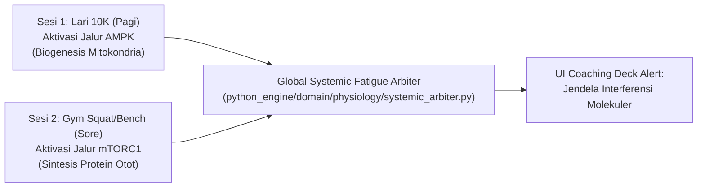

# Spesifikasi UX: Seleksi Cabor Dinamis & Telemetri Instan 33 Cabor

- **Tanggal Rilis**: 2026-11-24 10:15:00 WIB
- **Klasifikasi**: Athletic UX Architecture, Human-Computer Interaction (HCI), Ergonomics & Multi-Sport Ingress
- **Status**: **CONFIRMED & AUTHORITATIVE**
- **Cakupan**: Dynamic Athlete Repertoire, Progressive Disclosure 33 Cabor, Zero-Clutter Feed & Instant Mathematical Preview
- **Lokasi Dokumen**: `docs/11-ai/10-SPESIFIKASI_UX_SELEKSI_CABOR_DINAMIS_DAN_TELEMETRI_INSTAN.md`

---

## 1. Filosofi Desain: Mengatasi Paradoks 2 Cabor vs 33 Formula

### 1.1. Konteks Realitas Atlet
Aplikasi `a-coach` berakar dari kebutuhan atletik nyata. Saat ini, atlet secara dominan aktif dalam **2 cabang olahraga**:
1. **Lari (Running)**: Disiplin aerobik luar ruang dengan fokus pada ritme, pace, cadence, dan pemulihan sendi kaki.
2. **Sepeda (Cycling / Ride)**: Disiplin daya tahan siklik dengan telemetri daya (Watts), kecepatan (km/j), dan zona kardio.

Di sisi lain, tim rekayasa telah merampungkan arsitektur matematika dan sains olahraga deterministik untuk **33 cabang olahraga dunia** di backend Python (`python_engine/domain/physiology/`) dan TypeScript (`src/lib/domain/coach/sports/`), yang didukung oleh 94 unit test otomatis dengan tingkat kelulusan 100%.

### 1.2. Paradoks Antarmuka & Bahaya "AI Slop"
Jika kita secara naif menampilkan seluruh 33 cabang olahraga pada dashboard utama:
- Antarmuka akan dibanjiri oleh **31 tab dan widget kosong** yang tidak relevan dengan rutinitas harian atlet.
- Hal ini melanggar manifesto [ANTI_AI_SLOP.md](../02-design/ANTI_AI_SLOP.md) (kepadatan informasi tinggi tanpa polusi dekoratif) dan [DESIGN_PHILOSOPHY.md](../02-design/DESIGN_PHILOSOPHY.md) (filosofi pelatih yang tenang, presisi, dan tidak cerewet).
- Sebaliknya, jika 31 cabor lainnya disembunyikan sepenuhnya di balik dropdown tersembunyi, atlet tidak akan pernah mengetahui bahwa sistem memiliki kecerdasan menghitung beban *Powerlifting (INOL/1RM)*, *BJJ (Grappling Strain)*, *Sepakbola (PlayerLoad)*, atau *Panjat Tebing (Pulley Tension)* saat mereka memutuskan untuk mencoba cabor baru.

### 1.3. Solusi Emas: Progressive Disclosure & Dynamic Repertoire
Solusi yang diadopsi adalah **Dynamic Athlete Repertoire**:
1. **Default Zero-Clutter**: Antarmuka hanya menampilkan tab dan ringkasan metrik untuk cabor yang **memiliki data aktivitas riil** (saat ini Lari & Sepeda).
2. **Discoverable Sport Vault**: Akses cepat 1-klik melalui tombol `[ + Tambah Cabor ]` yang membuka katalog 33 cabor dunia.
3. **Confidence via "Formula Siap Pakai"**: Setiap cabor di dalam katalog secara eksplisit menampilkan badge status kesiapan rumus matematika dan ringkasan metrik otomatisnya.
4. **Instant Ingress**: Atlet cukup memasukkan 2-3 angka mentah esensial; mesin Python backend mengeksekusi perhitungan sains olahraganya secara instan.
5. **Polymorphic Adaptation**: Seketika cabor baru dicatat, dashboard, feed filter, dan halaman detail aktivitas bertransformasi secara dinamis menyajikan kartu telemetri spesifik cabor tersebut.

```mermaid
flowchart TD
    subgraph CurrentState ["Status Faktual Atlet"]
        A1[Data Riil: 2 Cabor<br/>Lari & Sepeda]
        A2[Feed Filter Bersih:<br/>Semua | Lari | Sepeda]
    end

    subgraph DynamicVault ["Sport Vault: 33 Cabor Dunia"]
        V1["Katalog 6 Klaster Fisiologis"]
        V2["Badge: 🟢 Formula Siap Pakai"]
        V3["Preview Metrik Otomatis<br/>(INOL, 1RM, PlayerLoad, SWOLF)"]
    end

    subgraph UserAction ["Tindakan Atlet"]
        U1["Klik [+ Tambah Cabor] di Feed / Modal"]
        U2["Pilih Cabor Baru (e.g. Gym / Powerlifting)"]
        U3["Input Minimal: Beban 100kg, 5 reps, 3 set"]
    end

    subgraph InstantExecution ["Eksekusi Mesin Deterministik"]
        E1["Python Engine: /calculate/coach/cabor-telemetry"]
        E2["Kalkulasi Otomatis: Tonase 1,500kg, 1RM 116.7kg, INOL 0.88"]
    end

    subgraph DynamicMorph ["Adaptasi Antarmuka Otomatis"]
        M1["Feed Filter Bertambah:<br/>Semua | Lari | Sepeda | Kekuatan"]
        M2["Detail Page Polimorfik:<br/>Peta GPS digantikan Kartu Tonase & 1RM"]
        M3["AI Coach Alert:<br/>Jendela Interferensi AMPK vs mTORC1"]
    end

    A1 & A2 --> U1
    U1 --> V1 & V2 & V3
    V1 & V2 & V3 --> U2
    U2 --> U3
    U3 --> E1 --> E2
    E2 --> M1 & M2 & M3
```

---

## 2. Prinsip Human-Computer Interaction (HCI) Atletik

1. **Aturan 3 Detik (Glance-and-Go Legibility)**:
   Seorang atlet yang selesai berlari maraton atau bersepeda 80 km berada dalam kondisi lelah fisik dan kognitif. Mereka tidak boleh dipaksa menavigasi menu bertingkat yang rumit. Metrik utama harus terbaca dalam 3 detik.
2. **Aturan Input Maksimal 3 Variabel (Minimum Burden Ingress)**:
   Setiap formulir cabor hanya meminta parameter fisik mentah yang mutlak dibutuhkan. Jangan pernah meminta atlet menghitung sendiri rasio atau tonase.
   - *Buruk*: "Masukkan persentase intensitas 1RM Anda."
   - *Benar*: "Masukkan berat beban (kg) dan jumlah repetisi." (Sistem menghitung $1RM = \frac{w}{1.0278 - 0.0278 \times r}$ via Brzycki).
3. **Live Calculation Feedback (Kepuasan Instan)**:
   Saat mengetik angka di form input, sistem langsung menampilkan pratinjau kalkulasi secara reaktif di samping form input sebelum tombol simpan ditekan.
4. **Zero Empty States on Specialized Screens**:
   Jika aktivitas bukan olahraga luar ruangan berbasis GPS, jangan pernah menampilkan peta hitam kosong atau pace `0:00 min/km`. Gantikan ruang tersebut secara terhormat dengan kartu telemetri domain cabor terkait.

---

## 3. Arsitektur 4 Tingkat Dynamic Athlete Repertoire

### Tingkat 1: Dynamic Repertoire Store & Feed Filter
Alih-alih filter statis `"All" | "Run" | "Ride"`, komponen [`ActivityFeed.tsx`](file:///c:/Users/MyBook%20Hype%20AMD/OneDrive/Documents/kerja/_code/project_strava/src/components/activity/ActivityFeed.tsx) menggunakan fungsi pembantu deterministik:

```typescript
export interface ActiveSportFilter {
  code: string;
  label: string;
  cluster: SportCluster;
  count: number;
}

export function extractActiveSports(activities: Activity[]): ActiveSportFilter[] {
  // Mengekstrak seluruh cabor unik yang benar-benar memiliki data riil
}
```

#### Tampilan Filter Bar di Feed:
```
┌─────────────────────────────────────────────────────────────────────────────┐
│ [ Semua (42) ] [ 🏃 Lari (26) ] [ 🚴 Sepeda (16) ]   [ + Tambah Cabor (31) ] │
└─────────────────────────────────────────────────────────────────────────────┘
```
- Tombol `[ + Tambah Cabor (31) ]` bertindak sebagai *discovery trigger* yang memberi tahu atlet bahwa masih ada 31 cabor bertenaga tinggi yang siap digunakan.

---

### Tingkat 2: Sport Vault (Katalog 33 Cabor dengan Indikator Formula Siap)
Ketika tombol `[ + Tambah Cabor ]` ditekan atau saat modal pencatatan dibuka, sistem menyajikan **Sport Vault**:

#### Struktur Tampilan Sport Vault:
1. **Header Klaster Navigasi Cepat (6 Klaster Fisiologis)**:
   - `Ketahanan Siklik` (6 cabor)
   - `Kekuatan & Daya` (5 cabor)
   - `Bela Diri & Kontak` (6 cabor)
   - `Beregu & Lapangan` (6 cabor)
   - `Raket & Presisi` (5 cabor)
   - `Fungsional & Ekstrem` (5 cabor)
2. **Kartu Cabor Berstatus Formal ("Formula Ready Card")**:
   Setiap kartu menyajikan 3 elemen kunci:
   - Ikon & Nama Cabor resmi.
   - Badge status: `🟢 Formula Siap Pakai`.
   - Daftar 3-4 metrik deterministik yang otomatis dihitung mesin backend.

#### Desain Visual Kartu Cabor:
```
┌──────────────────────────────────────────────────────────────────────────────┐
│ 🏋️ POWERLIFTING & GYM                                  [ 🟢 Formula Siap ]   │
│ Klaster: Kekuatan & Daya                                                     │
├──────────────────────────────────────────────────────────────────────────────┤
│ 📐 Kalkulasi Matematis Otomatis:                                             │
│    • Total Tonase Mekanis: W = Σ (Beban × Reps × Set)                        │
│    • Prediksi 1RM Deterministik (Brzycki Formula)                            │
│    • Skor Kelelahan Neuromuskular Sheiko INOL                                │
│    • Time Under Tension (TUT) Kumulatif                                      │
├──────────────────────────────────────────────────────────────────────────────┤
│ [ + Pilih & Catat Sesi Ini ]                     [ ℹ️ Dokumentasi Sains ]   │
└──────────────────────────────────────────────────────────────────────────────┘
```

---

### Tingkat 3: Zero-Friction Telemetry Ingress (Input Minimal, Output Maksimal)

Matriks kebutuhan input pengguna vs output kalkulasi otomatis mesin:

| Klaster | Cabor Contoh | Input Mentah yang Diminta (Hanya 2-3 Field) | Output Otomatis dari Python/TS Engine |
| :--- | :--- | :--- | :--- |
| **1. Ketahanan Siklik** | Lari / Sepeda / Renang | Jarak ($km$), Durasi ($menit$), RPE / Heart Rate | GAP, Trimp, Zona 1-5, Aerobic Decoupling, SWOLF, CSS |
| **2. Kekuatan & Daya** | Powerlifting / Weightlifting / Gym | Beban ($kg$), Repetisi, Set, RPE | **Total Tonase**, **1RM Brzycki**, **Sheiko INOL**, **TUT**, **CNS Fatigue Index** |
| **3. Bela Diri & Kontak** | Tinju / Muay Thai / BJJ / Silat | Jumlah Ronde, Menit/Ronde, RPE, Toggle Gi/No-Gi | **Grappling/Striking Strain**, **HR Decoupling Ronde**, **Status SCAT6 Concussion Alert** |
| **4. Beregu & Lapangan** | Sepakbola / Basket / Futsal / Voli | Durasi ($menit$), RPE, Jumlah Sprint, Meter HSR | **Catapult PlayerLoad (AU)**, **Bradley HSR Density**, **Rasio Cedera Hamstring** |
| **5. Raket & Presisi** | Bulutangkis / Tenis / Panahan | Durasi, Jumlah Smash / Panah, Draw Weight ($lbs$) | **Total Draw Volume (kg)**, **Rotator Cuff Load**, **Tremor Score**, **Rally Density** |
| **6. Fungsional & Ekstrem** | CrossFit / Panjat Tebing / Surfing | Durasi WOD, Reps, Grade Rute, Fall Count | **Work-Rest Density**, **Finger Pulley Strain (N)**, **Drop Shock Ground Reaction Force** |

#### Fitur Live Calculation Teaser:
Di dalam modal ingress, ketika atlet mengetik:
- Beban: `120 kg`
- Reps: `5`
- Set: `4`
Komponen menampilkan *live pill*:
`⚡ Tonase: 2,400 kg | Est. 1RM: 140.0 kg | Sheiko INOL: 0.95 (Volume Optimal)`
Atlet melihat hasil perhitungannya secara *real-time* sebelum menekan tombol simpan.

---

### Tingkat 4: Polymorphic Activity Detail View (Tampilan Detail Adaptif)

Pada rute [`src/app/activities/[id]/page.tsx`](file:///c:/Users/MyBook%20Hype%20AMD/OneDrive/Documents/kerja/_code/project_strava/src/app/activities/[id]/page.tsx):
Komponen detail tidak lagi memaksakan struktur Lari/Sepeda untuk seluruh aktivitas. Sebagai gantinya, dipasang komponen polimorfik:

```tsx
<ActivitySportPolymorphicDeck activity={activity} />
```

Logika adaptasi tata letak:
1. **Jika Klaster `CYCLIC_ENDURANCE`**:
   - Tampilkan `<ActivityGpsTrackMap />`, `<ActivityKinematicsCards />` (Pace, Speed, Elevasi), dan `<ActivityHeartRateZones />`.
2. **Jika Klaster `STRENGTH_POWER`**:
   - Gantikan peta GPS dengan `<ActivityStrengthVolumeCards />`:
     - Kartu Hero Tonase Total ($kg$) dengan perbandingan terhadap berat badan atlet ($x$ Bodyweight).
     - Kartu Estimasi 1RM untuk setiap gerakan yang dicatat.
     - Kartu Sheiko INOL Fatigue Gauge (Underload $<0.4$, Optimal $0.4-1.2$, High $1.2-2.0$, Danger $>2.0$).
3. **Jika Klaster `COMBAT_MARTIAL_ARTS`**:
   - Gantikan peta GPS dengan `<ActivityCombatTelemetryCards />`:
     - Grafik intensitas detak jantung per ronde (Round Decoupling).
     - Kartu Triase Cedera & Gejala Kepala (SCAT6 Concussion Alert System).
4. **Jika Klaster `TEAM_FIELD_COURT`**:
   - Tampilkan `<ActivityTeamTelemetryCards />`:
     - Catapult PlayerLoad Triaxial Gauge ($AU$).
     - High-Speed Running (HSR) Meters & Sprint Decoupling.
5. **Jika Klaster `RACQUET_PRECISION`**:
   - Tampilkan `<ActivityPrecisionTelemetryCards />`:
     - Volume tarikan panahan ($kg$), Tremor Index, atau Smash Accel Load.
6. **Jika Klaster `FUNCTIONAL_EXTREME`**:
   - Tampilkan `<ActivityExtremeTelemetryCards />`:
     - Density WOD, Estimasi Tegangan Katrol Jari (A2/A4 Pulley Strain), dan Drop Shock GRF.

---

### Tingkat 5: Spesifikasi UX Sidebar Dinamis (Dynamic Sidebar Coach Repertoire)

Komponen navigasi utama [`AppSidebar.tsx`](file:///c:/Users/MyBook%20Hype%20AMD/OneDrive/Documents/kerja/_code/project_strava/src/components/layout/AppSidebar.tsx) dan konfigurasi [`navConfig.ts`](file:///c:/Users/MyBook%20Hype%20AMD/OneDrive/Documents/kerja/_code/project_strava/src/components/layout/sidebar/navConfig.ts) saat ini memiliki daftar coach yang bersifat statis:
- `Running Coach` (`/coach/running`)
- `Cycling Coach` (`/coach/cycling`)

Hal ini sangat selaras dengan kondisi atlet saat ini yang baru aktif di 2 cabor. Namun, ketika sistem mendukung 33 cabang olahraga dunia, sidebar harus dirancang dengan prinsip **"Pinned Repertoire + Vault Door"**:

#### 1. Larangan Mutlak (Anti-Pattern):
- ❌ **Dilarang Menumpuk 33 Cabor di Sidebar**: Menaruh 33 menu coach akan menghancurkan hierarki navigasi, memaksa scrollbar vertikal yang panjang, dan melanggar prinsip instrumen presisi obsidian.

#### 2. Arsitektur Navigasi Sidebar Baru:
Navigasi sidebar dibagi menjadi 2 komponen cerdas:
1. **Sport Vault Door (Akses Permanen 33 Cabor)**:
   Di bawah section *Telemetri & Analitik*, ditambahkan satu menu tetap:
   ```
   TELEMETRI & ANALITIK
   ├── Overview              [LIVE]
   ├── Rekap Mingguan        [1M]
   ├── Riwayat Aktivitas     [37]
   └── Direktori 33 Cabor    [33]   <-- Pintu eksplorasi seluruh formula cabor
   ```
2. **Dynamic Pinned Coaches (Sesuai Cabor Aktif Atlet)**:
   Section *Pelatihan & Coach* merender menu coach secara dinamis berdasarkan cabor yang ada di riwayat atau yang di-pin oleh atlet:
   ```
   PELATIHAN & COACH
   ├── Kalender Latihan      [12W]
   ├── Running Coach         [READY]
   ├── Cycling Coach         [ACTIVE]
   └── [ + Aktifkan Coach ]  (Membuka drawer Sport Vault)
   ```

#### 3. Perilaku Saat Cabor Baru Diaktifkan:
Ketika atlet mencatat sesi Gym atau mengaktifkan cabor Bela Diri dari Sport Vault:
1. Item coach baru secara otomatis disematkan (*auto-pinned*) ke dalam sidebar:
   ```
   PELATIHAN & COACH
   ├── Kalender Latihan      [12W]
   ├── Running Coach         [READY]
   ├── Cycling Coach         [ACTIVE]
   ├── Strength & Gym Coach  [NEW]   <-- Muncul otomatis tanpa reload!
   └── [ + Aktifkan Coach ]
   ```
2. **Batas Maksimal Pinned (Max 4-5 Cabor)**:
   Untuk menjaga agar sidebar tidak pernah melebihi batas layar 1080p tanpa scroll:
   - Jika atlet aktif di lebih dari 4 cabor, cabor ke-5 dst dimasukkan ke dalam sub-menu flyout `Coach Cabor Lainnya (X) ▸`.
   - Atlet dapat melakukan *Pin / Unpin* cabor favorit melalui tombol bintang (★) di pengaturan profil atau Sport Vault.

---

## 4. Mekanisme Arbitrase Hibrida Sistemik (AMPK vs mTORC1)

Ketika atlet yang biasanya hanya Lari (Cyclic Endurance) mencatat sesi Angkat Beban (Strength) di hari yang sama atau hari berturut-turut, sistem secara otomatis mengaktifkan modul arbitrase sistemik:



### Pesan Pembinaan Presisi pada Dashboard:
> ⚠️ **Interferensi Latihan Konkuren Terdeteksi (AMPK $\rightarrow$ mTORC1)**:
> *"Anda mencatat sesi Lari 10 km pada pukul 06:30 dan sesi Gym Kekuatan pada pukul 10:00 (jeda 3.5 jam). Fosforilasi AMPK dari lari menghambat jalur translasi mTORC1 untuk adaptasi hipertrofi otot. Rekomendasi pelatih: beri jeda minimal 6–8 jam antar-sesi atau pisahkan hari latihan beban dan ketahanan jauh."*

---

## 5. Rencana Arsitektur Kode & Spesifikasi File Baru

Seluruh kode harus mematuhi batasan ketat: **Maksimal $< 300$ baris per file**, **Clean Architecture**, dan **Zero Regressions**.

### 5.1. Komponen Baru yang Akan Dibuat
1. **`src/components/sports/SportVaultModal.tsx`** ($< 250$ baris):
   Modal katalog 33 cabor dunia dengan filter 6 klaster, search, dan kartu formula siap pakai.
2. **`src/components/sports/SportVaultCard.tsx`** ($< 150$ baris):
   Komponen kartu individual cabor dengan badge status formula, ringkasan metrik matematis, dan tombol seleksi 1-klik.
3. **`src/components/activity/detail/ActivitySportPolymorphicDeck.tsx`** ($< 220$ baris):
   Komponen pembungkus di halaman detail yang mendeteksi klaster cabor dan me-render kartu telemetri spesifik yang relevan.
4. **`src/components/activity/detail/cards/ActivityStrengthCards.tsx`** ($< 200$ baris):
   Visualisasi Tonase, 1RM Brzycki, dan Sheiko INOL.
5. **`src/components/activity/detail/cards/ActivityCombatCards.tsx`** ($< 200$ baris):
   Visualisasi Ronde, Decoupling HR, dan SCAT6 Concussion Alert.
6. **`src/components/activity/detail/cards/ActivityTeamCards.tsx`** ($< 200$ baris):
   Visualisasi Catapult PlayerLoad & High-Speed Running (HSR).

### 5.2. Komponen yang Akan Diperbarui
1. **`src/components/activity/ActivityFeed.tsx`**:
   Mengganti state statis `selectedSport: "All" | "Run" | "Ride"` dengan array dinamis hasil ekstraksi cabor aktif atlet, ditambah tombol `[ + Tambah Cabor ]`.
2. **`src/lib/api/coachPythonClient.ts`**:
   Menambahkan fungsi `computeCaborTelemetryViaPython(sportCode, telemetryData)` yang memanggil `/calculate/coach/cabor-telemetry` di FastAPI backend dengan fallback lokal TypeScript yang aman.

---

## 6. Ringkasan & Roadmap Eksekusi

```
Phase 1: Dynamic Repertoire Store & Feed Filter Adaptif (Merapikan UI Lari & Sepeda saat ini)
Phase 2: Sport Vault Modal (Katalog 33 Cabor dengan Status Formula Siap Pakai)
Phase 3: Live Preview Ingress di Modal Catat Aktivitas (Input 3 angka, output formula instan)
Phase 4: Polymorphic Detail Cards (Tampilan cerdas di halaman detail tanpa peta kosong)
Phase 5: Bridge Next.js API ke FastAPI Python Engine (/calculate/coach/cabor-telemetry)
```

Dengan spesifikasi ini, antarmuka `a-coach` tetap minimalis, bersih, dan cepat untuk atlet yang hanya berlari dan bersepeda, namun memiliki kedalaman sains olahraga kelas dunia yang siap menyala seketika cabor baru dipilih.
