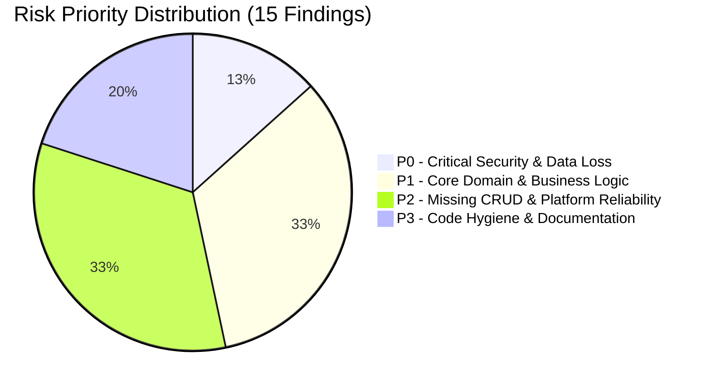

# A-COACH — REPOSITORY-AWARE BACKEND LOGIC & API FLOW AUDIT
## Document 00: Executive Summary & System Health Verdict

> **Audit Date**: 2026-11-07  
> **Repository**: `a-coach — High-Performance Athletic Telemetry, Injury-Aware Coaching & Adaptive Training Platform`  
> **Audited Branch**: `feat/backend`  
> **Auditor**: Senior Systems Architect & Lead Backend Auditor  
> **Runtime Environment**: Next.js 16.4.3 App Router, Node.js 20.x, React 19.3.0, PostgreSQL 16 (local pool `sport_training`), TypeScript 5.x  

---

### 1. Executive Verdict & System State

**System Operational Status**: `OPERATIONAL (MANUAL-FIRST) WITH CRITICAL ARCHITECTURAL HAZARDS`

The `a-coach` platform is currently functional as a **manual-first, device-independent coaching and athletic telemetry application**. Athletes can manually log multisport endurance sessions, submit post-activity subjective health check-ins (Borg CR10 RPE, joint pain scores, swelling, instability), and receive deterministic biological circuit-breaker protections (e.g. running automatically placed `ON_HOLD` while cycling is restricted to `CONDITIONAL` Zone 2 due to active lower-limb injury dossiers).

However, a rigorous code-level and database audit reveals **severe underlying architectural liabilities**, storage desynchronization ("split-brain"), and critical security flaws that compromise production readiness:

1. **Dual-Storage "Split-Brain" Data Loss Risk**: While PostgreSQL 16 holds 35 activities and comprehensive clinical health records, the local JSON fallback store ([`.data/store.json`](file:///c:/Users/MyBook%20Hype%20AMD/OneDrive/Documents/kerja/_code/project_strava/.data/store.json)) contains **0 activities** and **0 injury records**. The repository layer ([`src/lib/db/activityRepo.ts`](file:///c:/Users/MyBook%20Hype%20AMD/OneDrive/Documents/kerja/_code/project_strava/src/lib/db/activityRepo.ts#L205)) catches database query exceptions and silently falls back to reading from `.data/store.json`, meaning any transient database connection blip wipes the athlete's entire activity history from the dashboard without throwing an error.
2. **Hardcoded Fallback Encryption Key (P0 Security)**: AES-256-GCM token encryption in [`src/lib/crypto.ts`](file:///c:/Users/MyBook%20Hype%20AMD/OneDrive/Documents/kerja/_code/project_strava/src/lib/crypto.ts#L8) falls back to a hardcoded static 64-character secret and static salt (`strava-athlete-salt`) committed to the public Git repository if `ENCRYPTION_SECRET` is unset.
3. **Synthetic Strava ID Coupling**: Manual activity creation in [`src/lib/db/activityRepo.ts`](file:///c:/Users/MyBook%20Hype%20AMD/OneDrive/Documents/kerja/_code/project_strava/src/lib/db/activityRepo.ts#L330) generates a fake bigint (`Date.now() * 1000 + random`) because the relational schema mandates `strava_activity_id BIGINT UNIQUE NOT NULL` on table `activities`. The platform remains coupled to a Strava schema column despite operating completely manual-first with **zero active Strava connections**.
4. **Hardcoded Anatomical Fallback**: In [`src/app/api/athlete/checkin/route.ts`](file:///c:/Users/MyBook%20Hype%20AMD/OneDrive/Documents/kerja/_code/project_strava/src/app/api/athlete/checkin/route.ts#L52), missing pain body regions default strictly to `'Anterior Knees'` (if sport is Run) or `'Right Ankle'` (all other sports), corrupting clinical injury logs if an athlete logs shoulder, wrist, or hamstring pain without explicit region tagging.
5. **Double-Counting Streak Engine Bug**: In [`src/lib/domain/streak/streakEngine.ts`](file:///c:/Users/MyBook%20Hype%20AMD/OneDrive/Documents/kerja/_code/project_strava/src/lib/domain/streak/streakEngine.ts#L205), activity timestamps and completed scheduled workout timestamps are aggregated into the same array without deduplication, artificially doubling session contributions for matched workouts.
6. **Broken Integration Test Scripts**: Out of 5 test suites, 2 fail immediately: [`scripts/tests/test_add_activity_flow.js`](file:///c:/Users/MyBook%20Hype%20AMD/OneDrive/Documents/kerja/_code/project_strava/scripts/tests/test_add_activity_flow.js#L12) fails due to invoking a nonexistent Python file path (`scripts/parse_activity_image.py` was moved to `scripts/parsers/`), and [`scripts/tests/test_goal_driven_training_engine.js`](file:///c:/Users/MyBook%20Hype%20AMD/OneDrive/Documents/kerja/_code/project_strava/scripts/tests/test_goal_driven_training_engine.js#L15) fails due to a brittle assertion hardcoding 34 activities when 35 exist.

---

### 2. Verified System Health & Core Metrics

| Dimension | Audited Reality | Notes |
|---|---|---|
| **Active Relational Tables** | **20 tables in PostgreSQL 16** | All primary keys UUID/BigInt; foreign keys active. |
| **Active Athlete Accounts** | **1 athlete** (`00000000-0000-0000-0000-000000000001`) | Apex Athlete / Altra Calibrated. |
| **Recorded Activities** | **35 activities** | 100% manual or synthetic baseline entries. |
| **Active Strava Connections** | **0 connections, 0 tokens** | Verified via database query; Strava integration is inactive. |
| **Injury Dossiers** | **2 active dossiers** | Bilateral Anterior Knees & Right Ankle (History of Swelling). |
| **Authoritative Readiness** | **ACTIVE_WITH_UNRESOLVED_SYMPTOMS** | Run: `ON_HOLD`; Ride: `CONDITIONAL` Zone 2. |
| **Scheduled Workouts** | **38 workouts** | 12-week Zone 2 Endurance Plan (Road to 100km Century Ride MTB). |
| **API Endpoints** | **16 route handlers** | Located under `src/app/api/` (Next.js App Router). |
| **Test Verification Status** | **3 Passing (57 tests), 2 Failing** | README claims 58 passing tests across 3 suites; reality is 57 passing. |

---

### 3. Executive Risk Scorecard

| Priority | Count | Focus Areas | Key Risks |
|---|---|---|---|
| **P0 (Critical)** | **2** | Storage Split-Brain, Cryptographic Secrets | Silent data loss on DB failover; hardcoded encryption key leak. |
| **P1 (High)** | **5** | Streak Double Counting, Hardcoded Anatomy, Synthetic ID Mandate, Plan Wipeout, Hardcoded Dates | Distorted gamification streak; corrupted injury telemetry; data deletion on goal switch; stale 2026 plan dates. |
| **P2 (Medium)** | **5** | Missing Activity Deletion, Missing Injury Update, OCR Host Coupling, Brittle Tests, Unauthenticated APIs | Inability to delete workouts or update recovery status; OCR failure on cloud hosts; brittle test suites. |
| **P3 (Low)** | **3** | Unused `tesseract.js` package, In-Memory Sport Meta, Hardcoded Rationale Strings | Dead dependency baggage; unpersisted custom sport configurations; static rationale copy. |

---

### 4. Immediate Top 5 Corrective Priorities

1. **Abolish Silent Storage Fallback in Production**: Remove the silent catch block in [`src/lib/db/activityRepo.ts`](file:///c:/Users/MyBook%20Hype%20AMD/OneDrive/Documents/kerja/_code/project_strava/src/lib/db/activityRepo.ts#L205). If PostgreSQL fails, throw a clear 503 Service Unavailable error instead of returning empty fallback arrays from `.data/store.json`.
2. **Rotate and Enforce Cryptographic Keys**: Remove the hardcoded secret in [`src/lib/crypto.ts`](file:///c:/Users/MyBook%20Hype%20AMD/OneDrive/Documents/kerja/_code/project_strava/src/lib/crypto.ts#L8); throw an explicit fatal initialization error if `process.env.ENCRYPTION_SECRET` is missing.
3. **Make `strava_activity_id` Nullable**: Migrate the `activities` schema to make `strava_activity_id` optional (`BIGINT NULL`), introducing a dedicated `is_manual` boolean flag and decoupling the core entity from third-party vendor naming.
4. **Fix Streak Contribution Deduplication**: Update [`src/lib/domain/streak/streakEngine.ts`](file:///c:/Users/MyBook%20Hype%20AMD/OneDrive/Documents/kerja/_code/project_strava/src/lib/domain/streak/streakEngine.ts#L205) to index sessions by unique `activity_id` or date bucket, preventing double-counting of matched activities and completed scheduled workouts.
5. **Remediate Test Paths and Brittle Assertions**: Fix the invocation path in [`scripts/tests/test_add_activity_flow.js`](file:///c:/Users/MyBook%20Hype%20AMD/OneDrive/Documents/kerja/_code/project_strava/scripts/tests/test_add_activity_flow.js#L12) and change row count checks in [`scripts/tests/test_goal_driven_training_engine.js`](file:///c:/Users/MyBook%20Hype%20AMD/OneDrive/Documents/kerja/_code/project_strava/scripts/tests/test_goal_driven_training_engine.js#L15) from rigid equality (`=== 34`) to monotonic sanity checks (`>= 34`).

---

### 5. Audit Documentation Map

This audit report is divided into 15 specialized technical documents under `docs/backend-audit/`:

- [00-executive-summary.md](file:///c:/Users/MyBook%20Hype%20AMD/OneDrive/Documents/kerja/_code/project_strava/docs/backend-audit/00-executive-summary.md): High-level verdict, health check, and executive scorecard.
- [01-readme-vs-implementation.md](file:///c:/Users/MyBook%20Hype%20AMD/OneDrive/Documents/kerja/_code/project_strava/docs/backend-audit/01-readme-vs-implementation.md): Complete feature reconciliation matrix comparing README claims with code reality.
- [02-backend-architecture-map.md](file:///c:/Users/MyBook%20Hype%20AMD/OneDrive/Documents/kerja/_code/project_strava/docs/backend-audit/02-backend-architecture-map.md): Deep-dive architecture topology, domain engines, and repositories.
- [03-api-inventory-and-contracts.md](file:///c:/Users/MyBook%20Hype%20AMD/OneDrive/Documents/kerja/_code/project_strava/docs/backend-audit/03-api-inventory-and-contracts.md): Full inventory of all 16 API routes with schemas, inputs, outputs, and status codes.
- [04-athlete-health-and-injury-logic.md](file:///c:/Users/MyBook%20Hype%20AMD/OneDrive/Documents/kerja/_code/project_strava/docs/backend-audit/04-athlete-health-and-injury-logic.md): Biological circuit breakers, anatomy taxonomy, and clinical gatekeeper audit.
- [05-activity-and-telemetry-pipeline.md](file:///c:/Users/MyBook%20Hype%20AMD/OneDrive/Documents/kerja/_code/project_strava/docs/backend-audit/05-activity-and-telemetry-pipeline.md): Manual telemetry CRUD, kinematics math, and dynamic sport extensibility.
- [06-periodization-and-coach-logic.md](file:///c:/Users/MyBook%20Hype%20AMD/OneDrive/Documents/kerja/_code/project_strava/docs/backend-audit/06-periodization-and-coach-logic.md): 12-week Zone 2 engine, workout matching algorithms, and PR engine.
- [07-streak-and-flame-engine.md](file:///c:/Users/MyBook%20Hype%20AMD/OneDrive/Documents/kerja/_code/project_strava/docs/backend-audit/07-streak-and-flame-engine.md): ISO week calculations, thermodynamic heat tiers, and contribution counting logic.
- [08-database-and-storage-integrity.md](file:///c:/Users/MyBook%20Hype%20AMD/OneDrive/Documents/kerja/_code/project_strava/docs/backend-audit/08-database-and-storage-integrity.md): Dual-storage split-brain analysis, foreign keys, and migration integrity.
- [09-security-audit.md](file:///c:/Users/MyBook%20Hype%20AMD/OneDrive/Documents/kerja/_code/project_strava/docs/backend-audit/09-security-audit.md): Cryptographic key derivation, token handling, authentication, and authorization audit.
- [10-ocr-ingestion-audit.md](file:///c:/Users/MyBook%20Hype%20AMD/OneDrive/Documents/kerja/_code/project_strava/docs/backend-audit/10-ocr-ingestion-audit.md): Python Vision vs `tesseract.js`, temporary file handling, and regex parsers.
- [11-end-to-end-api-flow.md](file:///c:/Users/MyBook%20Hype%20AMD/OneDrive/Documents/kerja/_code/project_strava/docs/backend-audit/11-end-to-end-api-flow.md): Step-by-step trace of 11 critical user journeys across the codebase.
- [12-test-coverage-and-verification.md](file:///c:/Users/MyBook%20Hype%20AMD/OneDrive/Documents/kerja/_code/project_strava/docs/backend-audit/12-test-coverage-and-verification.md): Assessment of test suites, test count discrepancies, and brittle assertions.
- [13-missing-logic-and-gap-analysis.md](file:///c:/Users/MyBook%20Hype%20AMD/OneDrive/Documents/kerja/_code/project_strava/docs/backend-audit/13-missing-logic-and-gap-analysis.md): Prioritized catalog of all 15 findings with root causes and reproduction test cases.
- [14-implementation-roadmap.md](file:///c:/Users/MyBook%20Hype%20AMD/OneDrive/Documents/kerja/_code/project_strava/docs/backend-audit/14-implementation-roadmap.md): Phased, non-breaking remediation plan with verification milestones.

