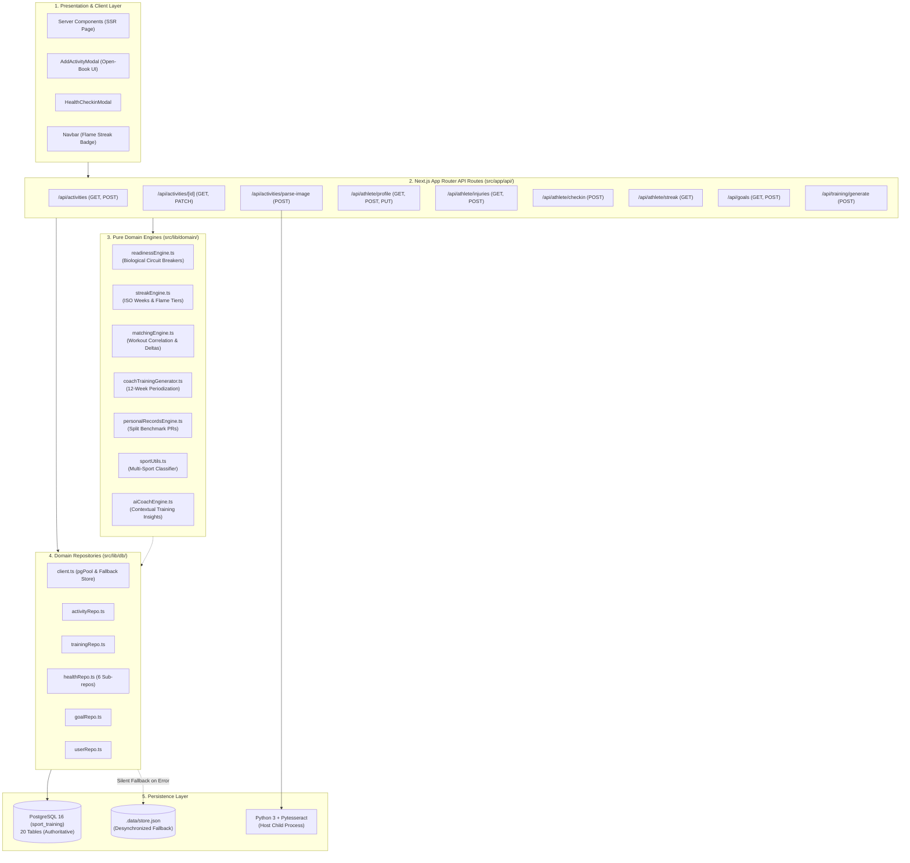

# A-COACH — REPOSITORY-AWARE BACKEND LOGIC & API FLOW AUDIT
## Document 02: Backend Architecture & Domain Topology Map

> **Audit Date**: 2026-11-07  
> **Repository**: `a-coach`  
> **Architecture Paradigm**: Clean Architecture / Domain-Driven Design (DDD) with Backward-Compatibility Facades  
> **Runtime**: Next.js 16.4.3 (Node.js runtime, App Router)  

---

### 1. High-Level Architecture Topology

The backend of `a-coach` is structured in four concentric layers:
1. **API & Interface Layer**: Next.js App Router Route Handlers (`src/app/api/`) receiving HTTP JSON requests and multipart form data.
2. **Domain Engines Layer**: Pure, deterministic TypeScript business logic modules (`src/lib/domain/`) with zero database side-effects.
3. **Repository & Data Access Layer**: Modular relational query implementations (`src/lib/db/`) wrapping `node-postgres` (`pg.Pool`) with legacy fallback support.
4. **Physical Storage Layer**: PostgreSQL 16 database running locally on port 5432 with secondary file store fallback (`.data/store.json`).



---

### 2. Backward-Compatibility Facade Architecture

To support clean architecture refactoring without breaking legacy imports across the frontend, the codebase employs root-level facade files in [`src/lib/`](file:///c:/Users/MyBook%20Hype%20AMD/OneDrive/Documents/kerja/_code/project_strava/src/lib/):

| Facade Path | Target Domain Implementation | Architectural Purpose |
|---|---|---|
| [`src/lib/db.ts`](file:///c:/Users/MyBook%20Hype%20AMD/OneDrive/Documents/kerja/_code/project_strava/src/lib/db.ts) | [`src/lib/db/index.ts`](file:///c:/Users/MyBook%20Hype%20AMD/OneDrive/Documents/kerja/_code/project_strava/src/lib/db/index.ts) | Aggregates 7 domain repositories into a unified database interface. |
| [`src/lib/readinessEngine.ts`](file:///c:/Users/MyBook%20Hype%20AMD/OneDrive/Documents/kerja/_code/project_strava/src/lib/readinessEngine.ts) | [`src/lib/domain/readiness/readinessEngine.ts`](file:///c:/Users/MyBook%20Hype%20AMD/OneDrive/Documents/kerja/_code/project_strava/src/lib/domain/readiness/readinessEngine.ts) | Exposes deterministic biological circuit breakers and safety gates. |
| [`src/lib/streakEngine.ts`](file:///c:/Users/MyBook%20Hype%20AMD/OneDrive/Documents/kerja/_code/project_strava/src/lib/streakEngine.ts) | [`src/lib/domain/streak/streakEngine.ts`](file:///c:/Users/MyBook%20Hype%20AMD/OneDrive/Documents/kerja/_code/project_strava/src/lib/domain/streak/streakEngine.ts) | Exposes weekly streak calculations and thermodynamic heat tiers. |
| [`src/lib/matching.ts`](file:///c:/Users/MyBook%20Hype%20AMD/OneDrive/Documents/kerja/_code/project_strava/src/lib/matching.ts) | [`src/lib/domain/matching/matchingEngine.ts`](file:///c:/Users/MyBook%20Hype%20AMD/OneDrive/Documents/kerja/_code/project_strava/src/lib/domain/matching/matchingEngine.ts) | Exposes activity-to-workout heuristic matching algorithms. |
| [`src/lib/personalRecords.ts`](file:///c:/Users/MyBook%20Hype%20AMD/OneDrive/Documents/kerja/_code/project_strava/src/lib/personalRecords.ts) | [`src/lib/domain/records/personalRecordsEngine.ts`](file:///c:/Users/MyBook%20Hype%20AMD/OneDrive/Documents/kerja/_code/project_strava/src/lib/domain/records/personalRecordsEngine.ts) | Exposes 5K/10K and maximum endurance milestone computations. |
| [`src/lib/sportUtils.ts`](file:///c:/Users/MyBook%20Hype%20AMD/OneDrive/Documents/kerja/_code/project_strava/src/lib/sportUtils.ts) | [`src/lib/domain/sports/sportUtils.ts`](file:///c:/Users/MyBook%20Hype%20AMD/OneDrive/Documents/kerja/_code/project_strava/src/lib/domain/sports/sportUtils.ts) | Exposes multi-sport classification, icons, and speed/pace formatters. |
| [`src/lib/coachTrainingGenerator.ts`](file:///c:/Users/MyBook%20Hype%20AMD/OneDrive/Documents/kerja/_code/project_strava/src/lib/coachTrainingGenerator.ts) | [`src/lib/domain/coach/coachTrainingGenerator.ts`](file:///c:/Users/MyBook%20Hype%20AMD/OneDrive/Documents/kerja/_code/project_strava/src/lib/domain/coach/coachTrainingGenerator.ts) | Exposes 12-week goal-driven periodization generators. |
| [`src/lib/ai-coach.ts`](file:///c:/Users/MyBook%20Hype%20AMD/OneDrive/Documents/kerja/_code/project_strava/src/lib/ai-coach.ts) | [`src/lib/domain/coach/aiCoachEngine.ts`](file:///c:/Users/MyBook%20Hype%20AMD/OneDrive/Documents/kerja/_code/project_strava/src/lib/domain/coach/aiCoachEngine.ts) | Injects health circuit breakers and training insights into the AI Coach. |

---

### 3. Repository Decomposition Map

The data layer was decomposed from a monolithic file into granular sub-repositories under [`src/lib/db/`](file:///c:/Users/MyBook%20Hype%20AMD/OneDrive/Documents/kerja/_code/project_strava/src/lib/db/):

1. **[`client.ts`](file:///c:/Users/MyBook%20Hype%20AMD/OneDrive/Documents/kerja/_code/project_strava/src/lib/db/client.ts)**: Configures `pg.Pool` connection pool, custom OID 1082 date parsers, `DEFAULT_USER_ID`, and local store JSON fallback initialization.
2. **[`activityRepo.ts`](file:///c:/Users/MyBook%20Hype%20AMD/OneDrive/Documents/kerja/_code/project_strava/src/lib/db/activityRepo.ts)**: Handles `getActivities`, `getActivityById`, `updateActivity`, `upsertActivity`, and `createManualActivity`. Note: **Missing `deleteActivity`**.
3. **[`trainingRepo.ts`](file:///c:/Users/MyBook%20Hype%20AMD/OneDrive/Documents/kerja/_code/project_strava/src/lib/db/trainingRepo.ts)**: Manages `training_plans`, `scheduled_workouts`, and `workout_activity_matches`.
4. **[`goalRepo.ts`](file:///c:/Users/MyBook%20Hype%20AMD/OneDrive/Documents/kerja/_code/project_strava/src/lib/db/goalRepo.ts)**: Manages `fitness_goals` and `personal_records` tables, including single primary goal enforcement.
5. **[`userRepo.ts`](file:///c:/Users/MyBook%20Hype%20AMD/OneDrive/Documents/kerja/_code/project_strava/src/lib/db/userRepo.ts)**: Handles `users` profile biometrics (weight, height, resting HR, max HR).
6. **[`healthRepo.ts`](file:///c:/Users/MyBook%20Hype%20AMD/OneDrive/Documents/kerja/_code/project_strava/src/lib/db/healthRepo.ts)**: Facade over `src/lib/db/health/` directory:
   - `athleteProfileRepo.ts`: Clinical athlete profile and training availability.
   - `injuryRepo.ts`: Injury dossiers (`createAthleteInjury`, `getAthleteInjuries`).
   - `painLogRepo.ts`: Subjective pain and swelling logs.
   - `trainingResponseRepo.ts`: Post-activity Borg CR10 RPE and symptom check-ins.
   - `assessmentRepo.ts`: Clinician medical assessments and return-to-sport clearance.
   - `healthAuditRepo.ts`: Immutable clinical audit trail (`health_audit_trail`).
7. **[`stravaRepo.ts`](file:///c:/Users/MyBook%20Hype%20AMD/OneDrive/Documents/kerja/_code/project_strava/src/lib/db/stravaRepo.ts)**: Strava OAuth connections, encrypted tokens, and sync logs. Currently dormant.

---

### 4. Component Coupling & Architectural Risks

```mermaid
classDiagram
    class NextApiRoutes {
        +GET /api/activities
        +POST /api/activities
        +POST /api/athlete/checkin
        +POST /api/training/generate
    }
    class ReadinessEngine {
        +evaluateTrainingReadiness()
        +validateWorkoutSafety()
    }
    class ActivityRepo {
        +getActivities()
        +createManualActivity()
        +upsertActivity()
    }
    class ClientDB {
        +pgPool: Pool
        +ensureLocalStore()
    }
    class PostgreSQL {
        <<Database>>
        +activities: 35 rows
        +athlete_injuries: 2 rows
    }
    class JSONStore {
        <<LocalFile>>
        +activities: 0 rows
        +athlete_injuries: 0 rows
    }

    NextApiRoutes --> ReadinessEngine : evaluates health safety
    NextApiRoutes --> ActivityRepo : persists activities
    ActivityRepo --> ClientDB : queries pool
    ClientDB --> PostgreSQL : primary SQL connection
    ClientDB -.-> JSONStore : uncoordinated fallback
```

#### Major Structural Deficiencies:
1. **Silent Catch-All Fallback in Data Layer**: In [`src/lib/db/activityRepo.ts#L205`](file:///c:/Users/MyBook%20Hype%20AMD/OneDrive/Documents/kerja/_code/project_strava/src/lib/db/activityRepo.ts#L205), `getActivities` swallows database query exceptions and reads from `.data/store.json`. Because `.data/store.json` is never updated during manual activity creation, this creates an immediate data-loss illusion during transient database interruptions.
2. **Hardcoded User ID Everywhere**: All API routes and domain repositories default to `DEFAULT_USER_ID = '00000000-0000-0000-0000-000000000001'`. The architecture lacks any session context, auth middleware, or tenant isolation.
3. **Absence of Mutation Transactions**: Multi-step operations such as `createManualActivity` (which inserts an activity, searches for matching workouts, saves a match record, updates the workout status to `COMPLETED`, and inserts an athlete training response) are executed across sequential un-bracketed queries without a database `BEGIN ... COMMIT` transaction.

