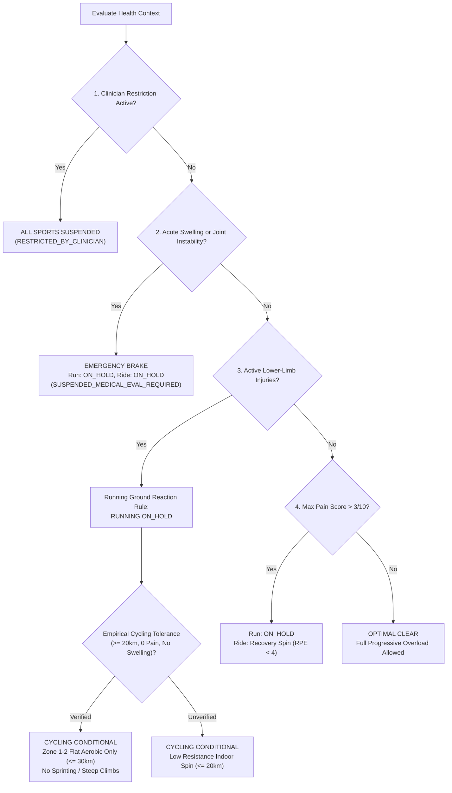

# A-COACH — REPOSITORY-AWARE BACKEND LOGIC & API FLOW AUDIT
## Document 04: Athlete Health, Anatomical Taxonomy & Biological Circuit Breakers

> **Audit Date**: 2026-11-07  
> **Core Module**: Athlete Health & Injury-Aware Readiness Engine  
> **Domain Files**: [`src/lib/domain/readiness/readinessEngine.ts`](file:///c:/Users/MyBook%20Hype%20AMD/OneDrive/Documents/kerja/_code/project_strava/src/lib/domain/readiness/readinessEngine.ts), [`src/lib/anatomy/`](file:///c:/Users/MyBook%20Hype%20AMD/OneDrive/Documents/kerja/_code/project_strava/src/lib/anatomy/), [`src/lib/db/health/`](file:///c:/Users/MyBook%20Hype%20AMD/OneDrive/Documents/kerja/_code/project_strava/src/lib/db/health/)  
> **Verification Suite**: [`scripts/tests/test_athlete_health_system.js`](file:///c:/Users/MyBook%20Hype%20AMD/OneDrive/Documents/kerja/_code/project_strava/scripts/tests/test_athlete_health_system.js) (31/31 Passing)

---

### 1. Athlete Physical Baseline & Physiological Unknowns

The athlete profile is persisted in table `users` and extended in `athlete_profiles`:
- **Current Live Data**:
  - `user_id`: `00000000-0000-0000-0000-000000000001`
  - `age`: 22 years
  - `height_cm`: 170.0 cm
  - `weight_kg`: 65.0 kg
  - `BMI`: `22.49 kg/m²` (Normative Healthy Range: 18.5 – 24.9)
  - `resting_heart_rate`: 68 bpm
  - `training_days_per_week`: 3 days

#### Physiological Unknown Protection (Zero-Hallucination Policy)
Unlike conventional consumer fitness apps that extrapolate maximal aerobic thresholds using age-predicted formulas (e.g. `220 - age`), `a-coach` strictly models untested metrics as unknown:
- `HRmax`: **UNKNOWN / UNCALIBRATED** (Formula `220 - 22 = 198` is deliberately rejected; clinical heart rate zones require lab ramp testing).
- `LTHR` (Lactate Threshold Heart Rate): **UNKNOWN** (Requires lab lactate step test or 30-minute functional TT).
- `FTP` (Functional Threshold Power): **UNKNOWN** (No power meter or 20-minute protocol completed).
- `VO2max`: **UNKNOWN** (Gas exchange cart analysis absent).

Automated tests in `test_athlete_health_system.js` explicitly assert that these values are undefined, preventing the AI Coach from hallucinating physiological zones.

---

### 2. Full-Body Anatomical Taxonomy & Kinetic Classification

The anatomical structure is organized under [`src/lib/anatomy/regions/`](file:///c:/Users/MyBook%20Hype%20AMD/OneDrive/Documents/kerja/_code/project_strava/src/lib/anatomy/regions/) into 9 discrete clinical regions:
1. `headNeck.ts`: Cervical spine, upper trapezius.
2. `upperLimb.ts`: Shoulder, elbow, wrist, hand.
3. `axialSpine.ts`: Thoracic spine, lumbar spine, sacroiliac joints.
4. `pelvisHip.ts`: Hip joint, groin/adductor, piriformis.
5. `thigh.ts`: Quadriceps, hamstrings, iliotibial band.
6. `knee.ts`: Patellofemoral, patellar tendon, medial/lateral menisci, cruciate ligaments.
7. `lowerLeg.ts`: Tibial shaft, gastrocnemius, soleus.
8. `ankleAchilles.ts`: Achilles tendon, talocrural joint, subtalar joint.
9. `footPlantar.ts`: Plantar fascia, metatarsophalangeal joints, calcaneus.

#### Kinetic Load Mapping
Each anatomical region is assigned metadata via [`src/lib/anatomyUtils.ts`](file:///c:/Users/MyBook%20Hype%20AMD/OneDrive/Documents/kerja/_code/project_strava/src/lib/anatomyUtils.ts):
- `isLowerExtremity`: Flags weight-bearing joints subject to ground reaction impacts during running (2.5× to 3.0× body weight).
- `isAxial`: Flags spinal and pelvic structures that tolerate soft-surface loading or require upright posture modifications on bicycles.
- `bilateralTracking`: Accurately differentiates `LEFT`, `RIGHT`, and `BILATERAL` clinical manifestations.

---

### 3. Injury Dossiers & Diagnostic Boundaries

Database table `athlete_injuries` contains **2 active dossiers**:

| Field | Injury Dossier 1 | Injury Dossier 2 |
|---|---|---|
| **Body Region** | `Anterior Knees` | `Right Ankle` |
| **Side** | `BILATERAL` | `RIGHT` |
| **Injury Mechanism** | Overuse running load / high-impact running | Inversion trauma / repetitive impact |
| **Timeframe** | 6 months history | 12 months history |
| **Medical Evaluation Status**| `PENDING_CLINICAL_ASSESSMENT` | `PENDING_CLINICAL_ASSESSMENT` |
| **Current Status** | `ACTIVE_SYMPTOMATIC` | `ACTIVE_SYMPTOMATIC` |
| **History of Swelling** | `false` | `true` (Prior acute swelling resolved) |
| **Initial Severity** | `MODERATE` | `MODERATE` |

#### Diagnostic Boundary Rule
The platform strictly differentiates **athlete-reported symptoms** from **clinician-confirmed medical diagnoses**:
- An athlete reporting "anterior bilateral knee pain during squats or stairs" is documented as *Symptom: Anterior Knee Ache*, **NOT** diagnosed as *Patellofemoral Pain Syndrome (PFPS)* or *Chondromalacia Patellae* without an uploaded medical assessment.
- Verified in `test_athlete_health_system.js` line 67: `assert(!readiness.rationale.includes('Patellofemoral Pain Syndrome'))`.

---

### 4. Biological Circuit Breakers & Sport Readiness

The readiness engine ([`src/lib/domain/readiness/readinessEngine.ts`](file:///c:/Users/MyBook%20Hype%20AMD/OneDrive/Documents/kerja/_code/project_strava/src/lib/domain/readiness/readinessEngine.ts)) evaluates health context hierarchically:



#### Grounded Live Status:
- `athlete_status`: `ACTIVE_WITH_UNRESOLVED_SYMPTOMS`
- `running_readiness`: `ON_HOLD` (Running is locked due to unresolved bilateral anterior knee and right ankle dossiers).
- `cycling_readiness`: `CONDITIONAL` (Permits monitored Zone 1–2 flat cadence rides; sprint intervals and steep standing climbs are forbidden).
- `automatic_progression_allowed`: `false` (Prevents automatic overload progression).

---

### 5. Identified Code Flaws & Deficiencies

1. **Hardcoded Telemetry in Rationale Copy**:
   - In [`src/lib/domain/readiness/readinessEngine.ts#L175`](file:///c:/Users/MyBook%20Hype%20AMD/OneDrive/Documents/kerja/_code/project_strava/src/lib/domain/readiness/readinessEngine.ts#L175):
     ```typescript
     rationaleItems.push(
       'Cycling is CONDITIONAL: Non-impact closed-chain pedaling was empirically tolerated on verified distance rides (e.g. 56.10 km with 0 pain during, after, next-day)...'
     );
     ```
     The distance `56.10 km` is hardcoded in the string instead of formatting the actual ride distance from `bestRide.distance_km`.
2. **Brittle Anatomical Region Fallback**:
   - In [`src/app/api/athlete/checkin/route.ts#L52`](file:///c:/Users/MyBook%20Hype%20AMD/OneDrive/Documents/kerja/_code/project_strava/src/app/api/athlete/checkin/route.ts#L52):
     ```typescript
     body_region: body.body_region || (body.sport_type === 'Run' ? 'Anterior Knees' : 'Right Ankle')
     ```
     Missing body regions default blindly to `'Anterior Knees'` or `'Right Ankle'`, corrupting the pain logs if the athlete experienced pain in another joint.
3. **Empty Clinical Assessments Table**:
   - PostgreSQL table `athlete_medical_assessments` contains **0 rows**. All clinical procedures are currently passed in via ad-hoc API calls rather than persisted historical dossiers.
4. **Missing Injury Modification Endpoint**:
   - No `PATCH /api/athlete/injuries/[id]` exists. Once created, an injury's status (`ACTIVE_SYMPTOMATIC` vs `ASYMPTOMATIC_RECOVERED`) cannot be transitioned via the API.

