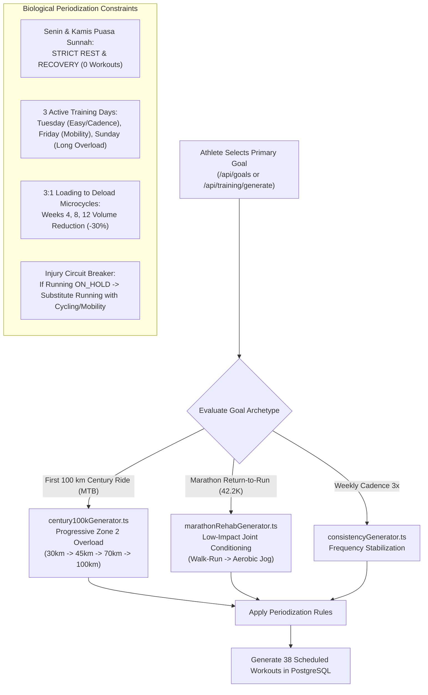

# A-COACH — REPOSITORY-AWARE BACKEND LOGIC & API FLOW AUDIT
## Document 06: Periodization Calendar, Coach Training Engine & Heuristic Matching

> **Audit Date**: 2026-11-07  
> **Core Module**: Tactical Command Deck & Periodization Calendar  
> **Domain Files**: [`src/lib/domain/coach/coachTrainingGenerator.ts`](file:///c:/Users/MyBook%20Hype%20AMD/OneDrive/Documents/kerja/_code/project_strava/src/lib/domain/coach/coachTrainingGenerator.ts), [`src/lib/domain/matching/matchingEngine.ts`](file:///c:/Users/MyBook%20Hype%20AMD/OneDrive/Documents/kerja/_code/project_strava/src/lib/domain/matching/matchingEngine.ts), [`src/lib/domain/records/personalRecordsEngine.ts`](file:///c:/Users/MyBook%20Hype%20AMD/OneDrive/Documents/kerja/_code/project_strava/src/lib/domain/records/personalRecordsEngine.ts)  
> **Verification Suites**: `test_coach_training_system.js` (5/5 Passing), `test_goal_driven_training_engine.js` (12 Passing / 1 Failing)

---

### 1. Goal-Driven 12-Week Periodization Architecture

The periodization engine ([`src/lib/domain/coach/coachTrainingGenerator.ts`](file:///c:/Users/MyBook%20Hype%20AMD/OneDrive/Documents/kerja/_code/project_strava/src/lib/domain/coach/coachTrainingGenerator.ts)) generates customized endurance programs aligned with the athlete's designated primary fitness goal (`is_primary = true`).



#### Grounded Live State in PostgreSQL 16:
- **Active Plan**: `12-Week Zone 2 Endurance Program (Road to 100km Century Ride MTB)`
- **Linked Goal ID**: `00000000-0000-0000-0000-000000000031` (`First 100 km Century Ride (MTB Zone 2)`)
- **Total Workouts in DB**: **38 sessions**
  - **12 Sunday Milestone Long Rides**: Progressive overload reaching 100 km.
  - **0 Workouts on Monday & Thursday**: Strictly preserved for fasting and supercompensation.
  - **Status**: 2 Completed / Matched, 36 Planned.

---

### 2. Critical Flaws in Training Generator

#### Flaw 1: Destructive Workout Wipeout on Plan Generation
In [`src/lib/domain/coach/coachTrainingGenerator.ts#L152`](file:///c:/Users/MyBook%20Hype%20AMD/OneDrive/Documents/kerja/_code/project_strava/src/lib/domain/coach/coachTrainingGenerator.ts#L152):
```typescript
// Clean existing plans and workouts for fresh authoritative generation
await deleteScheduledWorkoutsByUserId(userId);
await deleteTrainingPlansByUserId(userId);
```
Whenever an athlete switches goals via `/api/goals` or triggers `/api/training/generate`:
- **Every scheduled workout is deleted**, including past completed workouts and workout match history!
- This causes historical training adherence metrics (`Tingkat Kepatuhan Jadwal: 0%`) to be wiped out.

#### Flaw 2: Hardcoded Plan Dates
In [`src/lib/domain/coach/coachTrainingGenerator.ts#L156`](file:///c:/Users/MyBook%20Hype%20AMD/OneDrive/Documents/kerja/_code/project_strava/src/lib/domain/coach/coachTrainingGenerator.ts#L156):
```typescript
const planStartDate = '2026-11-02';
const planEndDate = '2027-01-24';
```
The plan's start and end dates are hardcoded to `2026-11-02` and `2027-01-24`. If a plan is generated months or years later, it will still place workouts starting on November 2, 2026.

#### Flaw 3: Hardcoded Fallback Baseline Milestones
In lines 96–98:
```typescript
current_value: maxRideKm > 0 ? maxRideKm : 56.1, // 56.1 km single session baseline
current_value: maxRunKm > 0 ? maxRunKm : 12.3, // 12.3 km single session baseline
```
If an athlete has no recorded rides or runs, their goal progress is initialized with hardcoded fictional values (`56.1 km` and `12.3 km`) instead of `0`.

---

### 3. Heuristic Workout-Activity Matching Engine

Implemented in [`src/lib/domain/matching/matchingEngine.ts`](file:///c:/Users/MyBook%20Hype%20AMD/OneDrive/Documents/kerja/_code/project_strava/src/lib/domain/matching/matchingEngine.ts):

#### Matching Algorithm Steps:
1. **Date Boundary Matching**:
   $$\text{formatDateOnly}(\text{activity.start\_date}) == \text{formatDateOnly}(\text{workout.scheduled\_date})$$
2. **Sport Category Compatibility (`isSportCompatible`)**:
   - `Run` matches: `run`, `interval`, `fartlek`, `tempo`, `recovery`.
   - `Ride` matches: `cycl`, `ride`, `bike`.
   - `Swim` matches: `swim`.
   - `WeightTraining` matches: `strength`, `cross`.
3. **Delta Computations (`calculateMatchDeltas`)**:
   - **Completion Percentage**:
     $$\text{completion\_percentage} = \min\left(200, \text{round}\left(\frac{\text{actual\_distance}}{\text{target\_distance}} \times 100\right)\right)$$
   - **Distance Delta**: $\text{actual\_distance\_meters} - \text{target\_distance\_meters}$
   - **Duration Delta**: $\text{actual\_duration\_seconds} - \text{target\_duration\_seconds}$
   - **Pace Delta**: $\text{actual\_pace\_seconds\_per\_km} - \text{target\_pace\_seconds\_per\_km}$
4. **State Transition**:
   - Updates `scheduled_workouts.status = 'COMPLETED'`.
   - Inserts record into `workout_activity_matches`.

#### Live Evidence in DB:
Table `workout_activity_matches` contains **2 records**:
- Correlating 2 real manual rides against scheduled milestone workouts.

---

### 4. Personal Records (PR) Engine

Defined in [`src/lib/domain/records/personalRecordsEngine.ts`](file:///c:/Users/MyBook%20Hype%20AMD/OneDrive/Documents/kerja/_code/project_strava/src/lib/domain/records/personalRecordsEngine.ts):

#### Tracked Categories:
1. **Running Split Benchmarks**:
   - `5K`: Fastest split pace for running activities with $\text{distance} \ge 4,900\text{ m}$.
   - `10K`: Fastest split pace for running activities with $\text{distance} \ge 9,800\text{ m}$.
   - `Half Marathon`: Fastest split for $\text{distance} \ge 20,800\text{ m}$.
2. **Longest Distance Milestones**:
   - `Longest Distance (Ride)`: Maximum single session distance across all cycling activities.
   - `Longest Distance (Run)`: Maximum single session distance across all running activities.

#### Live Records in PostgreSQL (`personal_records`):
- `pr-001`: 5K (21:00)
- `pr-002`: 10K (44:45)
- `pr-003`: Longest Distance (21.10 km)

---

### 5. AI Coach Intelligence & Safety Gatekeeper

In [`src/lib/domain/coach/aiCoachEngine.ts`](file:///c:/Users/MyBook%20Hype%20AMD/OneDrive/Documents/kerja/_code/project_strava/src/lib/domain/coach/aiCoachEngine.ts):
- Receives `AuthoritativeAthleteHealthContext`.
- If `running_readiness === 'ON_HOLD'`, the engine injects a top-level alert:
  ```typescript
  insights.push({
    id: 'ins-health-running-on-hold',
    type: 'recovery',
    severity: 'warning',
    title: 'Running Coach Safety Gate: Running Suspended (ON_HOLD)',
    description: 'High-impact running is temporarily suspended. Active symptoms detected...',
  });
  ```
- Any LLM prompt template passes the safety gatekeeper constraints as non-negotiable system rules.

