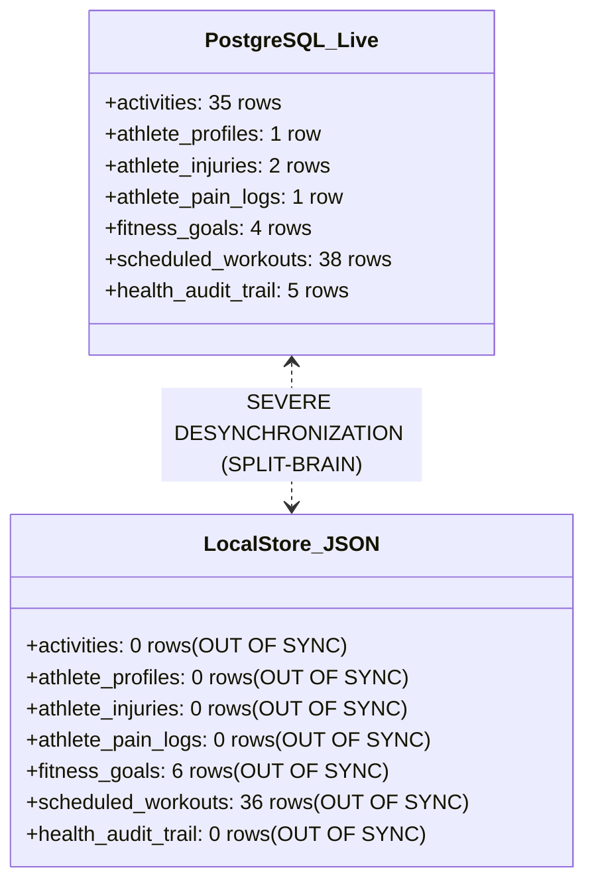

# A-COACH — REPOSITORY-AWARE BACKEND LOGIC & API FLOW AUDIT
## Document 08: Database Integrity, Dual-Storage Split-Brain & Schema Constraints

> **Audit Date**: 2026-11-07  
> **Primary Storage**: PostgreSQL 16 (`sport_training` on port 5432)  
> **Secondary Fallback**: Local File Store ([`.data/store.json`](file:///c:/Users/MyBook%20Hype%20AMD/OneDrive/Documents/kerja/_code/project_strava/.data/store.json))  
> **Key Files**: [`src/lib/db/client.ts`](file:///c:/Users/MyBook%20Hype%20AMD/OneDrive/Documents/kerja/_code/project_strava/src/lib/db/client.ts), [`src/lib/db/activityRepo.ts`](file:///c:/Users/MyBook%20Hype%20AMD/OneDrive/Documents/kerja/_code/project_strava/src/lib/db/activityRepo.ts)

---

### 1. PostgreSQL 16 Live Schema Inventory

A live automated schema audit via [`scripts/maintenance/audit_database_schema.cjs`](file:///c:/Users/MyBook%20Hype%20AMD/OneDrive/Documents/kerja/_code/project_strava/scripts/maintenance/audit_database_schema.cjs) confirms **20 active tables** in PostgreSQL:

| # | Table Name | Live Rows | Primary Key | Key Foreign Keys & Constraints |
|---|---|---|---|---|
| 1 | `users` | **1** | `id` (UUID) | Unique email; biometrics defaults. |
| 2 | `athlete_profiles` | **1** | `id` (UUID) | FK `user_id` -> `users.id` |
| 3 | `athlete_injuries` | **2** | `id` (UUID) | FK `user_id` -> `users.id` |
| 4 | `athlete_pain_logs` | **1** | `id` (UUID) | FK `injury_id` -> `athlete_injuries.id` (Nullable) |
| 5 | `athlete_training_readiness` | **1** | `id` (UUID) | FK `user_id` -> `users.id` |
| 6 | `athlete_training_responses` | **2** | `id` (UUID) | FK `activity_id` -> `activities.id` (Nullable) |
| 7 | `athlete_medical_assessments`| **0** | `id` (UUID) | FK `injury_id` -> `athlete_injuries.id` (Nullable) |
| 8 | `athlete_availability` | **1** | `id` (UUID) | FK `user_id` -> `users.id` |
| 9 | `athlete_daily_wellness` | **1** | `id` (UUID) | FK `user_id` -> `users.id` |
| 10 | `athlete_equipment` | **2** | `id` (UUID) | FK `user_id` -> `users.id` |
| 11 | `health_audit_trail` | **5** | `id` (UUID) | FK `user_id` -> `users.id` (Immutable audit log) |
| 12 | `activities` | **35** | `id` (UUID) | `strava_activity_id` (BIGINT UNIQUE NOT NULL) |
| 13 | `training_plans` | **1** | `id` (UUID) | FK `goal_id` -> `fitness_goals.id` |
| 14 | `scheduled_workouts` | **38** | `id` (UUID) | FK `plan_id` -> `training_plans.id` |
| 15 | `workout_activity_matches` | **2** | `id` (UUID) | FK `workout_id`, FK `activity_id` |
| 16 | `fitness_goals` | **4** | `id` (UUID) | FK `user_id` -> `users.id` |
| 17 | `personal_records` | **3** | `id` (UUID) | FK `user_id` -> `users.id`, FK `activity_id` |
| 18 | `strava_connections` | **0** | `id` (UUID) | FK `user_id` -> `users.id` (Dormant) |
| 19 | `strava_tokens` | **0** | `id` (UUID) | FK `connection_id` -> `strava_connections.id` |
| 20 | `sync_logs` | **4** | `id` (UUID) | FK `user_id` -> `users.id` |

---

### 2. Critical Investigation: Dual-Storage Split-Brain (P0)

The application architecture includes a secondary JSON file storage fallback implemented in [`src/lib/db/client.ts`](file:///c:/Users/MyBook%20Hype%20AMD/OneDrive/Documents/kerja/_code/project_strava/src/lib/db/client.ts#L61) designed for serverless environments.

#### Comparative Storage Audit:



| Entity Table | PostgreSQL 16 (Live Authoritative) | `.data/store.json` (Local Fallback) | Desynchronization Delta |
|---|---|---|---|
| `activities` | **35 rows** | **0 rows** | **-35 rows (100% Data Loss)** |
| `athlete_profiles` | **1 row** | **0 rows** | **-1 row** |
| `athlete_injuries` | **2 rows** | **0 rows** | **-2 rows (Clinical Loss)** |
| `athlete_pain_logs` | **1 row** | **0 rows** | **-1 row** |
| `athlete_training_readiness` | **1 row** | **0 rows** | **-1 row** |
| `health_audit_trail`| **5 rows** | **0 rows** | **-5 rows** |
| `fitness_goals` | **4 rows** | **6 rows** | **+2 stale / unmerged goals** |
| `scheduled_workouts`| **38 rows** | **36 rows** | **-2 workouts** |

---

### 3. Root Cause Analysis: The Silent Fallback Hazard

In [`src/lib/db/activityRepo.ts#L205`](file:///c:/Users/MyBook%20Hype%20AMD/OneDrive/Documents/kerja/_code/project_strava/src/lib/db/activityRepo.ts#L205):
```typescript
export async function getActivities(
  userId: string = DEFAULT_USER_ID,
  filters?: { sportType?: string; limit?: number; afterDate?: string }
): Promise<Activity[]> {
  if (pgPool) {
    try {
      const res = await pgPool.query(query, params);
      return res.rows.map(normalizeActivityRow);
    } catch (err: any) {
      console.warn("[PostgreSQL getActivities Error]:", err.message);
      // SILENT FALLTHROUGH TO LOCAL STORE!
    }
  }

  const store = ensureLocalStore();
  let acts = store.activities.filter((a) => a.user_id === userId);
  ...
  return acts.map(normalizeActivityRow);
}
```

#### The Failure Cascade:
1. When PostgreSQL is healthy, `upsertActivity` and `createManualActivity` write **exclusively to PostgreSQL**:
   ```typescript
   if (pgPool) {
     const query = `INSERT INTO activities (...) VALUES (...) RETURNING *;`;
     const res = await pgPool.query(query, [...]);
     return { activity: normalizeActivityRow(row), isCreated: Boolean(row.is_created) };
   }
   // Note: Local store is NEVER updated when pgPool is present!
   ```
2. Because writes never replicate to `.data/store.json`, the JSON file remains completely empty of activities.
3. If PostgreSQL encounters a momentary connection pool exhaustion, transient restart, or timeout:
   - `pgPool.query()` throws an error.
   - The `catch` block catches the error and logs a minor warning.
   - Execution falls through to `ensureLocalStore()`.
   - The API returns `activities: []`.
4. **Result**: The athlete refreshes their page and sees **0 activities**, a **broken streak**, and **erased health records** — with no error notification to the user or client application!

---

### 4. Required Architectural Recommendation

1. **Eliminate Silent Failover in Production**:
   - The data access layer must treat PostgreSQL as the **Single Source of Truth (SSOT)**.
   - If PostgreSQL fails, throw a explicit `503 Service Unavailable DatabaseConnectionError`. Never mask a database outage with stale or empty JSON stores.
2. **Restrict `.data/store.json` to Explicit Mock Mode**:
   - Local JSON storage should only be initialized if `DATABASE_URL` is completely absent and an environment flag `USE_LOCAL_MOCK_STORE=true` is explicitly set for unit testing.
3. **Decouple Strava Constraint**:
   - Execute an idempotent migration:
     ```sql
     ALTER TABLE activities ALTER COLUMN strava_activity_id DROP NOT NULL;
     ALTER TABLE activities ADD COLUMN IF NOT EXISTS is_manual BOOLEAN NOT NULL DEFAULT true;
     ```

