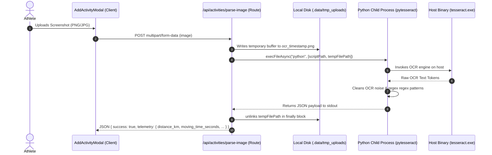

# A-COACH — REPOSITORY-AWARE BACKEND LOGIC & API FLOW AUDIT
## Document 10: OCR Data Ingestion Pipeline, Host Dependencies & Parsing Robustness

> **Audit Date**: 2026-11-07  
> **Route Handler**: [`src/app/api/activities/parse-image/route.ts`](file:///c:/Users/MyBook%20Hype%20AMD/OneDrive/Documents/kerja/_code/project_strava/src/app/api/activities/parse-image/route.ts)  
> **Vision Script**: [`scripts/parsers/parse_activity_image.py`](file:///c:/Users/MyBook%20Hype%20AMD/OneDrive/Documents/kerja/_code/project_strava/scripts/parsers/parse_activity_image.py)  
> **Test File**: [`scripts/tests/test_add_activity_flow.js`](file:///c:/Users/MyBook%20Hype%20AMD/OneDrive/Documents/kerja/_code/project_strava/scripts/tests/test_add_activity_flow.js) (Failing)

---

### 1. Ingestion Architecture: Python Subprocess vs Node.js

The OCR ingestion pipeline allows athletes to upload screenshots from GPS watches or fitness apps (Strava, Garmin, Coros) to automatically populate distance, duration, elevation, and speed.



---

### 2. Discrepancy: Ghost Dependency (`tesseract.js`)

#### Finding:
The project's `package.json` includes:
```json
"dependencies": {
  "tesseract.js": "^7.0.0"
}
```
However, an exhaustive search across all `.ts`, `.tsx`, and `.js` files confirms that **`tesseract.js` is not imported anywhere in the codebase**. 
Instead, [`src/app/api/activities/parse-image/route.ts#L36`](file:///c:/Users/MyBook%20Hype%20AMD/OneDrive/Documents/kerja/_code/project_strava/src/app/api/activities/parse-image/route.ts#L36) relies entirely on a native child process:
```typescript
const { stdout, stderr } = await execFileAsync("python", [scriptPath, tempFilePath], {
  timeout: 30000,
});
```

#### Operational Risks:
1. **Host Environment Lock-In**: The OCR engine requires:
   - A Python 3 runtime on the server.
   - Python dependencies: `pytesseract`, `Pillow`, `numpy`, `scipy`.
   - Host native binary: `C:\Program Files\Tesseract-OCR\tesseract.exe`.
2. **Serverless Failure**: If this endpoint is deployed to standard serverless platforms (e.g. Vercel, AWS Lambda) without custom container layers, `child_process.execFile("python")` fails immediately with `ENOENT`.
3. **Dead Dependency Baggage**: `tesseract.js` adds substantial package install weight without delivering any runtime functionality.

---

### 3. File Handling & Temporary Storage Security

In [`src/app/api/activities/parse-image/route.ts#L22`](file:///c:/Users/MyBook%20Hype%20AMD/OneDrive/Documents/kerja/_code/project_strava/src/app/api/activities/parse-image/route.ts#L22):
- The uploaded file is converted to a Buffer and saved under `.data/tmp_uploads/`:
  ```typescript
  const ext = path.extname(file.name || "image.png") || ".png";
  tempFilePath = path.join(tempDir, `ocr_${Date.now()}_${Math.random().toString(36).substring(2, 7)}${ext}`);
  fs.writeFileSync(tempFilePath, buffer);
  ```
- **Strengths**:
  - The `finally` block reliably executes `fs.unlinkSync(tempFilePath)` to prevent disk exhaustion.
  - Random alphanumeric suffixes mitigate collision risks.
- **Weaknesses**:
  - **No MIME Magic Number Verification**: The endpoint trusts `file.name` extension without validating magic bytes (e.g. `\x89PNG` or `\xFF\xD8\xFF`). An attacker could upload non-image payloads to trigger unhandled exceptions in the Python script.

---

### 4. Telemetry Parsing Robustness & Regex Logic

Implemented in [`scripts/parsers/parse_activity_image.py`](file:///c:/Users/MyBook%20Hype%20AMD/OneDrive/Documents/kerja/_code/project_strava/scripts/parsers/parse_activity_image.py):

#### OCR Error Correction Logic:
1. **Hour / Minute Character Normalization**:
   - Replaces common OCR glyph misreads:
     ```python
     s = re.sub(r'[tTliI\|!]\s*h', '1h', s)
     s = re.sub(r'[qQ]\s*h', '2h', s)
     ```
2. **Flexible Time Patterns**:
   - Captures `1h 25m`, `1:25:30`, and short running pace `05:30`.
3. **Distance Extraction**:
   - Matches decimal kilometers (`(\d+[\.,]\d+)\s*(?:km|k|kilometers)`) with comma-to-dot sanitization.
4. **Pace vs Speed Derivation**:
   - If pace (`5:20 /km`) is detected, automatically computes speed:
     $$\text{Speed (km/h)} = \frac{3600}{\text{Pace in seconds}}$$
   - If distance and duration are detected, cross-validates speed:
     $$\text{speed\_kmh} = \frac{\text{distance\_km}}{\text{duration\_hours}}$$

---

### 5. Automated Test Breakage Root Cause

Running [`node scripts/tests/test_add_activity_flow.js`](file:///c:/Users/MyBook%20Hype%20AMD/OneDrive/Documents/kerja/_code/project_strava/scripts/tests/test_add_activity_flow.js) fails with:
```
python: can't open file '.../scripts/parse_activity_image.py': [Errno 2] No such file or directory
```

#### Root Cause:
During prior codebase maintenance, `parse_activity_image.py` was moved into the subfolder `scripts/parsers/parse_activity_image.py`.
While the Next.js API route was updated with fallback paths:
```typescript
const candidatePaths = [
  path.join(process.cwd(), "scripts", "parsers", "parse_activity_image.py"),
  path.join(process.cwd(), "scripts", "parse_activity_image.py"),
];
```
The automated test script [`scripts/tests/test_add_activity_flow.js#L12`](file:///c:/Users/MyBook%20Hype%20AMD/OneDrive/Documents/kerja/_code/project_strava/scripts/tests/test_add_activity_flow.js#L12) still hardcodes:
```javascript
const ocrOutput = execSync(`python scripts/parse_activity_image.py "${testImagePath}"`).toString();
```
This is a confirmed test regression that must be corrected.

