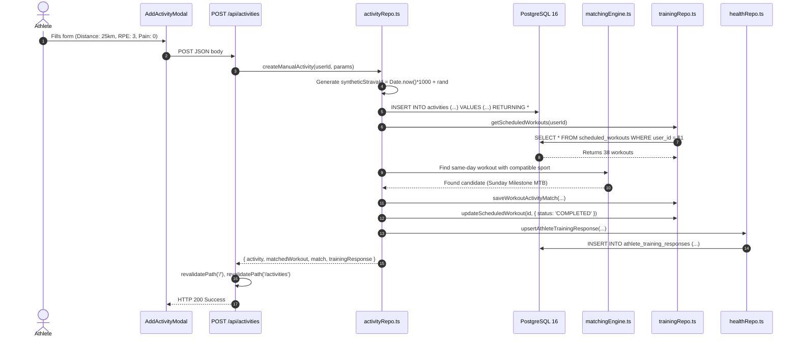

# A-COACH — REPOSITORY-AWARE BACKEND LOGIC & API FLOW AUDIT
## Document 11: End-to-End API Flow & User Journey Traceability

> **Audit Date**: 2026-11-07  
> **Scope**: 11 Core End-to-End User Workflows in `a-coach`  
> **Trace Method**: Source Code Line Auditing (Frontend Trigger -> Route Handler -> Domain Engine -> Repository -> Database)

---

### Master Traceability Matrix (11 Core Workflows)

| # | User Journey / Workflow | Entry Point & Route | Key Functions & Lines | Data Mutation Target | Verification Status |
|---|---|---|---|---|---|
| **1** | **Athlete Profile & Biometrics** | `POST /api/athlete/profile` | [`updateUserProfile`](file:///c:/Users/MyBook%20Hype%20AMD/OneDrive/Documents/kerja/_code/project_strava/src/lib/db/userRepo.ts#L30) | Tables `users`, `athlete_profiles` | **VERIFIED FUNCTIONAL** |
| **2** | **Injury Dossier & Safety State** | `POST /api/athlete/injuries` | [`createAthleteInjury`](file:///c:/Users/MyBook%20Hype%20AMD/OneDrive/Documents/kerja/_code/project_strava/src/lib/db/health/injuryRepo.ts#L18), [`evaluateTrainingReadiness`](file:///c:/Users/MyBook%20Hype%20AMD/OneDrive/Documents/kerja/_code/project_strava/src/lib/domain/readiness/readinessEngine.ts#L17) | Tables `athlete_injuries`, `athlete_training_readiness`, `health_audit_trail` | **VERIFIED FUNCTIONAL** |
| **3** | **Manual Activity Ingestion** | `POST /api/activities` | [`createManualActivity`](file:///c:/Users/MyBook%20Hype%20AMD/OneDrive/Documents/kerja/_code/project_strava/src/lib/db/activityRepo.ts#L327) | Tables `activities`, `scheduled_workouts`, `workout_activity_matches`, `athlete_training_responses` | **VERIFIED FUNCTIONAL** |
| **4** | **Activity Editing & Deletion** | `PATCH /api/activities/[id]` | [`updateActivity`](file:///c:/Users/MyBook%20Hype%20AMD/OneDrive/Documents/kerja/_code/project_strava/src/lib/db/activityRepo.ts#L80) | Table `activities` | **PARTIAL** (Edit works; Delete missing) |
| **5** | **Post-Activity Health Check-in** | `POST /api/athlete/checkin` | [`upsertAthleteTrainingResponse`](file:///c:/Users/MyBook%20Hype%20AMD/OneDrive/Documents/kerja/_code/project_strava/src/lib/db/health/trainingResponseRepo.ts#L17), [`createAthletePainLog`](file:///c:/Users/MyBook%20Hype%20AMD/OneDrive/Documents/kerja/_code/project_strava/src/lib/db/health/painLogRepo.ts#L18) | Tables `athlete_training_responses`, `athlete_pain_logs`, `athlete_training_readiness`, `health_audit_trail` | **VERIFIED (With Anatomy Bug)** |
| **6** | **Goal-Driven Periodization Plan** | `POST /api/goals` or `/api/training/generate` | [`generateCoachTrainingFromDatabase`](file:///c:/Users/MyBook%20Hype%20AMD/OneDrive/Documents/kerja/_code/project_strava/src/lib/domain/coach/coachTrainingGenerator.ts#L61) | Tables `training_plans`, `scheduled_workouts`, `fitness_goals` | **VERIFIED (With Wipeout Risk)** |
| **7** | **Workout Matching & Completion** | Triggered inside `createManualActivity` | [`calculateMatchDeltas`](file:///c:/Users/MyBook%20Hype%20AMD/OneDrive/Documents/kerja/_code/project_strava/src/lib/domain/matching/matchingEngine.ts#L45) | Tables `workout_activity_matches`, `scheduled_workouts` | **VERIFIED FUNCTIONAL** |
| **8** | **Weekly Streak & Flame Update** | `GET /api/athlete/streak` | [`calculateWeeklyStreak`](file:///c:/Users/MyBook%20Hype%20AMD/OneDrive/Documents/kerja/_code/project_strava/src/lib/domain/streak/streakEngine.ts#L198) | Pure Calculation (No Mutation) | **VERIFIED (With Double Count)** |
| **9** | **Personal Records Computation** | Triggered on Dashboard / Profile | [`computePersonalRecords`](file:///c:/Users/MyBook%20Hype%20AMD/OneDrive/Documents/kerja/_code/project_strava/src/lib/domain/records/personalRecordsEngine.ts#L4) | Table `personal_records` | **VERIFIED FUNCTIONAL** |
| **10** | **OCR Screenshot Telemetry Parse** | `POST /api/activities/parse-image` | Python child process execution | Local temp file unlinked | **FUNCTIONAL (Host-Coupled)** |
| **11** | **Multi-Sport AI Coach Insight** | Triggered during SSR Page Load | [`generateTrainingInsights`](file:///c:/Users/MyBook%20Hype%20AMD/OneDrive/Documents/kerja/_code/project_strava/src/lib/domain/coach/aiCoachEngine.ts#L11) | Pure Calculation (SSR JSON) | **VERIFIED FUNCTIONAL** |

---

### Detailed Code Path Traces

#### Workflow 3: Manual Activity Creation with Auto-Matching & Check-In

#### Workflow 6: Goal Promotion & Destructive Plan Regeneration
1. Athlete clicks *"Set as Primary"* on goal `"First 100 km Century Ride"` in the Hub Sasaran view.
2. Client sends `POST /api/goals` with `{ action: 'set_primary', goal_id: '...' }`.
3. Route calls [`setPrimaryFitnessGoal(userId, goalId)`](file:///c:/Users/MyBook%20Hype%20AMD/OneDrive/Documents/kerja/_code/project_strava/src/lib/db/goalRepo.ts#L90), updating `fitness_goals.is_primary = true` and demoting all other goals to `is_primary = false`.
4. Route immediately invokes [`generateCoachTrainingFromDatabase(userId, goalId)`](file:///c:/Users/MyBook%20Hype%20AMD/OneDrive/Documents/kerja/_code/project_strava/src/lib/domain/coach/coachTrainingGenerator.ts#L61).
5. **Destructive Execution**:
   - Executes `DELETE FROM scheduled_workouts WHERE user_id = $1`.
   - Executes `DELETE FROM training_plans WHERE user_id = $1`.
6. Generates 38 new workout sessions starting from hardcoded date `2026-11-02`.
7. Re-inserts historical benchmark sessions and correlates them with existing activities.
8. Returns the newly calibrated 12-week schedule.

#### Workflow 10: OCR Screenshot Processing
1. Athlete clicks *"Klik untuk Merekatkan Foto / Screenshot Aktivitas"*.
2. Client sends multipart form-data to `POST /api/activities/parse-image`.
3. Route converts `File` into `Buffer` and writes to `.data/tmp_uploads/ocr_<timestamp>_<rand>.png`.
4. Node executes `python scripts/parsers/parse_activity_image.py <tempFilePath>` via `execFile`.
5. Python script invokes `pytesseract` against `C:\Program Files\Tesseract-OCR\tesseract.exe`.
6. Output text is parsed by regular expressions to extract distance, moving time, average speed, and elevation.
7. Output JSON is printed to stdout: `{"success": true, "distance_km": 24.5, ...}`.
8. Node parses stdout, executes `fs.unlinkSync(tempFilePath)` in `finally`, and returns telemetry to client modal.
9. Client auto-populates modal input fields.

