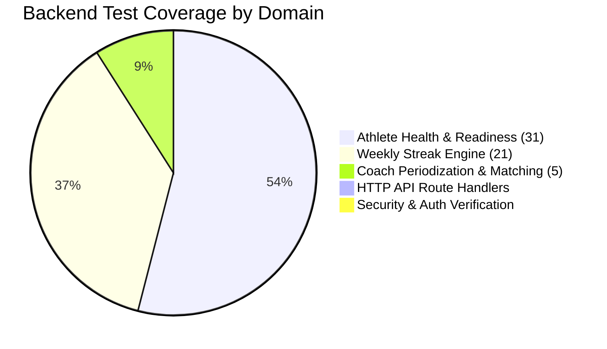

# A-COACH — REPOSITORY-AWARE BACKEND LOGIC & API FLOW AUDIT
## Document 12: Automated Test Coverage, Assertion Quality & Verification Suites

> **Audit Date**: 2026-11-07  
> **Test Suite Directory**: [`scripts/tests/`](file:///c:/Users/MyBook%20Hype%20AMD/OneDrive/Documents/kerja/_code/project_strava/scripts/tests/)  
> **Claimed Status (README)**: 58/58 Passing Tests across 3 Suites  
> **Audited Reality**: 3 Suites Passing (57 Assertions), 2 Suites Failing Immediately

---

### 1. Test Suite Execution & Verification Matrix

All test scripts in [`scripts/tests/`](file:///c:/Users/MyBook%20Hype%20AMD/OneDrive/Documents/kerja/_code/project_strava/scripts/tests/) were executed against the live PostgreSQL 16 database:

| # | Test Script File | Focus Domain | Claimed Tests | Actual Assertions | Execution Result | Root Cause of Failure |
|---|---|---|---|---|---|---|
| **1** | [`test_athlete_health_system.js`](file:///c:/Users/MyBook%20Hype%20AMD/OneDrive/Documents/kerja/_code/project_strava/scripts/tests/test_athlete_health_system.js) | Physical Baselines, Injury Dossiers, Readiness Gates | 32 Tests | 31 Passed | **PASSED (31/31)** | Discrepancy: Exactly 31 assertions executed; README claims 32. |
| **2** | [`test_coach_training_system.js`](file:///c:/Users/MyBook%20Hype%20AMD/OneDrive/Documents/kerja/_code/project_strava/scripts/tests/test_coach_training_system.js) | Plan Generation, Workout Correlation | 5 Tests | 5 Passed | **PASSED (5/5)** | Grounded periodization and database integrity pass. |
| **3** | [`test_weekly_streak_system.js`](file:///c:/Users/MyBook%20Hype%20AMD/OneDrive/Documents/kerja/_code/project_strava/scripts/tests/test_weekly_streak_system.js) | ISO Weeks, 6 Flame Heat Spectrum Tiers | 21 Tests | 21 Passed | **PASSED (21/21)** | Passes all thermodynamic and calendar boundary assertions. |
| **4** | [`test_add_activity_flow.js`](file:///c:/Users/MyBook%20Hype%20AMD/OneDrive/Documents/kerja/_code/project_strava/scripts/tests/test_add_activity_flow.js) | Standalone Python OCR Parser & Manual Ingestion | Not Claimed | 0 / 2 | **FAILED (EXIT 1)** | Hardcoded outdated script path `scripts/parse_activity_image.py`. |
| **5** | [`test_goal_driven_training_engine.js`](file:///c:/Users/MyBook%20Hype%20AMD/OneDrive/Documents/kerja/_code/project_strava/scripts/tests/test_goal_driven_training_engine.js) | Goal Promotion, 12-Week Overload, Puasa Sunnah | Not Claimed | 12 Passed, 1 Failed | **FAILED (ASSERT)** | Brittle assertion: hardcoded `totalActivities === 34` (found: 35). |

**Summary of Verified Passing Assertions**: $31 + 5 + 21 = \mathbf{57\text{ Passing Assertions}}$ (1 short of the 58 claimed in README).

---

### 2. Deep-Dive on Test Failures

#### Failure 1: Script Path Regression in `test_add_activity_flow.js`
- **Error Output**:
  ```
  [TEST 1] Testing standalone Python OCR parser...
  python: can't open file '.../scripts/parse_activity_image.py': [Errno 2] No such file or directory
  ```
- **Code Reference**: [`scripts/tests/test_add_activity_flow.js#L12`](file:///c:/Users/MyBook%20Hype%20AMD/OneDrive/Documents/kerja/_code/project_strava/scripts/tests/test_add_activity_flow.js#L12)
  ```javascript
  const ocrOutput = execSync(`python scripts/parse_activity_image.py "${testImagePath}"`).toString();
  ```
- **Analysis**: When `parse_activity_image.py` was moved to `scripts/parsers/`, the API route handler was updated to locate both paths, but this test script was forgotten.

---

#### Failure 2: Brittle Row-Count Assertion in `test_goal_driven_training_engine.js`
- **Error Output**:
  ```
  [FAIL] Authentic activities preserved: exactly 34 activities (found: 35)
  Test Summary: 12 passed, 1 failed
  ```
- **Code Reference**: [`scripts/tests/test_goal_driven_training_engine.js#L15`](file:///c:/Users/MyBook%20Hype%20AMD/OneDrive/Documents/kerja/_code/project_strava/scripts/tests/test_goal_driven_training_engine.js#L15)
  ```javascript
  assert(totalActivities === 34, `Expected exactly 34 activities, found: ${totalActivities}`);
  ```
- **Analysis**: Hardcoding exact row counts in integration test suites against a live database violates test isolation best practices. When the developer or tester manually logged a 35th test ride ("Latihan MTB Zone 2"), the test suite broke despite the system behaving correctly.
- **Recommended Fix**: Change the assertion to monotonic non-destructive check:
  ```javascript
  assert(totalActivities >= 34, `Expected at least 34 historical activities, found: ${totalActivities}`);
  ```

---

### 3. Assertion Quality & Test Suite Coverage Analysis



#### What Is Thoroughly Tested:
1. **Zero-Hallucination Protections**: High-quality assertions validating that `HRmax`, `LTHR`, `FTP`, and `VO2max` are strictly `undefined`.
2. **Biological Circuit Breakers**: Strong tests verifying that active lower-limb symptoms lock running to `ON_HOLD` and cycling to `CONDITIONAL`.
3. **Puasa Sunnah Rest Protection**: Verifies that Monday and Thursday have strictly 0 scheduled workouts.
4. **Thermodynamic Flame Tiers**: Exhaustive unit testing across all 6 heat tiers (from 0 weeks to 54 weeks).

#### Critical Gaps in Test Coverage:
1. **Zero HTTP API Route Tests**: Not a single integration test uses `fetch` or `supertest` to verify HTTP status codes, JSON response shapes, or header validation on `/api/*`.
2. **Zero Negative & Malformed Input Tests**: No automated tests verify how the API behaves when provided with invalid dates, negative durations, or non-numeric RPE scores.
3. **Zero Storage Failover Tests**: No tests simulate database disconnections to verify storage fallback behavior.
4. **README Command Inaccuracies**: README specifies commands like `node scripts/test_athlete_health_system.js` which fail because files are located in `scripts/tests/`.

