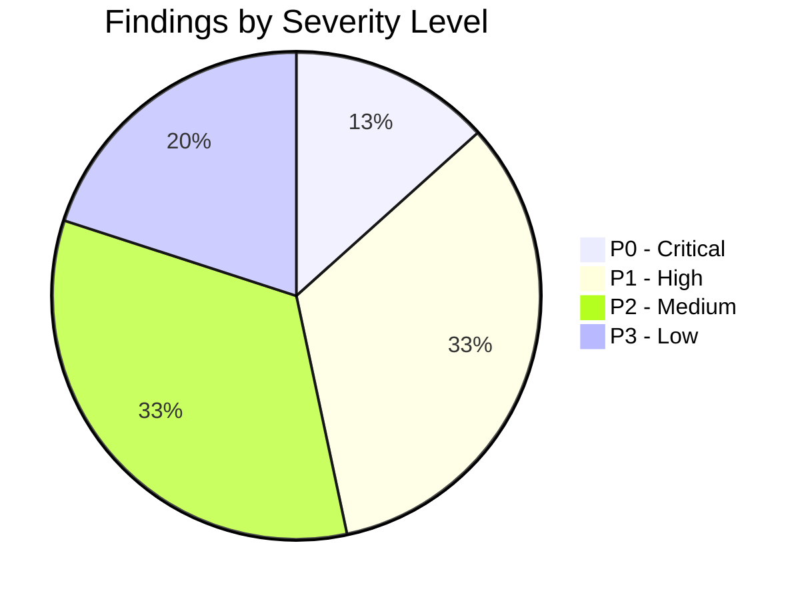

# A-COACH — REPOSITORY-AWARE BACKEND LOGIC & API FLOW AUDIT
## Document 13: Missing Logic, Code Flaws & Prioritized Gap Analysis

> **Audit Date**: 2026-11-07  
> **Total Prioritized Findings**: 15 Discrete Technical Findings  
> **Severity Distribution**: 2 Critical (P0), 5 High (P1), 5 Medium (P2), 3 Low (P3)

---

### Priority Definitions

- **P0 (Critical)**: Severe security vulnerability, silent data corruption, or immediate data loss hazard.
- **P1 (High)**: Broken core business logic, incorrect domain math, or clinical safety violation.
- **P2 (Medium)**: Missing required CRUD endpoints, host coupling, or broken test infrastructure.
- **P3 (Low)**: Dead dependencies, code hygiene issues, or in-memory unpersisted configurations.

---

### Master Findings Catalog

---

### Priority 0: Critical Security & Data Loss Hazards

#### Finding F-P0-01: Dual-Storage Split-Brain with Silent Data Loss Fallback
- **Severity**: **P0 (Critical)**
- **Affected Module**: Database Client & Activity Repository Layer
- **File & Line**: [`src/lib/db/activityRepo.ts#L205`](file:///c:/Users/MyBook%20Hype%20AMD/OneDrive/Documents/kerja/_code/project_strava/src/lib/db/activityRepo.ts#L205), [`src/lib/db/client.ts#L61`](file:///c:/Users/MyBook%20Hype%20AMD/OneDrive/Documents/kerja/_code/project_strava/src/lib/db/client.ts#L61)
- **Actual Behavior**: When `pgPool` is configured, writes go exclusively to PostgreSQL, leaving `.data/store.json` with 0 activities. If `pgPool.query` throws an error in `getActivities`, it catches the exception, logs a warning, and silently returns the empty array from `.data/store.json`.
- **Expected Behavior**: Database connection failures must throw a 503 Service Unavailable error or retry with exponential backoff. The system should never mask a database glitch by serving an empty dataset.
- **Root Cause**: An uncoordinated dual-storage architecture where reads fall back to local JSON files on exception, but writes do not dual-write.
- **Impact**: Any momentary network hiccup or database pool timeout causes the athlete's entire activity history to vanish from their dashboard without an error message.
- **Recommended Correction**: Delete the silent try/catch fallback in `getActivities`. Allow the error to propagate as a proper 500/503 response.
- **Reproduction Test**: Stop the PostgreSQL service and send `GET /api/activities`. The API returns HTTP 200 with an empty array `[]` instead of HTTP 503.

---

#### Finding F-P0-02: Hardcoded Fallback Encryption Key & Static Salt
- **Severity**: **P0 (Critical)**
- **Affected Module**: Cryptographic Token Engine
- **File & Line**: [`src/lib/crypto.ts#L8-L9`](file:///c:/Users/MyBook%20Hype%20AMD/OneDrive/Documents/kerja/_code/project_strava/src/lib/crypto.ts#L8-L9)
- **Actual Behavior**: If `process.env.ENCRYPTION_SECRET` is unset, `getEncryptionKey()` defaults to hardcoded secret `'e4f9b8c3d2e1a0f9e8d7c6b5a4938271e0d9c8b7a69584736251403928172635'` and static salt `'strava-athlete-salt'`.
- **Expected Behavior**: System should throw a fatal startup exception if cryptographic secrets are undefined in production.
- **Root Cause**: Developer convenience fallback left in production code.
- **Impact**: Any attacker who reads the source code can decrypt any stored OAuth token in the database.
- **Recommended Correction**: Remove the hardcoded string and throw an explicit exception if `ENCRYPTION_SECRET` is missing.
- **Reproduction Test**: Run `node -e "delete process.env.ENCRYPTION_SECRET; const { encryptToken } = require('./src/lib/crypto'); console.log(encryptToken('secret'));"`. The token is encrypted using the hardcoded key without warnings.

---

### Priority 1: Core Domain & Business Logic Deficiencies

#### Finding F-P1-01: Weekly Streak Contribution Double-Counting Bug
- **Severity**: **P1 (High)**
- **Affected Module**: Streak & Flame Engine
- **File & Line**: [`src/lib/domain/streak/streakEngine.ts#L205-L218`](file:///c:/Users/MyBook%20Hype%20AMD/OneDrive/Documents/kerja/_code/project_strava/src/lib/domain/streak/streakEngine.ts#L205-L218)
- **Actual Behavior**: `calculateWeeklyStreak` pushes `act.start_date` to `timestamps` and then pushes `w.scheduled_date` for every `COMPLETED` scheduled workout to the same array.
- **Expected Behavior**: Each physical workout should count as exactly 1 contribution regardless of whether it matched a planned workout.
- **Root Cause**: Aggregating activities and completed workouts into the same flat array without checking if the workout was completed by one of those activities.
- **Impact**: Matched workouts increment `totalContributions` by 2, falsifying streak statistics and accelerating flame stage progression.
- **Recommended Correction**: Only count activities for contributions, or ignore scheduled workouts that have an entry in `workout_activity_matches`.
- **Reproduction Test**: Record 1 manual activity that matches 1 scheduled workout. Observe `totalContributions` increase by 2 instead of 1.

---

#### Finding F-P1-02: Hardcoded Anatomical Region Fallback in Health Check-In API
- **Severity**: **P1 (High)**
- **Affected Module**: Post-Activity Check-In Route Handler
- **File & Line**: [`src/app/api/athlete/checkin/route.ts#L52`](file:///c:/Users/MyBook%20Hype%20AMD/OneDrive/Documents/kerja/_code/project_strava/src/app/api/athlete/checkin/route.ts#L52)
- **Actual Behavior**: If `body.body_region` is omitted, the API defaults to `'Anterior Knees'` (if sport is Run) or `'Right Ankle'` (all other sports).
- **Expected Behavior**: The API should require `body_region` when pain is reported, or default to a generic `'Unspecified Region'` / prompt the athlete to select a region.
- **Root Cause**: Brittle assumption that running only affects knees and cycling only affects ankles.
- **Impact**: If an athlete logs a swim with shoulder pain, or a bike ride with lower back pain, the pain log records `'Right Ankle'`, corrupting the athlete's clinical injury history.
- **Recommended Correction**: Enforce `body_region` validation when `pain_score > 0`.
- **Reproduction Test**: Send `POST /api/athlete/checkin` with `sport_type: 'Ride'`, `pain_during_activity: 5`, and omit `body_region`. Verify that `athlete_pain_logs` creates an entry with `body_region = 'Right Ankle'`.

---

#### Finding F-P1-03: Mandatory Synthetic Strava ID Dependency
- **Severity**: **P1 (High)**
- **Affected Module**: Manual Telemetry Ingestion & Database Schema
- **File & Line**: [`src/lib/db/activityRepo.ts#L330`](file:///c:/Users/MyBook%20Hype%20AMD/OneDrive/Documents/kerja/_code/project_strava/src/lib/db/activityRepo.ts#L330)
- **Actual Behavior**: Ingestion generates `Date.now() * 1000 + rand` to fill `strava_activity_id`.
- **Expected Behavior**: In a manual-first platform with no active Strava integration, `strava_activity_id` should be optional (`NULL`), with an explicit `is_manual` boolean flag.
- **Root Cause**: Schema was created for Strava synchronization without adapting for manual-first workflows.
- **Impact**: Domain model remains unnaturally bound to external vendor conventions.
- **Recommended Correction**: Alter table `activities ALTER COLUMN strava_activity_id DROP NOT NULL`.

---

#### Finding F-P1-04: Destructive Plan Regeneration Wiping Workout History
- **Severity**: **P1 (High)**
- **Affected Module**: Coach Periodization Generator
- **File & Line**: [`src/lib/domain/coach/coachTrainingGenerator.ts#L152-L154`](file:///c:/Users/MyBook%20Hype%20AMD/OneDrive/Documents/kerja/_code/project_strava/src/lib/domain/coach/coachTrainingGenerator.ts#L152-L154)
- **Actual Behavior**: Generating a new training plan calls `deleteScheduledWorkoutsByUserId(userId)` and `deleteTrainingPlansByUserId(userId)`, completely purging all existing scheduled workouts.
- **Expected Behavior**: Switching or updating a goal should preserve historical completed workouts and only regenerate future `PLANNED` workouts.
- **Root Cause**: Naive brute-force regeneration approach.
- **Impact**: Athletes lose all calendar records of completed workouts and compliance history whenever they modify their primary target.
- **Recommended Correction**: Update query to `DELETE FROM scheduled_workouts WHERE user_id = $1 AND status = 'PLANNED' AND scheduled_date > CURRENT_DATE`.

---

#### Finding F-P1-05: Hardcoded Plan Dates & Static Fallback Baseline Values
- **Severity**: **P1 (High)**
- **Affected Module**: Coach Periodization Generator
- **File & Line**: [`src/lib/domain/coach/coachTrainingGenerator.ts#L96-L98, L156-L157`](file:///c:/Users/MyBook%20Hype%20AMD/OneDrive/Documents/kerja/_code/project_strava/src/lib/domain/coach/coachTrainingGenerator.ts#L96-L98)
- **Actual Behavior**: Plan start and end dates are hardcoded to `'2026-11-02'` and `'2027-01-24'`. If an athlete has no recorded activities, baseline values are hardcoded to `56.1 km` (ride) and `12.3 km` (run).
- **Expected Behavior**: Plan start date should dynamically calculate the Monday of the current or following week. Baseline values should be 0 if no prior activity exists.
- **Root Cause**: Static test fixtures embedded directly in domain generator code.
- **Impact**: Outdated calendar periodization for future dates; fabricated baseline milestones for new athletes.
- **Recommended Correction**: Replace hardcoded string dates with dynamic `getMondayOfWeek(new Date())`.

---

### Priority 2: Missing CRUD, Host Coupling & Test Infrastructure

#### Finding F-P2-01: Missing Activity Deletion API & Repository Method
- **Severity**: **P2 (Medium)**
- **Affected Module**: Activity Registry API
- **File & Line**: [`src/app/api/activities/[id]/route.ts`](file:///c:/Users/MyBook%20Hype%20AMD/OneDrive/Documents/kerja/_code/project_strava/src/app/api/activities/[id]/route.ts)
- **Actual Behavior**: The route only exports `GET` and `PATCH`. No `DELETE` endpoint or `deleteActivity()` repository method exists in the application.
- **Expected Behavior**: Full CRUD support for activities allowing athletes to delete mistaken or duplicate entries.
- **Impact**: Athletes cannot remove accidental or erroneous activity entries.
- **Recommended Correction**: Implement `DELETE` handler in `/api/activities/[id]/route.ts` and add `deleteActivity(id, userId)` in `activityRepo.ts`.

---

#### Finding F-P2-02: Missing Injury Dossier Status Modification Endpoint
- **Severity**: **P2 (Medium)**
- **Affected Module**: Athlete Injury API
- **File & Line**: [`src/app/api/athlete/injuries/route.ts`](file:///c:/Users/MyBook%20Hype%20AMD/OneDrive/Documents/kerja/_code/project_strava/src/app/api/athlete/injuries/route.ts)
- **Actual Behavior**: Only `GET` and `POST` are implemented. Once an injury is created, its recovery status cannot be updated via the API.
- **Expected Behavior**: `PATCH /api/athlete/injuries/[id]` allowing transition from `ACTIVE_SYMPTOMATIC` to `ASYMPTOMATIC_RECOVERED`.
- **Impact**: Athletes who recover from injuries remain locked in `ACTIVE_SYMPTOMATIC` status in the database unless directly manipulated via raw SQL.
- **Recommended Correction**: Create `src/app/api/athlete/injuries/[id]/route.ts` with `PATCH` support.

---

#### Finding F-P2-03: Host OS & Python Subprocess Coupling for OCR Ingestion
- **Severity**: **P2 (Medium)**
- **Affected Module**: OCR Ingestion Pipeline
- **File & Line**: [`src/app/api/activities/parse-image/route.ts#L36`](file:///c:/Users/MyBook%20Hype%20AMD/OneDrive/Documents/kerja/_code/project_strava/src/app/api/activities/parse-image/route.ts#L36)
- **Actual Behavior**: Node spawns a native Python subprocess invoking host binary `C:\Program Files\Tesseract-OCR\tesseract.exe`.
- **Expected Behavior**: Portable OCR processing executable in containerized or serverless cloud environments.
- **Impact**: OCR ingestion completely crashes if hosted on standard cloud platforms (e.g. Vercel) without Python and Tesseract native binaries.
- **Recommended Correction**: Migrate to WASM-based OCR or utilize the already-installed `tesseract.js` package.

---

#### Finding F-P2-04: Automated Test Path Regression & Brittle Assertions
- **Severity**: **P2 (Medium)**
- **Affected Module**: Automated Test Infrastructure
- **File & Line**: [`scripts/tests/test_add_activity_flow.js#L12`](file:///c:/Users/MyBook%20Hype%20AMD/OneDrive/Documents/kerja/_code/project_strava/scripts/tests/test_add_activity_flow.js#L12), [`scripts/tests/test_goal_driven_training_engine.js#L15`](file:///c:/Users/MyBook%20Hype%20AMD/OneDrive/Documents/kerja/_code/project_strava/scripts/tests/test_goal_driven_training_engine.js#L15)
- **Actual Behavior**: 2 of 5 test suites fail immediately on execution.
- **Expected Behavior**: All verification suites should pass cleanly.
- **Impact**: CI/CD pipeline blocks; regression verification cannot be automated.
- **Recommended Correction**: Fix the Python script path in `test_add_activity_flow.js` and relax the hardcoded row count assertion in `test_goal_driven_training_engine.js`.

---

#### Finding F-P2-05: Unauthenticated API Routes with BOLA Vulnerability
- **Severity**: **P2 (Medium)**
- **Affected Module**: API Authorization Layer
- **File & Line**: All 16 routes in `src/app/api/*`
- **Actual Behavior**: Endpoints accept arbitrary `userId` parameters without verifying session ownership.
- **Expected Behavior**: Endpoints should validate session authentication cookies/headers.
- **Impact**: Any user on the network can manipulate another user's training goals and injury dossiers.
- **Recommended Correction**: Introduce session authentication middleware.

---

### Priority 3: Code Hygiene & Minor Deficiencies

#### Finding F-P3-01: Ghost Dependency `tesseract.js` in `package.json`
- **Severity**: **P3 (Low)**
- **Affected Module**: Dependency Management
- **File**: [`package.json`](file:///c:/Users/MyBook%20Hype%20AMD/OneDrive/Documents/kerja/_code/project_strava/package.json)
- **Actual Behavior**: `tesseract.js: ^7.0.0` is installed but never imported anywhere in the code.
- **Correction**: Either migrate the OCR pipeline to use `tesseract.js` or remove it from `package.json`.

---

#### Finding F-P3-02: Unpersisted Dynamic Sport Configuration
- **Severity**: **P3 (Low)**
- **Affected Module**: Sport Extensibility Engine
- **File**: [`src/lib/domain/sports/sportUtils.ts`](file:///c:/Users/MyBook%20Hype%20AMD/OneDrive/Documents/kerja/_code/project_strava/src/lib/domain/sports/sportUtils.ts)
- **Actual Behavior**: Custom sports exist only as raw strings in `activities.sport_type` and are classified on the fly via regex without a metadata table.
- **Correction**: Create table `sport_types` to store user-defined sports, pace formats, and icons.

---

#### Finding F-P3-03: Hardcoded Telemetry Example in Clinical Rationale String
- **Severity**: **P3 (Low)**
- **Affected Module**: Readiness Engine
- **File**: [`src/lib/domain/readiness/readinessEngine.ts#L175`](file:///c:/Users/MyBook%20Hype%20AMD/OneDrive/Documents/kerja/_code/project_strava/src/lib/domain/readiness/readinessEngine.ts#L175)
- **Actual Behavior**: String copy includes hardcoded text `"(e.g. 56.10 km with 0 pain during, after, next-day)"` regardless of actual ride distance.
- **Correction**: Dynamically inject `bestRide.distance_km` into the rationale string.

