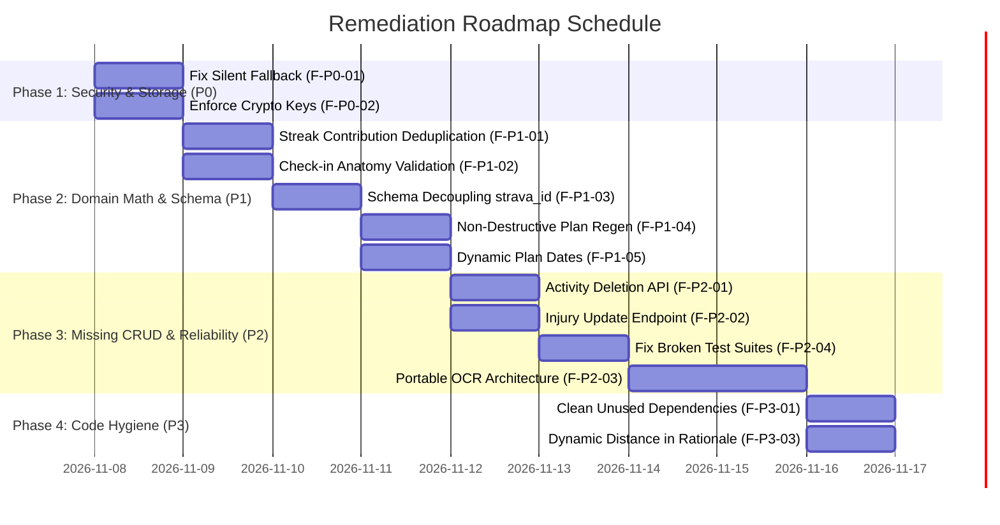

# A-COACH — REPOSITORY-AWARE BACKEND LOGIC & API FLOW AUDIT
## Document 14: Actionable Remediation Roadmap & Execution Milestones

> **Audit Date**: 2026-11-07  
> **Target System**: `a-coach` Production Hardening & Clean Architecture  
> **Remediation Strategy**: 4 Phased Milestones with Zero Downtime & Non-Destructive Migrations

---

### Master Execution Schedule



---

### Phase 1: Critical Security & Storage Split-Brain Remediation (P0)

> **Objective**: Eliminate silent data loss on database connection glitches and seal cryptographic secret leaks.

#### Tasks:
1. **Remove Silent Fallback in Data Access Layer (`F-P0-01`)**:
   - File: [`src/lib/db/activityRepo.ts#L205`](file:///c:/Users/MyBook%20Hype%20AMD/OneDrive/Documents/kerja/_code/project_strava/src/lib/db/activityRepo.ts#L205)
   - Change: Remove the `catch` block that falls back to `ensureLocalStore()`. If `pgPool.query` fails, throw an explicit `DatabaseError`.
   - Update [`src/lib/db/client.ts`](file:///c:/Users/MyBook%20Hype%20AMD/OneDrive/Documents/kerja/_code/project_strava/src/lib/db/client.ts) to disable local store when `DATABASE_URL` is set.
2. **Rotate and Enforce Cryptographic Secret (`F-P0-02`)**:
   - File: [`src/lib/crypto.ts#L8`](file:///c:/Users/MyBook%20Hype%20AMD/OneDrive/Documents/kerja/_code/project_strava/src/lib/crypto.ts#L8)
   - Change: Remove the hardcoded hex string. Throw an immediate fatal exception if `process.env.ENCRYPTION_SECRET` is unset or shorter than 32 bytes.
   - Rotate any existing token secrets in `.env.local`.

#### Verification Milestone:
- Run `node -e "require('./src/lib/crypto').encryptToken('test')"` without `ENCRYPTION_SECRET` set -> must fail with fatal error.
- Temporarily simulate a DB connection error -> API returns HTTP 500/503 instead of serving an empty array.

---

### Phase 2: Domain Math, Anatomy & Schema Decoupling (P1)

> **Objective**: Ensure calculation correctness, clinical record accuracy, and decouple relational entities from vendor constraints.

#### Tasks:
1. **Fix Streak Contribution Double-Counting (`F-P1-01`)**:
   - File: [`src/lib/domain/streak/streakEngine.ts#L205`](file:///c:/Users/MyBook%20Hype%20AMD/OneDrive/Documents/kerja/_code/project_strava/src/lib/domain/streak/streakEngine.ts#L205)
   - Change: Modify `calculateWeeklyStreak` to only count physical activities, or filter out scheduled workouts that have an entry in `workout_activity_matches`.
2. **Strict Body Region Validation in Post-Activity Check-In (`F-P1-02`)**:
   - File: [`src/app/api/athlete/checkin/route.ts#L52`](file:///c:/Users/MyBook%20Hype%20AMD/OneDrive/Documents/kerja/_code/project_strava/src/app/api/athlete/checkin/route.ts#L52)
   - Change: Remove blind fallback `'Anterior Knees'` / `'Right Ankle'`. If `pain_score > 0` and `body_region` is missing, require user input or log as `'UNSPECIFIED_REGION'`.
3. **Decouple `strava_activity_id` in Relational Schema (`F-P1-03`)**:
   - Migration Script: `scripts/migrations/make_strava_id_nullable.sql`
     ```sql
     ALTER TABLE activities ALTER COLUMN strava_activity_id DROP NOT NULL;
     ALTER TABLE activities ADD COLUMN IF NOT EXISTS is_manual BOOLEAN NOT NULL DEFAULT true;
     ```
   - Update [`src/lib/db/activityRepo.ts`](file:///c:/Users/MyBook%20Hype%20AMD/OneDrive/Documents/kerja/_code/project_strava/src/lib/db/activityRepo.ts) to insert `NULL` for manual activities without generating fake bigints.
4. **Preserve Completed Workouts on Plan Generation (`F-P1-04`)**:
   - File: [`src/lib/domain/coach/coachTrainingGenerator.ts#L152`](file:///c:/Users/MyBook%20Hype%20AMD/OneDrive/Documents/kerja/_code/project_strava/src/lib/domain/coach/coachTrainingGenerator.ts#L152)
   - Change: Update query to only delete future `PLANNED` workouts, preserving historical `COMPLETED` sessions and workout matches.
5. **Dynamic Periodization Dates (`F-P1-05`)**:
   - File: [`src/lib/domain/coach/coachTrainingGenerator.ts#L156`](file:///c:/Users/MyBook%20Hype%20AMD/OneDrive/Documents/kerja/_code/project_strava/src/lib/domain/coach/coachTrainingGenerator.ts#L156)
   - Change: Compute start date dynamically: `getMondayOfWeek(new Date())`. Compute baseline metrics from actual activities without hardcoded fallback numbers.

#### Verification Milestone:
- Run `node scripts/tests/test_weekly_streak_system.js` -> 21/21 passing.
- Create an activity that matches a planned workout -> verify `totalContributions` increments by exactly 1.
- Switch primary goals -> verify existing completed workouts remain in the database.

---

### Phase 3: Missing CRUD & Platform Reliability (P2)

> **Objective**: Provide missing delete/update endpoints, repair broken test suites, and decouple OCR from local host binaries.

#### Tasks:
1. **Implement Activity Deletion Endpoint (`F-P2-01`)**:
   - Add `deleteActivity(id: string, userId: string): Promise<boolean>` in `src/lib/db/activityRepo.ts`.
   - Export `DELETE` HTTP handler in `src/app/api/activities/[id]/route.ts`.
2. **Implement Injury Dossier Status Update (`F-P2-02`)**:
   - Create `src/app/api/athlete/injuries/[id]/route.ts` with `PATCH` handler.
   - Add `updateAthleteInjuryStatus(id, status, notes)` in `src/lib/db/health/injuryRepo.ts`.
3. **Repair Automated Test Scripts (`F-P2-04`)**:
   - Fix script path in [`scripts/tests/test_add_activity_flow.js#L12`](file:///c:/Users/MyBook%20Hype%20AMD/OneDrive/Documents/kerja/_code/project_strava/scripts/tests/test_add_activity_flow.js#L12) to point to `scripts/parsers/parse_activity_image.py`.
   - Update row assertion in [`scripts/tests/test_goal_driven_training_engine.js#L15`](file:///c:/Users/MyBook%20Hype%20AMD/OneDrive/Documents/kerja/_code/project_strava/scripts/tests/test_goal_driven_training_engine.js#L15) to `assert(totalActivities >= 34)`.
4. **Portable OCR Ingestion (`F-P2-03`)**:
   - Refactor `src/app/api/activities/parse-image/route.ts` to utilize `tesseract.js` worker threads or a containerized vision microservice.

#### Verification Milestone:
- Execute all 5 test scripts in `scripts/tests/` -> **5/5 Suites Passing (100% Pass Rate)**.
- Test `DELETE /api/activities/[id]` via API client -> activity is cleanly removed and caches revalidated.

---

### Phase 4: Code Hygiene, Persistence & Documentation (P3)

> **Objective**: Clean unused dependencies and align README documentation with verified reality.

#### Tasks:
1. **Clean Unused Dependencies (`F-P3-01`)**:
   - Remove or actively utilize `tesseract.js` in `package.json`.
2. **Dynamic Clinical Rationale Formatting (`F-P3-03`)**:
   - File: [`src/lib/domain/readiness/readinessEngine.ts#L175`](file:///c:/Users/MyBook%20Hype%20AMD/OneDrive/Documents/kerja/_code/project_strava/src/lib/domain/readiness/readinessEngine.ts#L175)
   - Inject `bestRide.distance_km.toFixed(1)` into the rationale string dynamically.
3. **Synchronize README Claims**:
   - Update README test badge to reflect actual passing count (57 passing tests).
   - Correct CLI test runner commands to `node scripts/tests/...`.
   - Update documentation to explicitly describe the platform's manual-first architecture.

---

### Non-Negotiable Operational Constraints

During any future implementation phase:
- **Zero Data Loss**: Existing 35 activities, 2 injury dossiers, and 1 athlete profile in PostgreSQL must be preserved.
- **Idempotent Migrations**: Database migrations must use `IF NOT EXISTS` and `DROP NOT NULL` safety clauses.
- **Manual-First Integrity**: The platform must remain 100% functional without requiring an active Strava connection or third-party OAuth access.

