# Git Branching Strategy & Release Lifecycle

**Project:** `a-coach` (Personal Sports Training & Performance Platform)  
**Status:** CONFIRMED & AUDITED  
**Version:** 1.0  
**Last Updated:** 2026-11-01  
**Owner:** Engineering Lead & Principal Software Architect  
**Related Documents:** [ROADMAP.md](./00-foundation/ROADMAP.md), [DEVELOPMENT_WORKFLOW.md](./08-development/DEVELOPMENT_WORKFLOW.md), [GIT_CONVENTIONS.md](./08-development/GIT_CONVENTIONS.md)

---

## 🏛️ 1. Filosofi & Ikhtisar Strategi Branching

Strategi branching pada repositori `a-coach` dirancang untuk menjamin stabilitas cabang utama (`main`), memfasilitasi iterasi pengembangan yang terisolasi, serta menyelaraskan setiap Pull Request (PR) langsung dengan **6 Fase Roadmap Rekayasa** yang didefinisikan dalam [`ROADMAP.md`](file:///C:/Users/MyBook%20Hype%20AMD/OneDrive/Documents/kerja/_code/project_strava/docs/00-foundation/ROADMAP.md).

Platform menggunakan pendekatan **Trunk-Based Development dengan Short-Lived Feature Branches**:
- Cabang `main` selalu berada dalam kondisi *deployable* (siap rilis ke produksi).
- Setiap pekerjaan fitur dikembangkan dalam cabang terisolasi dan digabungkan kembali (*merged*) ke `main` melalui metode **Squash & Merge** setelah lulus verifikasi build (`npm run build`).

---

## 🗺️ 2. Visualisasi Alur Kerja Branching

```mermaid
flowchart LR
    subgraph Trunk ["Produksi (Deployable)"]
        M0["main (Initial)"] --> M1["v1.0-alpha"]
        M1 --> M2["v1.1-strava"]
        M2 --> M3["v1.2-planner"]
        M3 --> M4["v1.3-analytics"]
        M4 --> M5["v1.4-ai-coach"]
        M5 --> M6["v1.5-stable (Launch)"]
    end

    subgraph Phase1 ["Fase 1: Foundation"]
        B1["feat/01-foundation-data-layer"]
    end

    subgraph Phase2 ["Fase 2: Strava Core"]
        B2["feat/02-strava-integration"]
    end

    subgraph Phase3 ["Fase 3: Training Calendar"]
        B3["feat/03-training-planner"]
        B4["feat/04-workout-matching"]
    end

    subgraph Phase4 ["Fase 4: Analytics"]
        B5["feat/05-analytics-goals"]
    end

    subgraph Phase5 ["Fase 5: AI Coach"]
        B6["feat/06-ai-coach-insights"]
    end

    subgraph Phase6 ["Fase 6: Hardening"]
        B7["chore/07-hardening-and-audit"]
    end

    M0 -.-> B1
    B1 ==>|"Merged (Completed)"| M1

    M1 -.-> B2
    B2 -->|"PR Review & Build Gate"| M2

    M2 -.-> B3
    B3 --> B4
    B4 -->|"PR Review & Build Gate"| M3

    M3 -.-> B5
    B5 -->|"PR Review & Build Gate"| M4

    M4 -.-> B6
    B6 -->|"PR Review & Build Gate"| M5

    M5 -.-> B7
    B7 -->|"Final Release Gate"| M6

    classDef mainBranch fill:#10b981,stroke:#047857,stroke-width:2px,color:#ffffff;
    classDef activeBranch fill:#3b82f6,stroke:#1d4ed8,stroke-width:2px,color:#ffffff;
    classDef pendingBranch fill:#1f2937,stroke:#374151,stroke-width:1px,color:#9ca3af;
    classDef doneBranch fill:#059669,stroke:#047857,stroke-width:1px,color:#ffffff;

    class M0,M1,M2,M3,M4,M5,M6 mainBranch;
    class B1 doneBranch;
    class B2 activeBranch;
    class B3,B4,B5,B6,B7 pendingBranch;
```



---

## 🎯 3. Matriks 6–7 Feature Branches Utama (Rekomendasi Rilis Bertahap)

Pendekatan ini membagi pengerjaan repositori ke dalam **7 cabang terstruktur** sesuai milestone roadmap:

| # | Nama Branch | Base Branch | Modul Acuan di `/docs` | Ruang Lingkup & Deliverable Teknis | Status |
| :-: | :--- | :--- | :--- | :--- | :-: |
| **1** | `feat/01-foundation-data-layer` | `main` | `00-foundation/`<br>`03-architecture/` | Inisialisasi skema PostgreSQL 16 ([`schema.sql`](file:///C:/Users/MyBook%20Hype%20AMD/OneDrive/Documents/kerja/_code/project_strava/schema.sql)), cipher token AES-256-GCM ([`crypto.ts`](file:///C:/Users/MyBook%20Hype%20AMD/OneDrive/Documents/kerja/_code/project_strava/src/lib/crypto.ts)), dan abstraksi dual-mode persistence ([`db.ts`](file:///C:/Users/MyBook%20Hype%20AMD/OneDrive/Documents/kerja/_code/project_strava/src/lib/db.ts)). | **DONE (Merged)** |
| **2** | `feat/02-strava-integration` | `main` | `04-integrations/` | Route handler OAuth callback ([`route.ts`](file:///C:/Users/MyBook%20Hype%20AMD/OneDrive/Documents/kerja/_code/project_strava/src/app/api/auth/strava/callback/route.ts)), token auto-refresh proaktif (<5 menit), pipeline ingest inkremental (`afterTimestamp`), dan telemetri rate-limit. | **READY (Active)** |
| **3** | `feat/03-training-planner` | `main` | `01-product/`<br>`02-design/` | Komponen kalender mingguan (Grid 7 hari), modal pembuatan dan edit jadwal latihan, transisi status latihan (*Planned*, *Completed*, *Missed*), serta tipografi `font-tabular`. | *Pending* |
| **4** | `feat/04-workout-matching` | `main` | `05-domain-logic/` | Mesin auto-matching Planned vs Actual ([`matching.ts`](file:///C:/Users/MyBook%20Hype%20AMD/OneDrive/Documents/kerja/_code/project_strava/src/lib/matching.ts)), pemetaan kompatibilitas cabang olahraga, dan kartu visual perbandingan varians delta (jarak, durasi, pace). | *Pending* |
| **5** | `feat/05-analytics-goals` | `main` | `02-design/`<br>`05-domain-logic/` | Dashboard agregasi volume multi-olahraga 30/90 hari ([`analytics.ts`](file:///C:/Users/MyBook%20Hype%20AMD/OneDrive/Documents/kerja/_code/project_strava/src/lib/analytics.ts)), tren pace aerobik, pelacak target bulanan, dan etalase rekor pribadi (*Personal Records*). | *Pending* |
| **6** | `feat/06-ai-coach-insights` | `main` | `05-domain-logic/` | Kartu rekomendasi kecerdasan kepelatihan deterministik ([`ai-coach.ts`](file:///C:/Users/MyBook%20Hype%20AMD/OneDrive/Documents/kerja/_code/project_strava/src/lib/ai-coach.ts)): ACWR, aturan kenaikan volume 10%, dan pola resep terpolarisasi 80/20. | *Pending* |
| **7** | `chore/07-hardening-and-audit` | `main` | `06-security/`<br>`07-quality/`<br>`09-audit/` | Audit kepatuhan OWASP, pengujian keamanan Anti-IDOR, audit performa bundle & SLA respons API (<200ms), penanganan boundary error global, dan checklist *Definition of Done*. | *Final Gate* |

---

## 🧩 4. Alternatif Granular (Skala Kolaborasi Multi-Developer)

Jika proyek dikerjakan secara paralel oleh beberapa pengembang secara bersamaan dengan ukuran Pull Request kecil (<250 baris per PR), gunakan pemecahan sub-branch berikut:

```
main
 ├── feat/strava-oauth-handshake       (Otorisasi, state CSRF cookie, token exchange)
 ├── feat/strava-activity-ingestion    (Pipeline penarikan aktivitas inkremental)
 ├── feat/ui-calendar-grid             (Komponen tabel kalender 7 hari tampilan desktop/mobile)
 ├── feat/ui-workout-modal             (Formulir input jadwal latihan atletik)
 ├── feat/matching-reconciliation-core (Logika matematis perhitungan delta metrik)
 ├── feat/ui-variance-comparison-cards (Komponen kartu komparasi target vs realisasi)
 ├── feat/analytics-volume-charts      (Visualisasi grafik batang/area volume harian)
 ├── feat/analytics-pace-trend         (Visualisasi grafik garis adaptasi pace)
 ├── feat/goals-and-pr-tracker         (Widget progress target bulanan dan lencana rekor)
 ├── feat/ai-acwr-safety-alerts        (Deteksi dini risiko cedera lonjakan volume)
 ├── feat/ai-training-prescription     (Rekomendasi struktur latihan pekan depan)
 └── chore/security-hardening-audit    (Pembersihan celah keamanan dan optimasi build)
```

---

## 🏷️ 5. Standar Konvensi Penamaan Branch

Format penamaan cabang wajib mengikuti pola: `<kategori>/<nomor-fase>-<deskripsi-singkat>`

| Prefiks | Penggunaan | Contoh Penamaan |
| :--- | :--- | :--- |
| `feat/` | Penambahan fitur fungsional baru | `feat/02-strava-integration` |
| `fix/` | Perbaikan bug pada kode yang sudah ada | `fix/strava-token-expiry-calc` |
| `docs/` | Pembaruan atau penambahan dokumentasi | `docs/update-branching-strategy` |
| `style/` | Penyesuaian token visual UI tanpa mengubah logika | `style/obsidian-calendar-theme` |
| `refactor/` | Restrukturisasi kode tanpa mengubah fungsionalitas | `refactor/db-query-optimizations` |
| `chore/` | Pemeliharaan dependensi, skrip, dan audit | `chore/07-hardening-and-audit` |

---

## 🛠️ 6. Panduan Alur Kerja Langkah Demi Langkah (Step-by-Step)

### Langkah 1: Memastikan Cabang `main` Terbaru
Sebelum membuat cabang baru, pastikan branch lokal Anda sinkron dengan repositori *remote*:
```bash
git checkout main
git pull origin main
```

### Langkah 2: Membuat Cabang Fitur Baru
Buat dan pindah ke cabang fitur sesuai urutan pengerjaan fase:
```bash
git checkout -b feat/02-strava-integration
```

### Langkah 3: Mengembangkan Fitur & Melakukan Commit Konvensional
Terapkan perubahan dan buat *commit* yang deskriptif sesuai format [Conventional Commits](file:///C:/Users/MyBook%20Hype%20AMD/OneDrive/Documents/kerja/_code/project_strava/docs/08-development/GIT_CONVENTIONS.md):
```bash
git add .
git commit -m "feat(strava): implement token auto-refresh within 5-minute expiry window"
```

### Langkah 4: Menjalankan Quality Gate Lokal
Pastikan tidak ada kesalahan tipe TypeScript atau kegagalan kompilasi sebelum mengajukan PR:
```bash
npm run build
```

### Langkah 5: Mendorong Cabang & Membuat Pull Request (PR)
Dorong cabang fitur ke GitHub:
```bash
git push -u origin feat/02-strava-integration
```
Buka Pull Request ke branch `main` dengan deskripsi perubahan dan checklist verifikasi.

### Langkah 6: Penggabungan (*Squash & Merge*) & Pembersihan
Setelah PR ditinjau dan lulus pengujian, lakukan **Squash and Merge** ke `main` dan hapus cabang fitur lokal/remote untuk menjaga pohon Git tetap bersih:
```bash
git checkout main
git pull origin main
git branch -d feat/02-strava-integration
```

---

## 🛡️ 7. Aturan Proteksi Cabang (*Branch Protection Rules*)

1. **No Direct Pushes to `main`**: Tidak diperkenankan melakukan `git push` langsung ke cabang `main` tanpa melalui Pull Request.
2. **Build Verification Gate**: Setiap PR wajib lulus pemeriksaan `npm run build` dengan **Exit code 0**.
3. **Linear History**: Gunakan opsi *Squash and Merge* agar riwayat *commit* pada `main` tetap bersih, linear, dan mudah ditelusuri per rilis fitur.
4. **Documentation Sync**: Jika suatu fitur mengubah skema database atau kontrak endpoint API, berkas dokumentasi di `/docs/03-architecture/` dan `/docs/10-changelog/` wajib diperbarui dalam PR yang sama.
